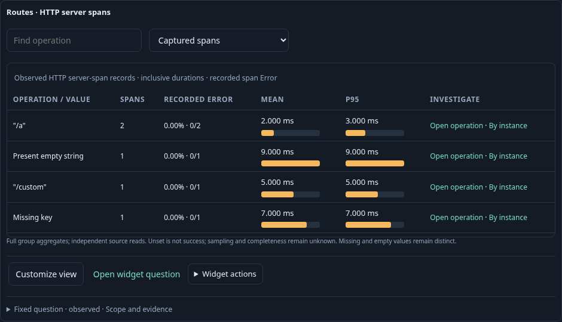
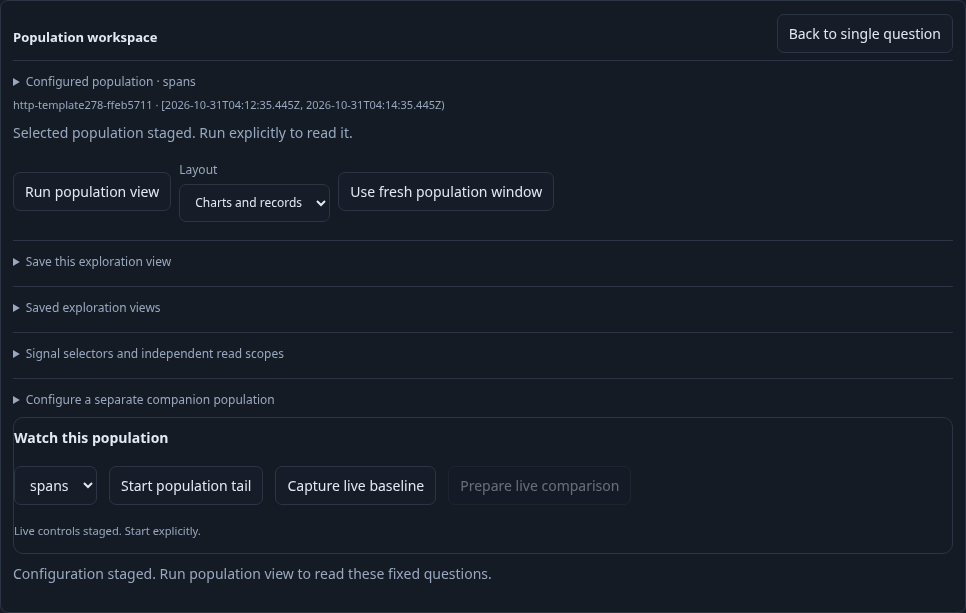
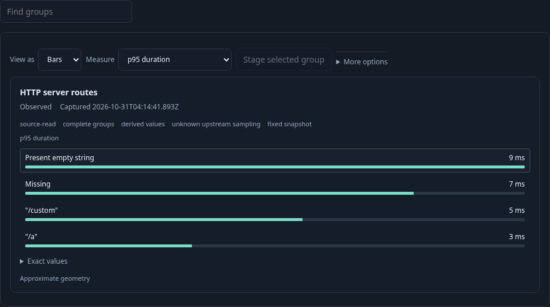

# 278 · Customize an OTel HTTP service view

The executable [278-http-template.spec.js](278-http-template.spec.js) supplies ten
real OTLP spans for one service and namespace. Five are reported Server records
with a nonempty current `http.request.method`: two `/a`, one custom-method
`/custom`, one missing route and one present-empty route. Client/Producer records,
empty or missing current methods, and legacy-only `http.method` are excluded.
These are captured server-span observations, not unique requests or an HTTP
outcome policy.

1. **Start at the discovered service.** Open its incoming-HTTP dashboard and the
   HTTP server route widget. **Customize view** expands the shipped, pinned
   `otel.http-server-routes` template using that widget's exact checked query.
   Existing environment, namespace, service, window, Server/method constraints,
   summary/status flags and additional filters travel unchanged.

   

2. **Stage a shared view.** Customize navigates to the existing population editor
   and stages count bars with population share. It loads no records or source
   witness. Run remains explicit, and Back to service preserves the service return
   path. A delayed expansion response after leaving its service cannot publish a
   staged population.

   

3. **Run, edit and save.** Run reads the exact same checked route population and
   retains missing and empty route groups. Switch locally to P95 duration, save
   the declaration through the existing immutable catalog, reopen configuration,
   and Run explicitly again. Neither template expansion nor measure edits,
   save, or configuration reopening adds a telemetry read.

   

Validated on 2026-10-31 against the running Go application and real OTLP/ClickHouse
data. The final live journey passed in 51.9 seconds (54.5-second invocation). Ten fixture
spans produced exactly five qualifying HTTP Server observations and four distinct
route groups, preserving missing versus empty. The delayed expansion after leaving
the first service owner was ignored. Two configuration expansions made no telemetry
reads; current widget predicates and every query field survived expansion and save.

Observed source-read counts were `[13,13,14,14,14,14,15]`: discovery, opening services
and the stale-response probe preceded the modeled service baseline; Customize,
local edits, save and configuration reopen added zero reads. Each explicit Run
added one read. The observed Quint replay passed in 5.56 seconds, rejected five
altered traces and rejected an unfinished prefix.

The finite Hegel checks passed 50 valid Go expansion/public-JS-declaration cases
and 50 refused version, grouping, role, method, page and OR-weakened cases. The final 30-second Bombadil campaign passed 559 snapshots across ten phases:
initial, inventory, service, Customize, Run, count, duration, Save, reopen and complete.
It starts from real discovery, opens the actual HTTP service widget and invokes the
new Customize action. The loaded-service baseline was seven telemetry reads;
configuration expansion added none, and explicit Run added one. The actor checked
five matching records plus the environment, namespace, service, Server kind,
current-method and route-grouping scope. Local field edits and save/reopen added
no reads. Its final state was reopened/staged, with one configuration expansion,
eight total telemetry reads, no overflow and no uncaught errors. All three frames
were refreshed by the final real journey, including the neutral staged-configuration
footer. These checks establish configuration and source-read boundaries, not
upstream telemetry completeness or verified HTTP outcome policy.
