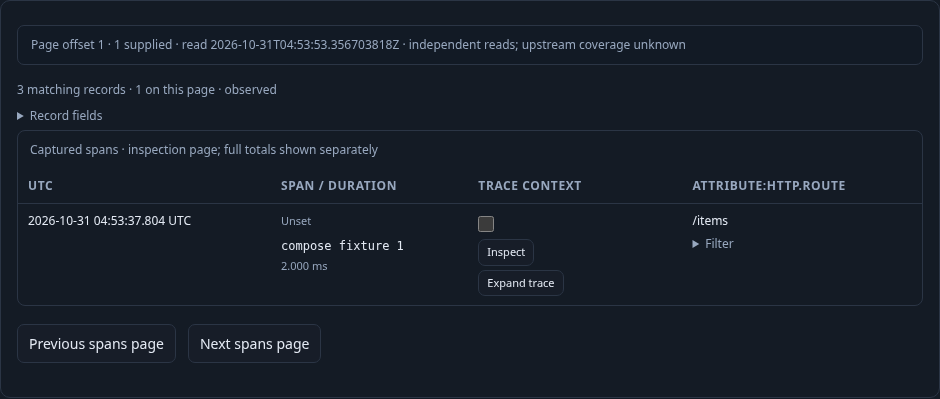
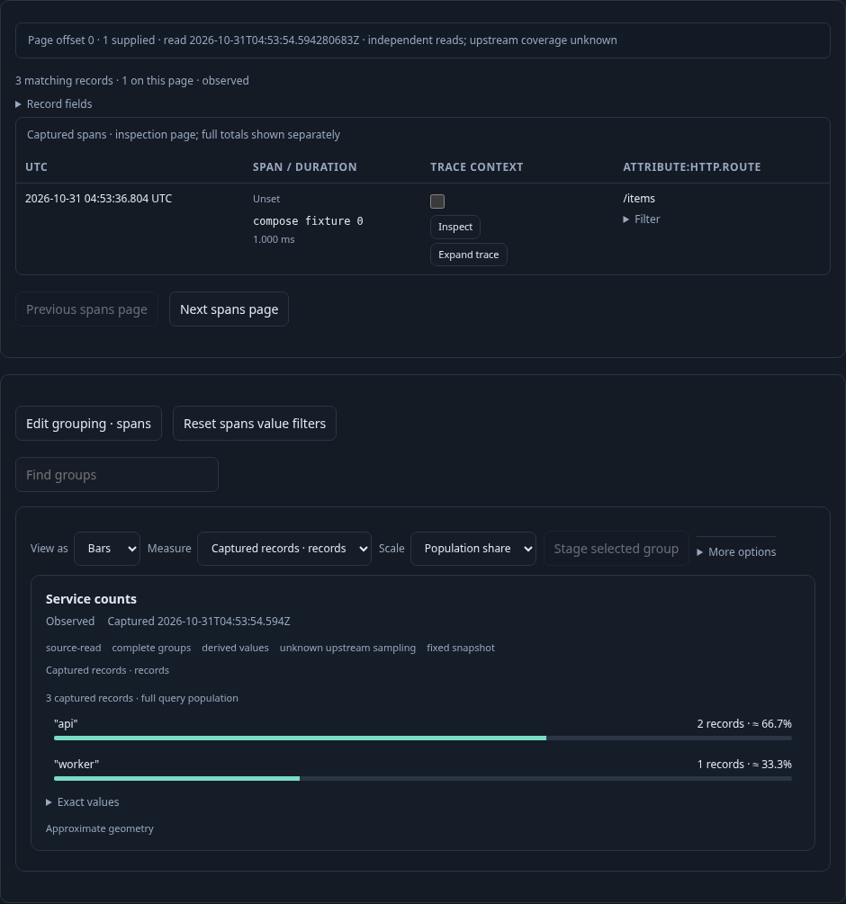

# 279 · Records and aggregate composition

An operator starts with a saved single-query population grouped by service. Three
real OTLP spans supply two `api` records and one `worker`, while the inspection
page is limited to one record. [Executable journey](279-view-composition.spec.js)
uses the existing application, source endpoint and saved-view catalog.

1. **Compose supplied aspects.** Run the checked population, then choose **Compose
   aggregate and records**. The public stack contains one aggregate and one
   `record-table` child referring to that same query. Reverse the order and hide/
   show records locally. Column settings belong to the records child; measure and
   display settings belong to the aggregate. None of those edits reads telemetry.

   

2. **Inspect an independent bounded page.** Invalid source with both children
   hidden is refused and blocks Save without changing the last good preview.
   After correction, Next reads one new record page. The aggregate snapshot ID,
   revision, clock and three-record denominator remain held. Page offset, supplied
   rows, read clock and unknown upstream coverage are explicit. A bounded page
   cannot inherit an exhaustive-group completeness witness.

   

3. **Save composition and reopen explicitly.** The immutable configuration stores
   the stack and child-local options, with no competing root layout/column/display
   fields. The parent query remains page zero; the original saved revision stays
   unchanged. Reopening stages configuration without telemetry, then explicit Run
   restores the order, record fields and aggregate view.

   

Validated against the real Go application and OTLP/ClickHouse records on
2026-10-31. The final live journey passed in 19.7 seconds. Read counts were
`[1,1,1,1,2,2,2,3]`: initial Run, one Next-page read, and explicit Run after
reopening. Compose, order, visibility, column/source edits, Save and reopen added
no telemetry reads. Invalid all-hidden source blocked Save and retained the last
valid preview. An old page’s retained Expand-trace control could not open an
inspector or issue another read after paging. The original saved configuration
remained unchanged, while the new configuration omitted all conflicting flat
presentation fields.

The aggregate ID, revision, captured clock and three-record denominator were
identical before and after record paging. The record page displayed one supplied
row, offset one and its own later read clock, with upstream coverage unknown.
The three frames above were regenerated in a 1,400-pixel-high viewport so the
existing sticky trail does not obscure those facts; no image was edited.

The 100 finite Hegel cases passed 50 valid and 50 refusal Go↔JavaScript AST cases.
Quint validated all eight observed steps in 5.68 seconds and rejected six altered
traces plus an unfinished prefix. The 30-second Bombadil campaign passed 691
snapshots across ten phases, exercising actual Compose, reverse order, hide/show,
Next page and Save/reopen controls. Its final configuration was staged with two
source reads, no overflow and no uncaught errors. The updated HTTP service-template
journey278 also passed (21.5 seconds), proving that its template now stages the
same composed configuration.

The records input is an explicit immutable `goo.record-page/1` profile, not a
relabeled numeric Dataset, complete-population claim or atomic page/aggregate
snapshot. Paging currently uses the existing exploration endpoint; this journey
does not claim a SQL page-only projection optimization.
