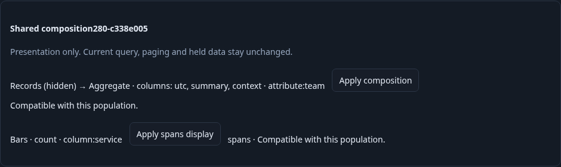
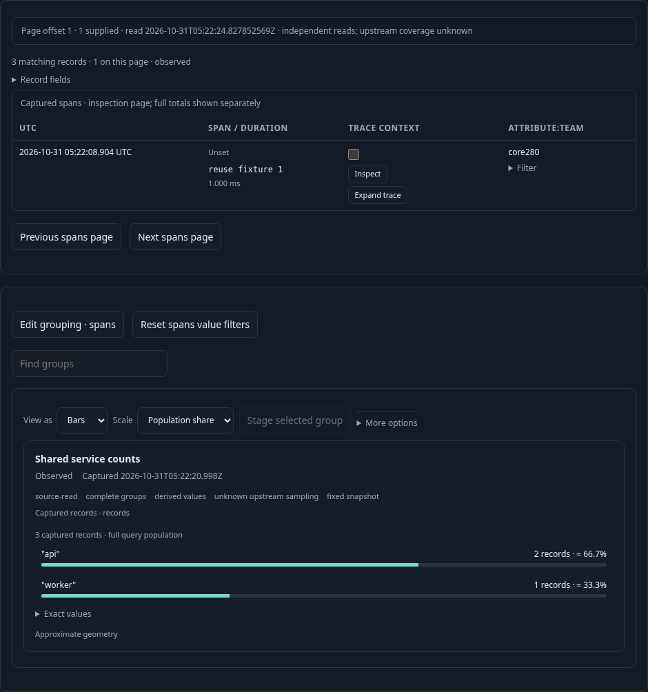
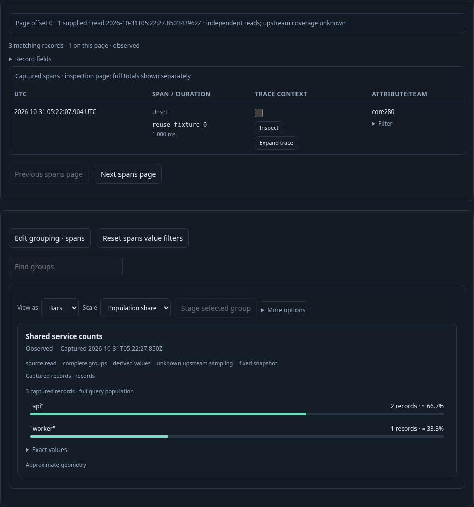

# 280 · Reuse a whole composition in the current population

An operator has a current, filtered population and a saved composition created for
a different environment and fixed window. The existing catalog now offers
**Apply composition** separately from aggregate-only Apply. The same checked
compatibility rules protect quantities and grouping, while record columns, order
and visibility travel together. Current query, paging policy and held data do not.

[Executable journey](280-composition-reuse.spec.js) supplies three real OTLP spans
and limits the inspection page to one row. The source composition references an
old, deliberately unrelated environment/window and a never-read service predicate.

1. **Inspect compatibility and resolve active work explicitly.** The catalog shows
   the source's record-first order, hidden record child and qualified `team` column.
   A configured live view blocks whole Apply. Selecting a current record also blocks
   it. Clearing live configuration does not discard the selection; the operator
   explicitly clears selected records before proceeding. These steps acquire no
   telemetry and do not mutate the saved source.

   

2. **Reuse intent against held current inputs.** Apply transfers only the composition
   AST. Showing its hidden record child reveals the existing current page, with no
   source read. An explicit Next page advances records. A pending page blocks another
   Apply until settled; applying again at offset one keeps that page's read clock,
   rows and offset, plus the aggregate's ID, revision, clock and three-record
   denominator. Old detached trace controls cannot open a new source inspection.

   

3. **Save a distinct current-scope configuration.** The resulting saved view retains
   the destination title, query, predicates, environment and page policy. It has no
   conflicting flat presentation or tail options. Reopen stages configuration without
   acquiring telemetry; explicit Run starts again at parent offset zero and restores
   the imported composition. The original source revision remains identical.

   

Validated on 2026-10-31 against real OTLP/ClickHouse data. The main journey passed
in 50.1 seconds, retaining the destination query/title and the original source
revision. Clear live configuration preserved the selected record and its guard;
explicit Clear selected records was required. A pending page refused whole Apply.
Reapplying at offset one preserved that page's rows/read clock and the aggregate's
ID, revision, clock and three-record denominator. A detached old trace button
could not open an inspector or issue a POST. All three frames came from this run.

The main source-read ledger is `[1,1,1,2,2,2,2,3]`: initial Run, explicit Next page,
then explicit Run after configuration-only reopening. Whole Apply and other local
configuration operations made zero telemetry reads. The saved query retained parent
offset zero, so the explicit reopening Run returned to its first bounded page.

Finite Hegel checks passed 50 valid and 50 refusal Go↔JavaScript reuse cases,
including deep detachment and input immutability. Quint validated eight observed
steps in 5.62 seconds, rejected six altered traces and rejected an unfinished
prefix. Bombadil passed 30 seconds / 509 snapshots / thirteen phases through the
actual catalog, selection/live-config guards, whole Apply, visibility, paging and
save/reopen. Its final state was reopened/staged, with two reads, zero selected
records, held current scope and no overflow or uncaught errors. The existing 279
composition journey also passed as a regression (19.4 seconds).

These checks do not imply upstream telemetry completeness or an atomic
aggregate/page read.
