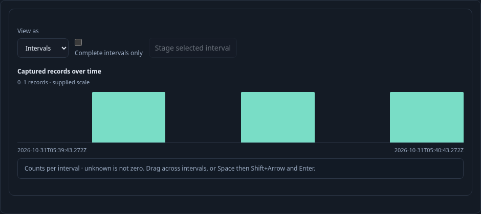
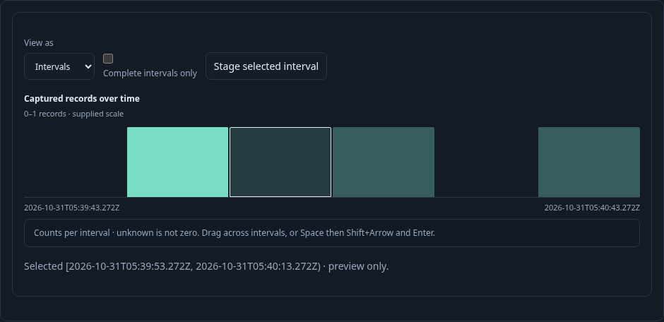
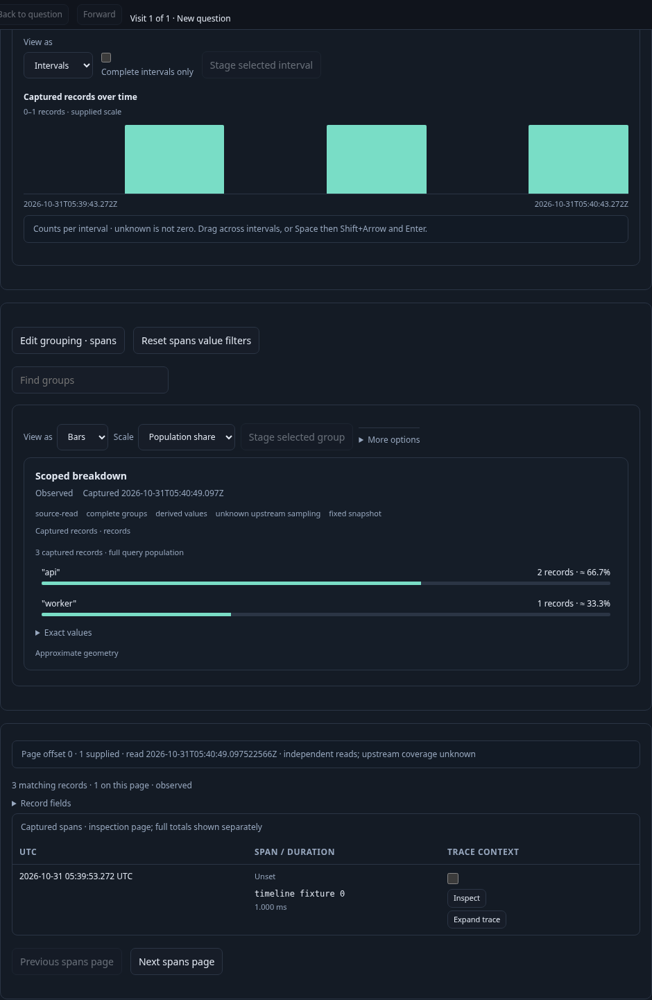

# Counts over time in a saved population — 281

Executable: [281-count-timeline.spec.js](281-count-timeline.spec.js).
The journey sends three real spans through OTLP and reads them from ClickHouse in
an isolated Go runtime. No chart data or source response is mocked.

1. Open a saved service-count and record-page composition; Run its fixed question.
2. In Composition, choose ten-second intervals and Add count timeline. The width
   changes the shared question and stages it; nothing reads until Run.
3. Run and see six UTC intervals, service counts and the bounded record page.
   Page records; the timeline retains its original supplied counts and basis.

4. Focus an interval, press Space, Shift+Right and Enter. The two-interval range
   remains a preview. Stage selected interval stages one shared half-open UTC
   window; Run refreshes all children. Unknown coverage cannot become zero or a
   selectable gap; the checked owner rejects stale and noncontiguous ranges.

5. Reset the starting window, save, and reopen. Reopen is configuration only;
   Run reads the restored window with its saved timeline and record columns.

The observed source-read ledger is `[1,1,2,3,3,4,4,4,4,5]`: only initial Run,
width Run, Next page, narrowed Run and reopened Run read telemetry. The ten-step
Quint replay rejects six mutated ledgers and an unfinished prefix. A separate
Bombadil campaign exercises Run, paging, selection, staged narrowing, Reset,
save and reopen, with read-budget, viewport and uncaught-error invariants.

The finite Hegel property checks Go/JavaScript reuse parity across supported
widths, signal/order/visibility variations and different current scopes. A hidden
timeline still requires matching explicit width; imported configuration cannot
silently rewrite the destination query.
