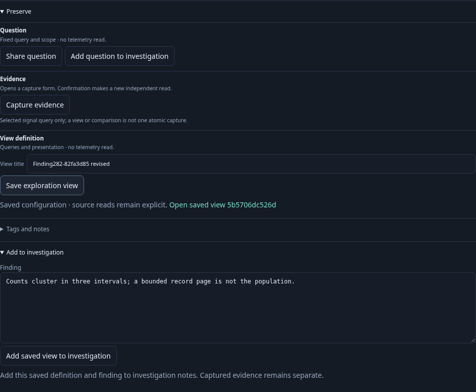
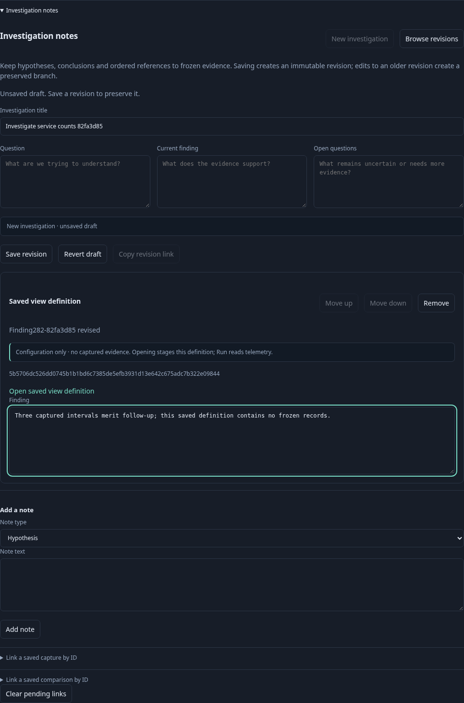
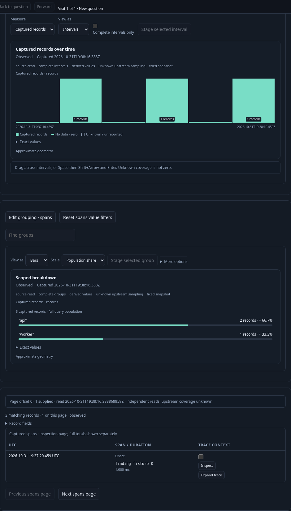

# Preserve a composed finding — 282

Executable: [282-saved-view-finding.spec.js](282-saved-view-finding.spec.js).
The journey sends three spans through real OTLP and reads them from ClickHouse in
an isolated Go runtime. Its saved timeline uses the shared scoped-interval
renderer; native disclosures are opened idempotently so retained open state is
respected. No telemetry responses or display snapshots are mocked.

1. Run a saved composition containing count intervals, service counts and a bounded
   record page. Open **Preserve → Add to investigation**. Edit its title: Add saved view to investigation becomes unavailable
   until that exact configuration is saved. Write a finding and save a new definition.
2. Add the saved definition to investigation notes. Its exact immutable ID, title
   and finding travel together; records, cursors, aggregate snapshots and capture
   custody do not. Edit the finding in the investigation and save a revision.
3. Reopen that revision. The finding and exact saved-definition reference survive.
   Type an unapplied note, then open the definition. Adding the definition again
   refuses the pending note without deleting it or creating another card.
4. Clear that pending note explicitly and Run the reopened definition. Opening
   the definition stages its fixed query and composition; only Run reads telemetry.

The observed source-read ledger is `[1,1,1,1,1,1,1,2]`. Configuration publication,
attachment, note editing, document publication, reopening and definition opening
add no reads. No capture is created, and both original and revised saved definitions
remain unchanged. Evidence capture remains a separate explicit operation.

The eight-step Quint replay requires the final explicit Run and checks pinned
reference state; six mutated traces and an unfinished prefix must fail. Hegel
checks Go/JavaScript draft validation parity for bounded view-reference cards.
A separate Bombadil campaign exercises Run, attachment, save and definition reopen,
then independently observes the second Run finish before declaring completion.
