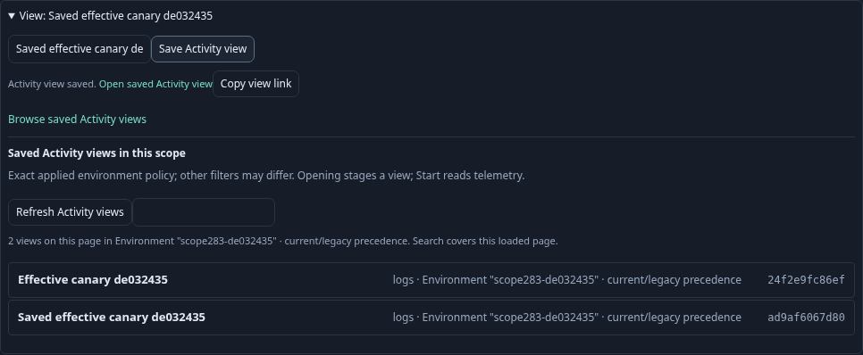
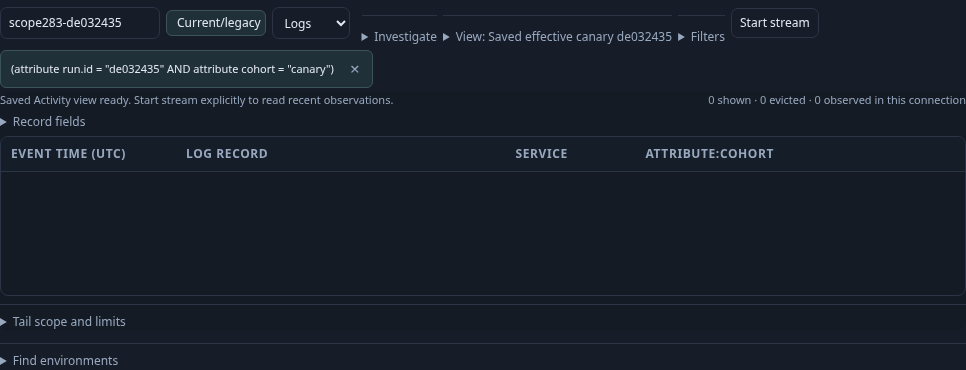
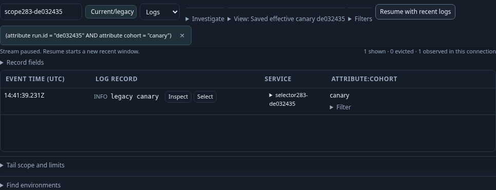

# Save the exact Activity population — 283

Executable: [283-activity-selector-view.spec.js](283-activity-selector-view.spec.js).
The real OTLP fixture includes current-named, legacy-only named, current-empty with
legacy fallback present, and unreported logs. A typed effective-named selector plus
saved canary predicates isolates the legacy-only record.

1. Open the typed saved view. Its current/legacy policy is visible; the record
   buffer stays empty until Start stream. Start then Pause retains the selected log.
2. Save a new Activity view with the same exact selector, predicates, ordered
   columns and extra cohort field. Configuration publication does not read telemetry.
3. Inspect exact-scope catalog results: current-only named differs from effective
   named, while empty-label and unreported scopes remain separate. The effective
   catalog includes both immutable saved definitions.

4. Open the new saved view. It stages the same policy and filter, with no rows and
   no new reads. The record columns survive the round trip.

5. Start explicitly again and observe only the legacy canary. Pause retains that
   result. The original saved view remains unchanged.

The eight-step source-request ledger is `[0,1,1,1,1,1,2,2]`: only the two explicit
starts open tail requests. Save, catalog discovery and reopening add none. Quint
checks lifecycle state and rejects six mutated traces and an unfinished prefix.
Hegel checks Go/JavaScript validation parity for supported and refused selector
policies. Bombadil exercises the same saved-view Start/Pause/Save/reopen lifecycle.
