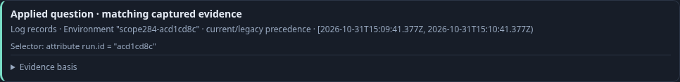
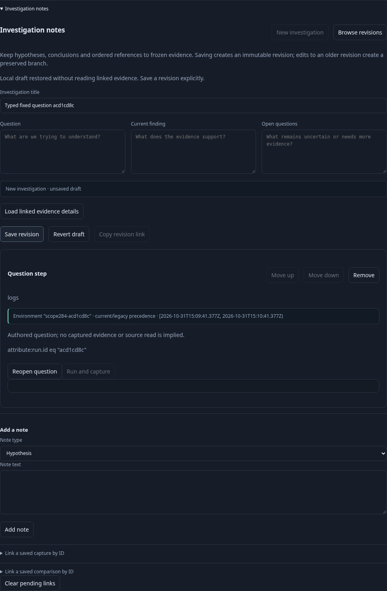
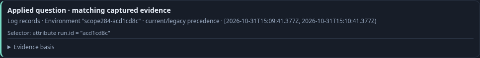

# Share and recover an exact fixed question — 284

Executable: [284-record-step-handoff.spec.js](284-record-step-handoff.spec.js).
The journey sends real legacy-only and current-empty/legacy-present logs through
OTLP. An effective named Activity scope isolates the legacy-only canary.

1. Open the saved Activity scope, Start explicitly, then Analyze the completed
   observation window. Analysis stages the exact policy, predicate and fixed UTC
   bounds. Run reads that fixed question.
2. Open Edit analysis and share the question. Its bounded step link preserves the selector and exact
   fixed question. Reopening the link clears results and stages Run.

3. Add the question to an investigation draft. Reload and explicitly restore the
   local draft; the typed question survives without source reads or publication.
   Save the investigation revision after recovery.

4. Reopen the saved investigation and its question. The question remains staged
   until Run. Its selector, predicate and fixed window match the original query.

The eleven-step source-request ledger is `[0,1,1,2,2,2,2,2,2,2,3]`: one explicit
Activity tail connection and two explicit fixed queries. Internal tail polling is
not counted as separate browser requests. Sharing, pinning, draft recovery,
publication and reopen add no reads and create no capture.

Quint checks the staged/read lifecycle and rejects six mutated traces and an
unfinished prefix. Hegel compares Go and JavaScript step validation and link
round trips over typed scope variants. Bombadil drives the fixed-question pin,
publication and reopen workflow and independently observes the final Run.
