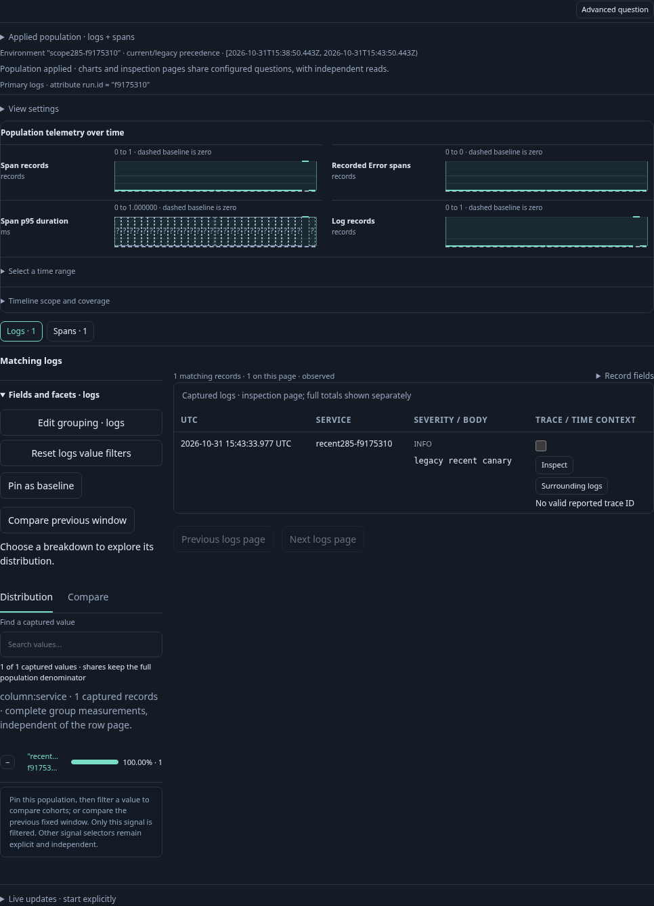
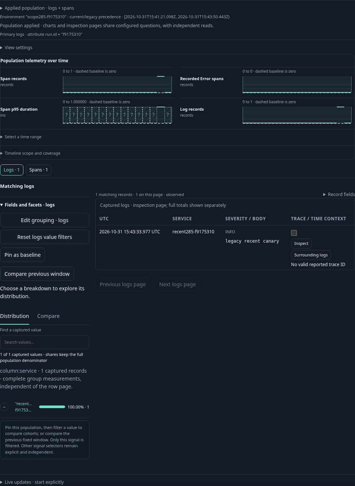
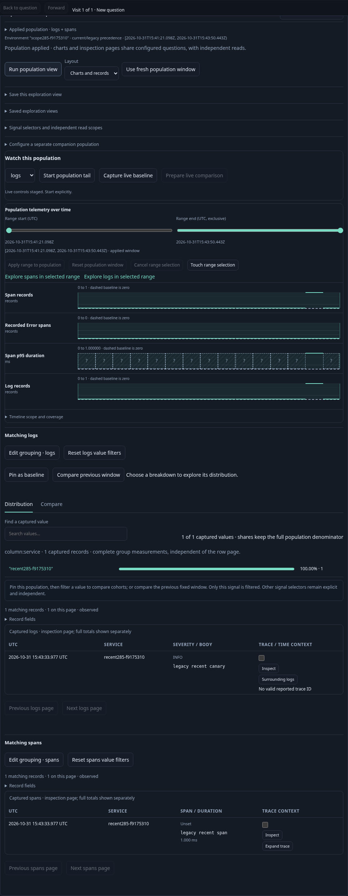

# Recent populations retain exact scope — 285

Executable: [285-recent-scope.spec.js](285-recent-scope.spec.js).
The fixture sends logs and spans through real OTLP with legacy-only named,
current-named other, current-empty/legacy-present and unreported resources.
An effective named selector plus a canary predicate admits only the legacy record
in each signal. No source or presentation response is mocked.

1. Open a typed fixed question and choose Show recent activity. This explicit
   action resolves one fresh five-minute window, plans it and reads the two
   supported signals. Both retain the selector and predicate.

2. Open Select a time range and adjust the start slider. The interval is a preview;
   its typed question links retain policy, predicate and exact bounds. Open selected
   population stages a child without reading. Run selected population reads both
   signals against that same selected window.

3. Save the fixed view and reopen its exact ID. Reopen is configuration only;
   Run reads the saved questions without asking for a fresh plan.

The source-request ledger is `[0,2,2,2,2,4,4,4,6]`, with one separate source-free
planner request. Initial recent, selected-child Run and reopened Run each read two
signals; selection, links, child staging, Save and reopen add none. Six HTTP source
requests can perform multiple independent backend reads; no transactional snapshot
or two-SQL-query budget is implied. No tail or capture is created.

The nine-step Quint replay rejects six mutated traces and an unfinished prefix.
Hegel checks generated Go planner outputs against the browser's source-scope
admission, including policy/window/predicate mutation refusals. Bombadil exercises
recent entry, selection, staged child, save/reopen and independently observed Run.
