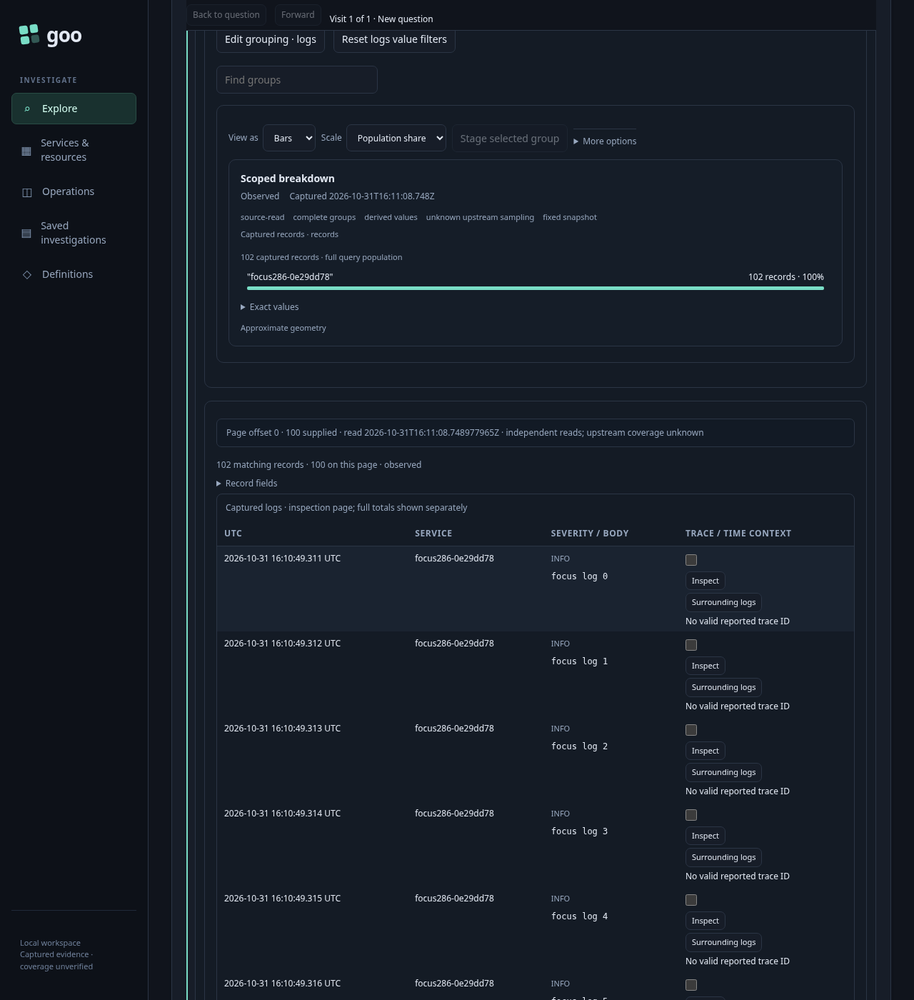
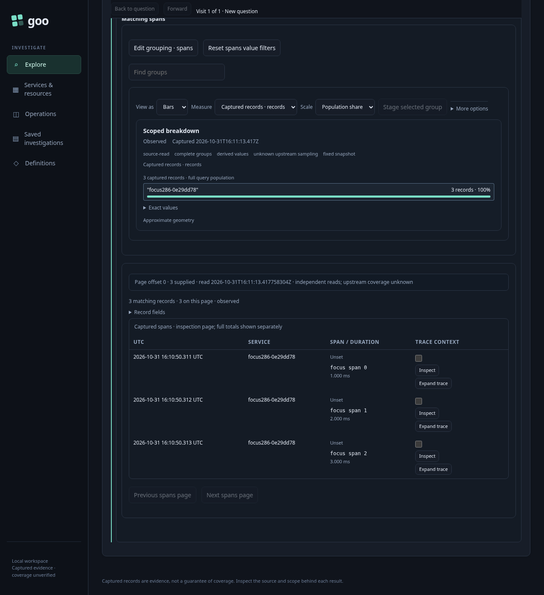
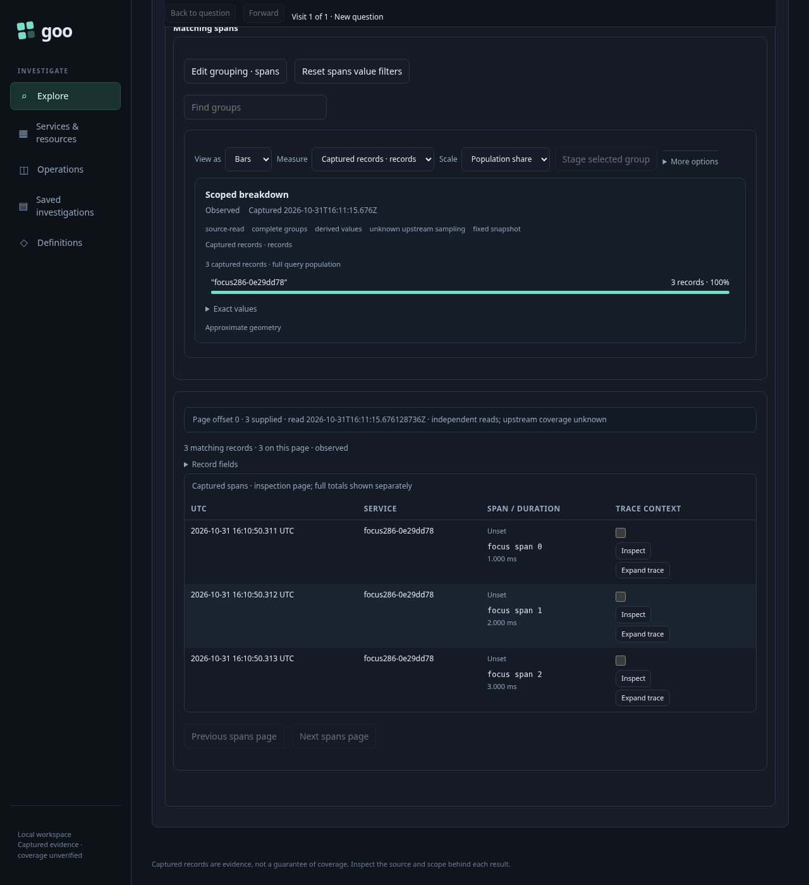

# Focus one signal for authoring — 286

Executable: [286-focused-authoring.spec.js](286-focused-authoring.spec.js).
The real OTLP fixture contains 102 logs and three spans under an effective
legacy-key environment selector. No source result or display snapshot is mocked.

1. Show recent activity to read both signals. Page the logs to offset100. A pending
   record selection disables Customize until explicitly cleared.
2. Customize logs stages only its original root question at page zero. The checked
   policy, predicates, fixed window and measure configuration remain unchanged.
   Its existing service grouping supports a records-plus-count-aggregate composition
   immediately. Only Run reads the focused query.

3. Save that definition, then Back to parent population. The parent keeps its
   offset100 record page and supplied data; returning does not read telemetry.
4. Switch to spans and Customize again. This companion has no grouping; the
   focused question stays ungrouped and cannot author an aggregate yet. Choose
   service explicitly in the existing grouping editor, then enable Reusable spans
   display and Compose aggregate and records. These steps stage configuration.
   Retired trace and Customize buttons cannot act. A disposed child’s old close
   button cannot close the new focused child.

5. Run, save and reopen the one-query definition. Reopen is staged; Run reads the
   same explicitly grouped span question. The saved logs definition remains unchanged.

The fifteen-step source-request ledger is
`[0,2,3,3,3,4,4,4,4,4,4,5,5,5,6]`, with one separate source-free population plan.
Only initial recent activity, explicit page navigation and focused Runs read.
Customize, composition, grouping, saving, parent return and reopen add no reads.
No capture or live subscription is created.

Hegel checks root-query projection and detached scope across all four environment
policies, both signals and grouped/ungrouped configurations. Quint checks the
observed lifecycle, rejecting six mutated traces and an unfinished prefix.
Bombadil exercises recent activity, focus, Run, Save/reopen and final independently
observed Run completion, guarding source requests and viewport overflow.
