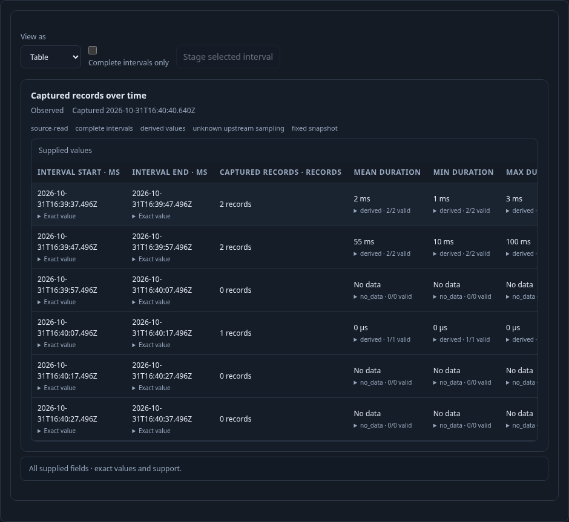
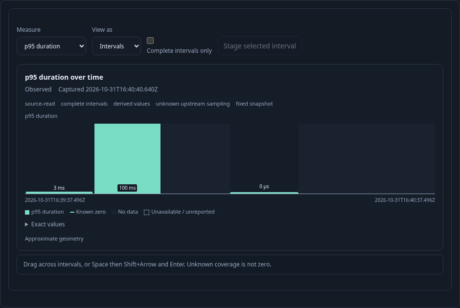

# When did captured span latency change? — 287

Executable: [287-duration-timeline.spec.js](287-duration-timeline.spec.js).
The fixture sends five real OTLP spans into ClickHouse: two durations of 1/3 ms,
two of 10/100 ms, and one valid zero-duration span in a separate interval. Empty
intervals are retained. No telemetry result or chart dataset is mocked.

1. Run a saved composition with an explicit ten-second interval and span-duration
   summary. Switch from count to mean and p95 locally. Two supplied 1/3 ms spans
   yield mean 2 ms and p95 3 ms; 10/100 ms yield mean 55 ms and p95 100 ms.
2. Enable complete intervals only without hiding known empty duration cells. Switch
   to the shared table: human units, exact values, valid support and the quantile
   method remain accessible. Empty duration intervals say No data; a derived zero
   duration stays zero with positive support.

3. Page the bounded record table. The timeline keeps its original admitted
   snapshot identity, revision and read clock. Switch back to interval bars.

4. Drag across two known intervals, then select the same range by Space,
   Shift+Right and Enter. Both gestures preserve exact interval boundaries.
   Preview and Stage do not read. Run applies that exact shared window to all children. Reset stages
   the original bounds without changing the measure or querying telemetry.
5. Save and reopen the definition. It remains staged with p95 selected; only Run
   reads the original fixed window again. The original saved definition is unchanged.

The thirteen-step source-request ledger is `[1,1,1,1,2,2,2,2,3,3,3,3,4]`.
Only initial Run, record paging, narrowed Run and reopened Run read telemetry.
The observed Quint replay rejects six mutated traces and an unfinished prefix.
A separate Bombadil campaign independently observes the final Run complete.

Hegel checks Go/JavaScript query-support and reuse parity, including hidden
unsupported duration timelines and mismatching widths. Duration rendering requires
query support; interval completeness and per-cell availability remain independent.
