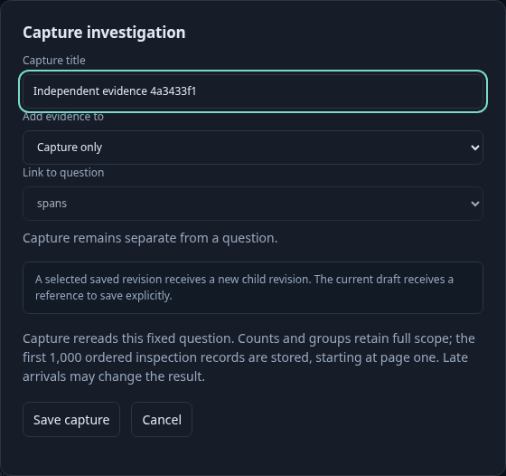
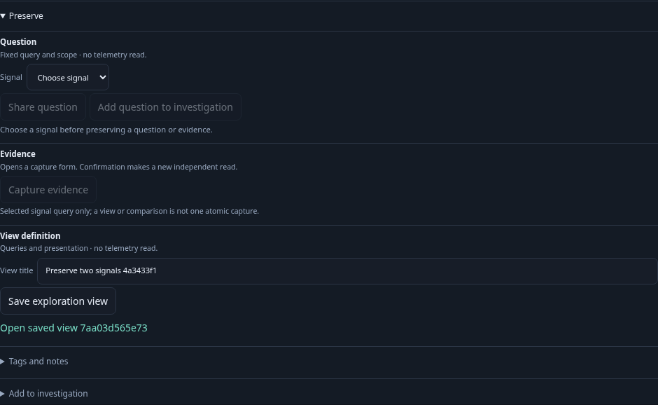
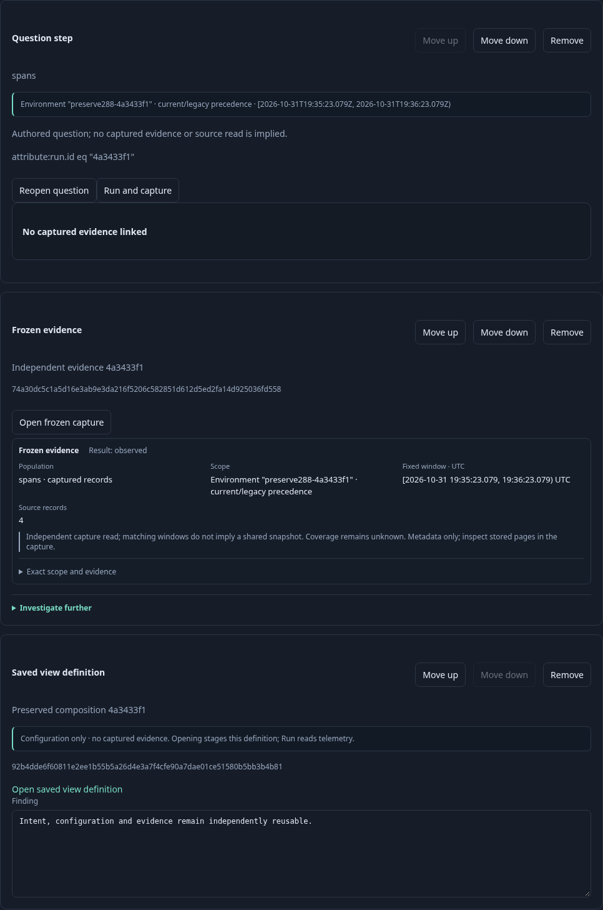

# Preserve the useful part of an exploration

A responder investigates one fixed UTC window over real OTLP spans, then keeps three independently reusable pieces. The window uses the effective OpenTelemetry environment selector, including a legacy-only environment resource, and an exact `run.id` predicate.

1. **Keep the question.** Open the fixed question, expand **Preserve**, and share its exact signal, selector, predicate, grouping, duration summary and absolute window. Add that intent to an investigation and save it. Sharing and saving do not query telemetry; reopening stages the question until **Run question** is pressed.
2. **Capture evidence deliberately.** Run once and see three spans. **Capture evidence** opens a confirmation form explaining that it makes a fresh read. A fourth matching span arrives inside the original window while the form is open; the current result still says three. Confirm **Capture only**: the receipt contains four spans. After a fifth arrival, opening the stored receipt still returns four, without another source read. Add that receipt separately to the investigation.

3. **Choose one signal explicitly.** Open a two-query saved view. **Preserve** initially says **Choose signal**; sharing, adding a question and capturing cannot silently use the visible tab. Saving the complete view configuration remains available. Select Logs and share exactly its root question. A staged view cannot capture until explicitly run. Old fixed-context buttons cannot act on this population, and a detached view Save button cannot publish a newer context.

4. **Keep the composition.** Open a single-query composition, apply its valid source through **View settings → Composition**, then save a new view through **Preserve**. Applying presentation and saving definitions make no telemetry read. An unfinished investigation note blocks adding a question with visible feedback, without losing the note or adding a duplicate. Open **Add to investigation** for the optional finding. Clear the note, add the current saved definition and its finding, and save the investigation revision. Its cards remain distinct question intent, captured evidence and view definition.

The executable journey is [288-preservation.spec.js](288-preservation.spec.js). Its browser ledger separates Explore requests from capture creation; independent fixture polling is excluded. The Quint lifecycle validates the observed ledger and rejects six corrupted ledgers and an unfinished prefix. Hegel generates explicit-signal and root-query preservation cases. The focused-authoring regression also returns from a child and shares the held parent’s exact root query without another read. A separate 30-second Bombadil run selects both signals, shares each, saves the whole configuration and reopens it without source reads or implicit cards; its eventual completion is checked independently.
