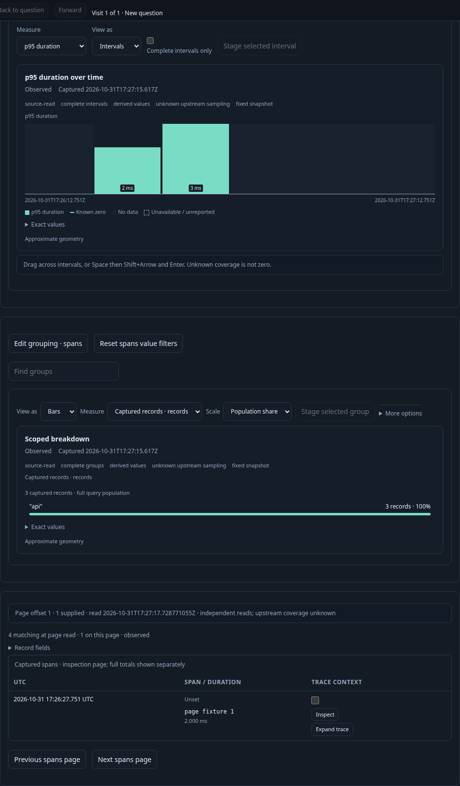
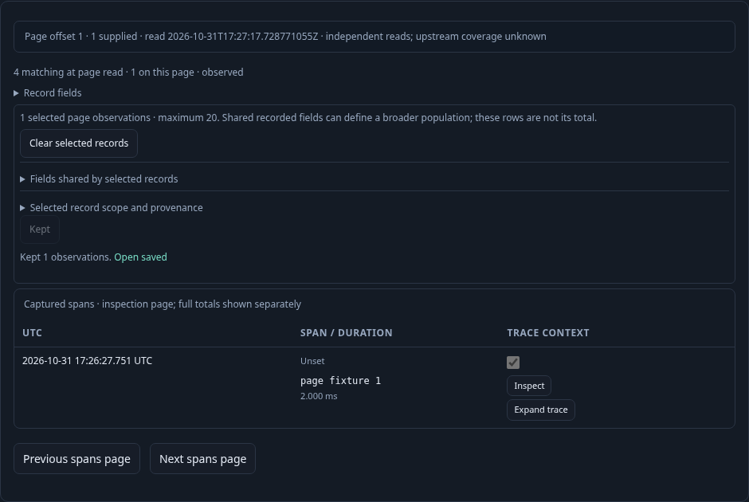

# Page records without refreshing held charts — 289

Executable: [289-record-page-profile.spec.js](289-record-page-profile.spec.js).
The fixture sends real OTLP spans into the local collector. Polling setup calls are
separate from the UI request ledger.

1. Open a saved composition and explicitly Run. Three matching spans supply the
   aggregate, duration timeline and initial one-record page.
2. A fourth span arrives inside the original fixed window. Page forward. The new
   count-and-rows response reports four matching at the page read; both chart
   identities, revisions, source clocks and original population remain held.

3. Select the newly paged observation and Keep it. The existing server token keeps
   exactly that page row and basis without another telemetry request. That token
   cannot promote the page into captured explanation evidence.

4. Delay a real next-page response, then open a different ordinary view. Releasing
   the retired response cannot install the old page. Ordinary Run and pagination
   retain their full-query behavior.
5. Capture evidence from Preserve. Confirmation still performs the full independent
   capture, including population aggregates, at root offset zero.

The live journey and independent 30-second Bombadil campaign pass. The campaign
records 387 snapshots through five phases, one full Run and two page-profile
requests, with chart identity held and no viewport overflow.

The compact observed lifecycle is checked against Quint with six corrupted ledgers
and an unfinished prefix as negative controls. Hegel varies signal, environment,
page bounds and row cardinality through the actual UI admission contract; malformed
counts, foreign scope and aggregate authority are rejected. Bombadil separately
runs, pages next and previous, checks held chart identity and completes within a
bounded source-operation budget. Source-read reduction is measured by the backend
profile tests; route counts alone are not SQL counts or latency measurements.
