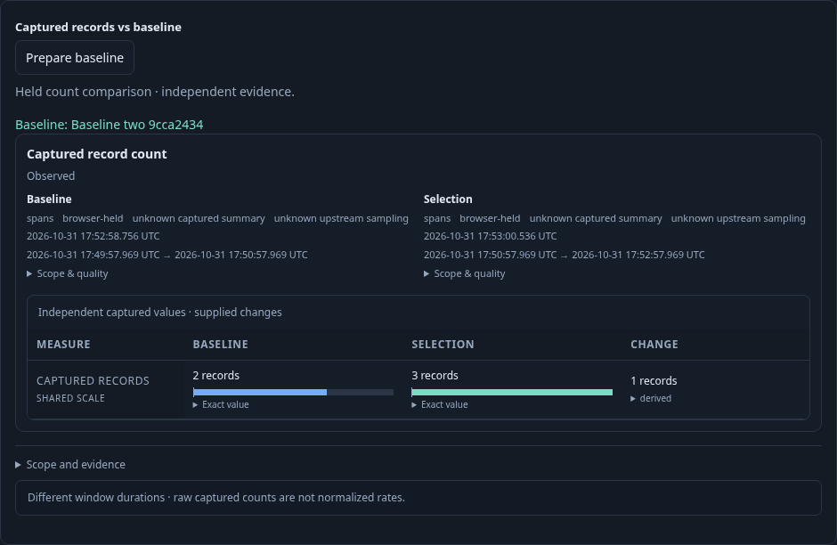
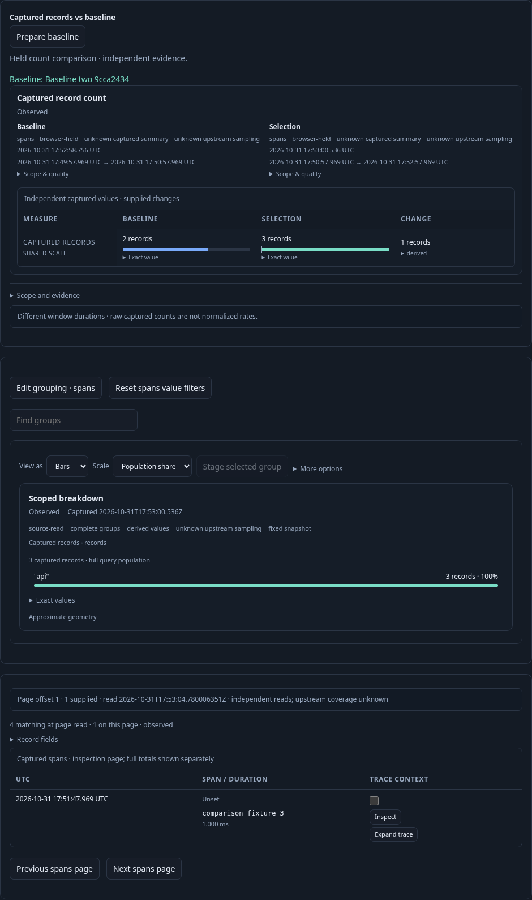
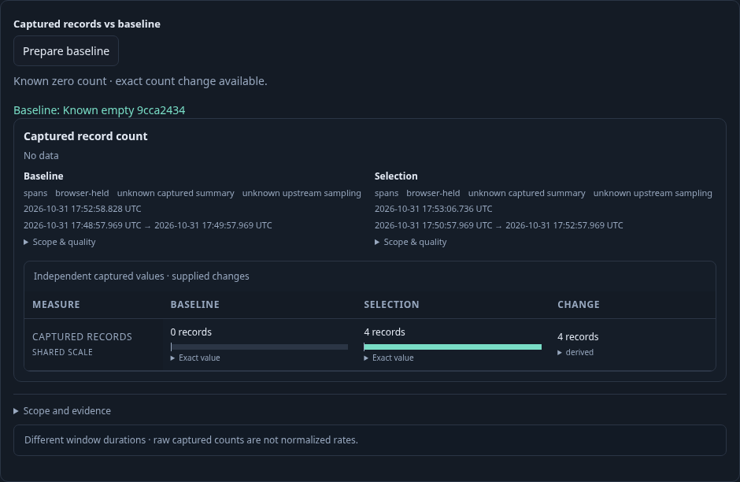

# Compare held captured counts — 290

Executable: [290-authored-comparison.spec.js](290-authored-comparison.spec.js).
Real OTLP spans populate a baseline fixed window with two records and a longer
current window with three. Both questions retain the same service grouping,
checked environment and exact run predicate; the windows differ deliberately.

1. Open and Run the current composition. Load captured evidence by title in View settings, choose an immutable baseline
   (or enter its exact ID), then explicitly Prepare baseline. Its stored evidence is
   loaded without another telemetry read. The canonical count comparison shows
   baseline2, held current3 and exact change+1. Unequal window durations warn that
   these are raw counts, not normalized traffic rates.

2. A fourth record arrives inside the original current window. Paging acquires a
   fresh count4 and bounded page while the comparison retains current3, baseline2
   and the original side identities/clocks. Selecting records blocks preparation
   until the record selection is cleared.

3. Preserve saves the definition and exact baseline ID. Reopen stages it with no
   baseline storage read or telemetry request. Explicit Run obtains current4 and
   prepares the same stored baseline, yielding change+2.
4. Choose an independently stored known-empty baseline. The canonical comparison
   retains known0, current4 and exact change+4 despite its no_data envelope state.
   A differently filtered capture is refused, and a missing ID is unavailable;
   neither substitutes the old pair. A delayed preparation retired by navigation
   cannot publish or reactivate its detached button.

Hegel generates compatible and incompatible typed root queries through both Go
and browser helpers and validates real canonical count arithmetic, zero and
source disagreement. Quint validates the observed lifecycle and rejects corrupted
read/held-value traces and unfinished prefixes. The independent30-second Bombadil run observes a prepared pair, held paging,
definition publication and staged reopening:563 snapshots across six phases,
with one full Run, one narrow page, one baseline read, one pure comparison and
one definition publication. Final latest-source journey passes32.7s; composed
paging289 and composition reuse280 regressions also pass.
The focused component screenshots hide only the sticky investigation trail during
capture so it cannot overlay the compared data; product layout and telemetry are
unchanged. Execution results are recorded in VALIDATION.md.
