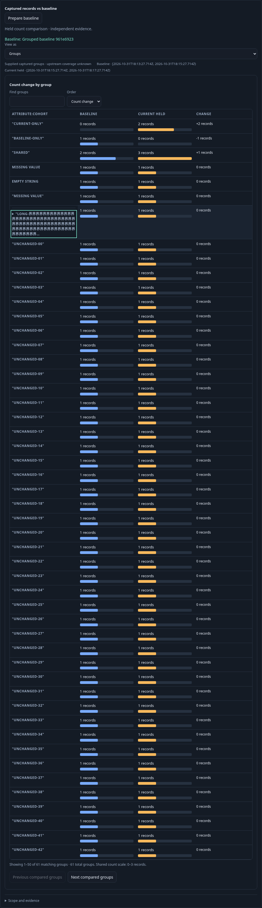
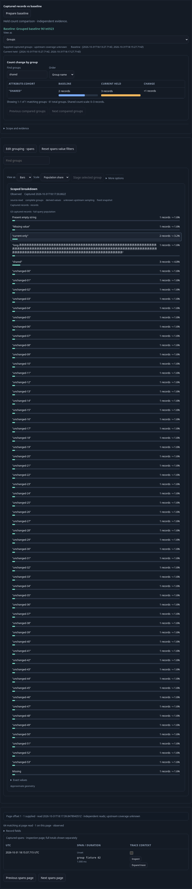
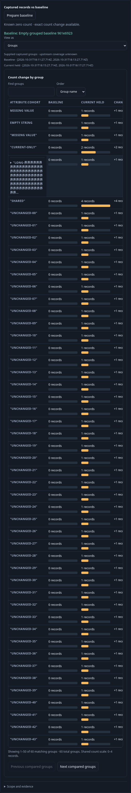

# Which groups account for the count change? — 291

Executable: [291-group-count-comparison.spec.js](291-group-count-comparison.spec.js).
Real OTLP spans supply61 baseline records and63 current records across61 group
identities. The fixture includes shared, baseline-only, current-only, absent
attribute, present empty string and the literal string `Missing value`, plus55
unchanged groups so local row paging is exercised. One unchanged category is a
long Unicode string: its bounded preview has a native keyboard-accessible exact
value disclosure, without another read.

1. Run a single-query composition, set an exact immutable baseline capture and
   Prepare explicitly. Switch the same prepared comparison from Summary to
   Groups. No telemetry, storage or comparison request accompanies the switch.
   The full common count domain is3. Shared counts2→3, baseline-only1→0 and
   current-only0→2 carry exact signed changes; missing and empty categories remain
   visibly distinct from the quoted literal label.

2. Select a record. Summary/Groups switching, local Find, exact Change/name order
   and local group paging preserve that record selection and keyboard focus.
   Finding no row says No matching groups; it does not declare no data. Every
   local presentation retains the same full-union domain and performs no reads.
3. A late shared-group record arrives. Inspect the next source record page:
   its independent fresh count becomes64, while both prepared group operands,
   their clocks and domain3 remain held. The current Find input stays intact.

4. Save the view with Groups and Group name order selected. Reopen is staged with no baseline GET or
   telemetry request. Run explicitly reacquires current64 and the same stored
   baseline61; the common domain becomes4 and shared2→4 has exact change+2.
5. Select an independently stored known-empty baseline. Its absent group cells
   are known zero, and exact count changes remain available under the canonical
   no_data state. Inspect the compact comparison on a narrow viewport.

The Go/browser Hegel properties cover complete unions, exactuint64 extremes,
known-zero and diagnostic absence rules, category identity and corrupted payloads.
Quint checks the observed ownership/read lifecycle and rejects six mutated traces
and an unfinished prefix. Independent Bombadil exercises rendered groups, local
Find/order/view controls, held record paging, definition save and staged reopen.
The real journey plus independent campaign passed. Bombadil recorded 484 snapshots
across eight phases, completing a rendered group pair, local presentation, held
record page, saved definition and staged reopen with one full Run, one page read,
one baseline GET, one pure compare and one save. The Hegel100 properties, full
2000-group union boundary, both-empty case and twelve-step Quint model passed
(27.7 seconds together), including six corrupted ledgers and an unfinished prefix.
[VALIDATION](../VALIDATION.md) records the complete delivery checks.

Final latest-source journey passed in43.3 seconds with the Groups-only upstream
coverage caption and refreshed frames. Regressions289 (22.0s) and290 (25.8s)
passed. Successful raw capture/campaign copies are cleaned; compact API, model,
campaign and journey ledgers remain.
