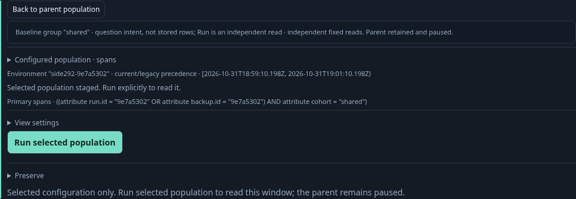
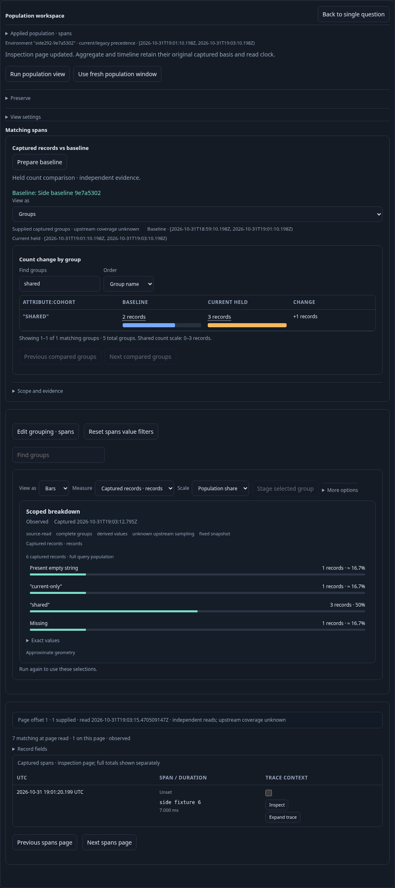

# Explore a compared group on its chosen side — 292

Executable: [292-group-side-staging.spec.js](292-group-side-staging.spec.js).
Real OTLP spans use a checked effective environment selector over a legacy-only
resource key. The root query preserves an OR predicate, one nullable attribute
grouping, a fixed bucket width and duration summary.

1. Prepare five baseline records and six current records. Page the parent's
   inspection records independently. Later arrivals bring those source windows to
   six and seven; the displayed pair stays held at five and six.
2. Find the shared group and activate its **Baseline** count. A retained child
   stages the exact baseline question, with offset zero and the entire original
   OR predicate AND the chosen group equality. No source, storage or comparison
   call occurs. Run is an explicit independent read: it sees three records,
   rather than pretending to filter the original capture's two shared records.

3. Back restores the same held pair, Find/order and parent's inspection offset.
   Focus returns to a newly bound count button. A retained old button cannot
   stage another child. A fresh Current count stages that side's different fixed
   window; explicit Run reads four matching records.

4. Explore Missing value and Empty string separately. The former appends a typed
   `missing` predicate; the latter appends `eq` with a present empty value. Neither
   overwrites the old predicate, window, environment policy or summary directives.
5. One-sided aligned zero cells have no staging action. Pending record selection,
   unapplied source text, hidden Summary mode and navigation refuse old actions
   without dropping drafts or reading telemetry. Standalone group displays stay
   passive until an explicit host interaction binding is installed.

The model ledger distinguishes parent preparation, source-free child staging,
explicit child reads, Back and permanently retired old controls. Six corrupted
ledgers and an unfinished prefix must be rejected. Generated Go/JavaScript cases
check exact detached AST derivation and refuse diagnostic, absent or forged side
contexts. Bombadil independently completes baseline staging/Run/Back and current
staging/Back before declaring success.

Final real journey and independent 30-second Bombadil campaign pass. Bombadil
observes 546 snapshots across nine phases, including an actually rendered
three-record baseline child before Back, then Current staging and another Back.
Its two full reads, one baseline GET and one pure comparison stay within budget;
held pair identity and Find remain unchanged, with no overflow/errors. Main
journey has five explicit full reads, one page, one baseline GET and one comparison.
Regressions286 (27.9s) and291 (33.6s) pass.

The generated parity checks distinguish Go's original canonical wire context from
the browser's conservatively imported local snapshot context. Each frame derives
the same query with its own valid intent; copying an intent across those frames
is correctly refused. One hundred generated cases, the predicate-budget negative
case and the observed seventeen-step model with six mutants/prefix rejection pass.

Validation outcomes are recorded in [VALIDATION.md](../VALIDATION.md); this
storyboard describes executable acceptance rather than a user study.
