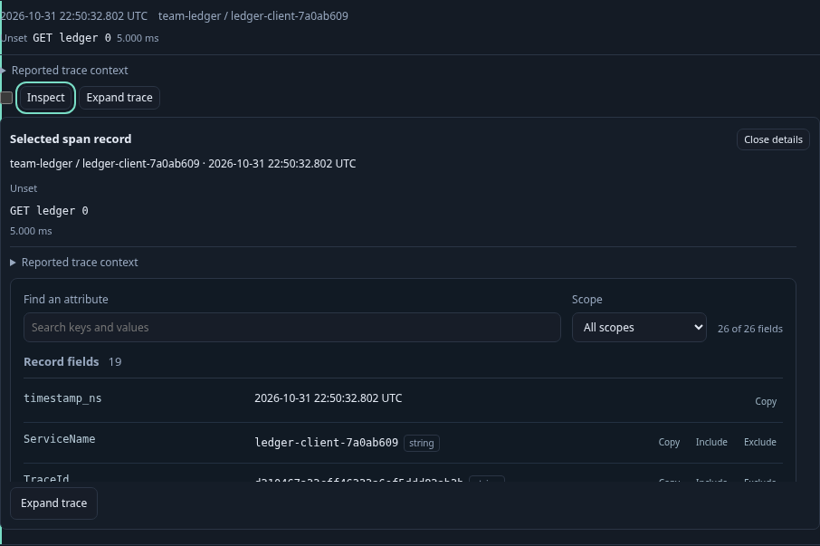
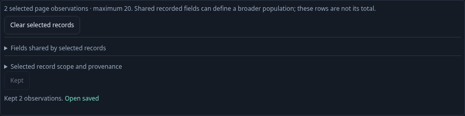
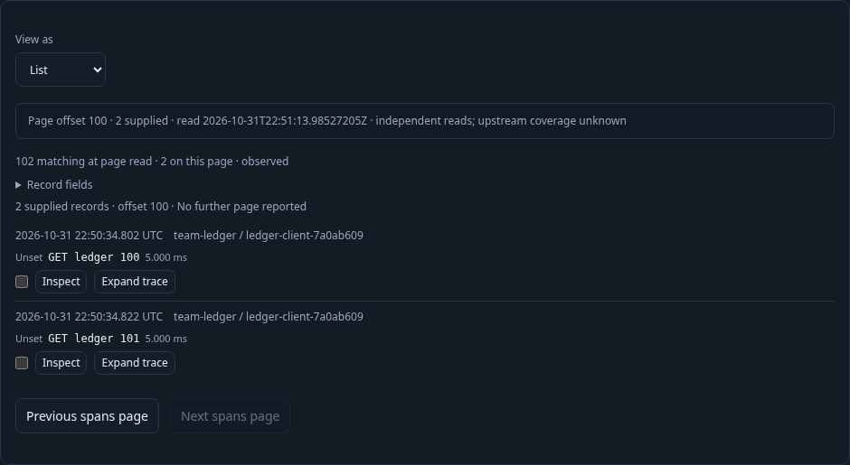

# One record workflow in Table and List — 298

Executable: [298-record-interactions.spec.js](298-record-interactions.spec.js).
Contract: [shared record interactions](../docs/RECORD_INTERACTIONS.md).

1. **Find a service.** Discover a real PostgreSQL client through standard OTel
   database attributes. Customize its supplied view and explicitly Run. No saved
   view or display declaration is API seeded in this main journey.
2. **Choose List.** Change presentation locally over the same 100 supplied rows
   from a 102-record population. Inspect a row with the keyboard/native button;
   the same structured attribute viewer appears without a source read.
3. **Follow a trace.** Expand the row's reported trace ID explicitly. Wait for the
   actual trace waterfall, then close it. The span and linked-log queries are separate reads and do not
   promote the page into a complete trace or event identity.
4. **Keep exact observations.** Select positions one and two. The view selector
   refuses a synthetic change while selected. Hold the real Keep response to
   check busy guards, then verify the saved question, evidence basis and both
   exact records/indexes. Clear the selection explicitly afterward.
5. **Broaden through fields.** Include the selected record's `attribute:cohort`,
   open the staged facets as a child and return. Back supplies fresh controls;
   reattaching retired DOM cannot reopen a trace or perform a source read.
6. **Inspect the next supplied page.** Offset 100 returns two rows while the
   aggregate retains its original identity/basis. Select local position two and
   Keep; it resolves to index one of that page's result token, with that page's
   question and basis.
7. **Change presentation again.** Table and List offer the same record actions.
   Switching reads nothing; reattached actions from the replaced List stay
   retired. Save the List view through the native Preserve control.
8. **Check a frozen consumer separately.** Capture the real 102-record population,
   page the stored UI to offset 100 and Keep local position two. The extracted
   owner must emit absolute capture index 101; saved paging reads no telemetry.

The independent optional Bombadil campaign runs the saved List from staged state,
selects and Keeps a row, refuses replacement while selected, clears, switches
Table/List, pages to offset 100 and inspects the remaining supplied rows. Its
invariants constrain selection bounds, replacement blocking, source/write budget,
uncaught errors and horizontal overflow.

The observed Quint ledger checks read/page/Keep/save conservation, presentation
and selection state across the main lifecycle, with seven corrupted traces and an
unfinished prefix rejected. Generated Hegel state/swarm tests execute the actual
selection state implementation; they include duplicate occurrences, the 20-row
cap, submission locks and revision retirement. These checks do not prove source
completeness, globally unique events or distributed causality.

Screenshots are captured from the real application. Capture-only styling hides
an unrelated sticky investigation trail; the product UI and data are unmodified.

A second test is a deliberately seeded saved-configuration consumer over three
real OTLP logs. Its two supplied rows have missing trace IDs, so Expand trace is
withheld. Inspect reads nothing; Surrounding logs explicitly reads the independent
three-row service/time context, retains the origin question and returns focus to
the opener. Selection and clearing use the same app owner without further reads.

