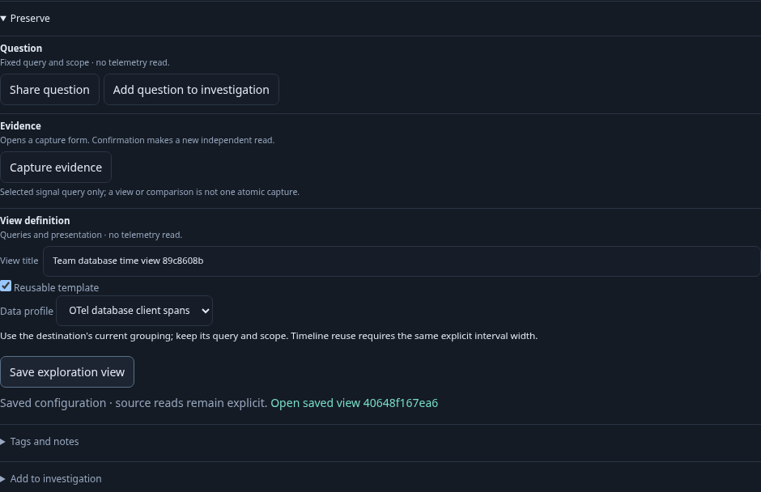
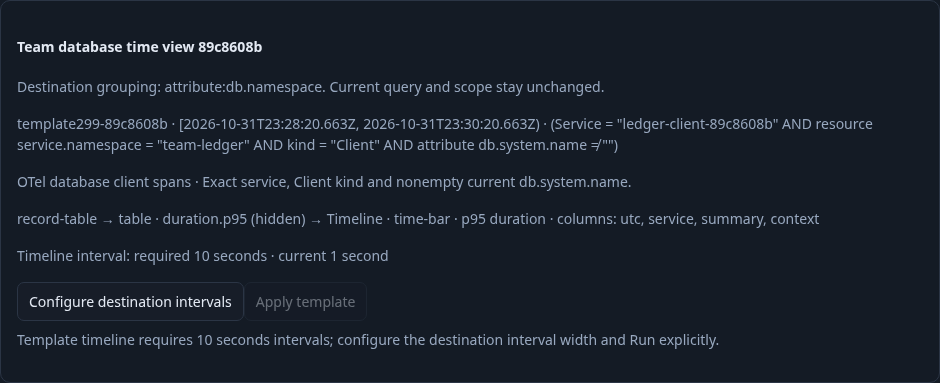
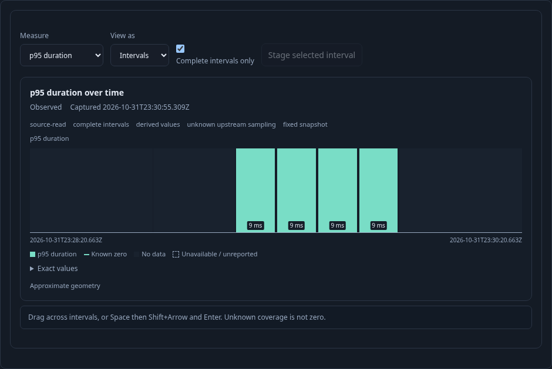

# Reuse a service view without importing its clock — 299

Executable: [299-time-aware-template.spec.js](299-time-aware-template.spec.js).
Contract: [time-aware templates](../docs/TIMELINE_VIEW_TEMPLATES.md).

The generic Go runtime starts without saved definitions. The test ingests standard
OTLP PostgreSQL Client spans for two services/namespaces: three catalog observations
and 102 ledger observations. This is ordinary OTel-shaped fixture telemetry, not a
claim of a real database server or complete instrumentation.

1. **Customize the discovered catalog service.** Start from Database client activity,
   open View settings → Composition and explicitly add a ten-second timeline.
   This stages acquisition without reading. Run the destination-owned query.
2. **Author once.** Choose aggregate Table/p95, timeline p95 and Complete intervals
   only, hide the aggregate and reverse component order. Enable Reusable template,
   retain the database-client profile and Save through Preserve. These native
   controls preserve records → hidden aggregate → timeline. No source JSON or
   API-seeded definition is used in the main journey.
3. **Move to another service.** Customize the ledger client and replace grouping
   with `attribute:db.namespace`. The service/namespace, fixed bounds, grouping and
   resulting values differ. Run obtains 102 observations in the target scope.
4. **Discover the acquisition requirement.** Inspect the saved template from the
   existing catalog. A destination without intervals refuses Apply before an
   expansion POST. Configure destination intervals reveals and focuses the existing
   width control; it does not change the query or read data. Choose one-second
   intervals and Run explicitly. Inspection still refuses: the authored ten-second
   requirement is not silently translated or imported from the source question.
5. **Repair deliberately.** Use the same recovery control, stage ten-second width
   and Run. Inspection now makes one pure expansion call and explains the timeline
   kind/measure and required/current widths. Apply changes presentation only,
   retaining the exact destination question and held evidence.
6. **Read and page independently.** Run explicitly again. The p95 timeline and
   Complete intervals only remain selected. Paging to offset 100 obtains two rows
   while the timeline's identity, revision and read clock remain held. A row page
   is not the timeline's population denominator or a completeness witness.
7. **Save and reopen.** Save the destination through Preserve. Its composition is
   byte-equivalent to the authored source composition, while its stored query is
   the destination's page-zero question. Reopen stages it without reading; Run
   again sends exactly that destination question. The source template remains
   unchanged.

The main journey checks eight Explore HTTP requests (two service overviews and six
explicit population Runs), one record-page request and two view saves; no capture
or document publication. Ingestion/readiness polling is separate. These counts are
HTTP requests, not physical SQL statements. Five actual save/expansion request and
response pairs are checked with the existing OpenAPI validator.

An observed 22-step Quint lifecycle constrains read/page/save conservation and
staged state; seven corrupt traces and an unfinished prefix must fail. One hundred
Hegel cases invoke the actual Go expansion and JavaScript handoff: successful
cases vary widths, signals/profiles, measures, qualified fields, order, hidden
roles, custom title and completeness metadata; refusal cases cover missing or
mismatched acquisition, excessive interval counts, unavailable duration support,
split intervals, unsupported kinds and captured-comparison children. Title
preservation is exercised through the supported declaration API; this milestone
does not add a native timeline title editor.

The independent optional Bombadil campaign opens the saved destination, Runs it,
changes the local timeline measure, rediscovers the source template, previews and
applies it, and pages the records. Completion requires restored p95/complete-only,
offset 100/two records and an unchanged held timeline. Its budget is one Explore,
one expansion, one page and zero writes.

The three bounded screenshots come from the real app. Screenshot-only styling
hides the unrelated sticky investigation trail; product UI and telemetry are not
mocked.

