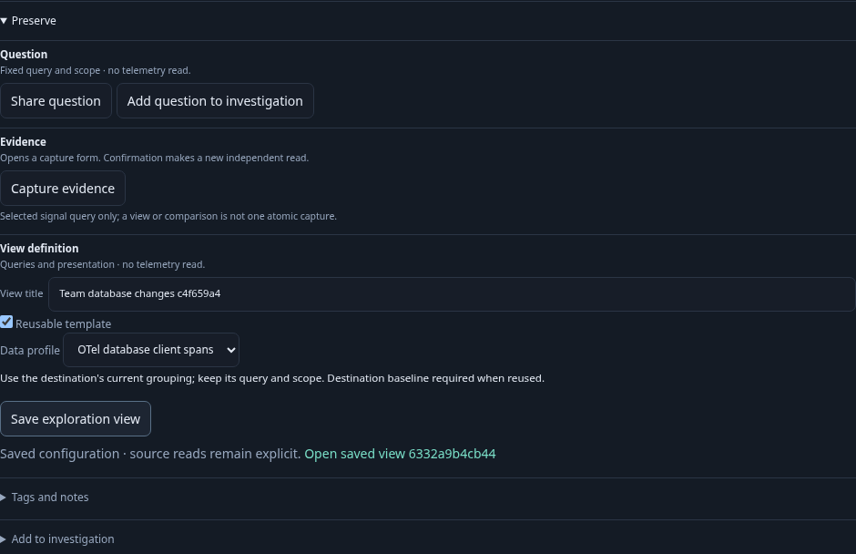
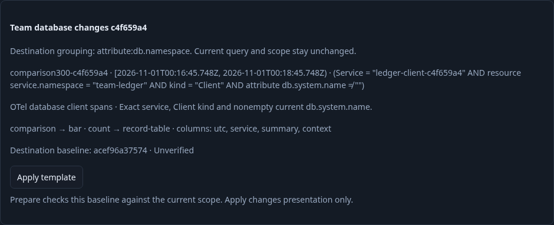
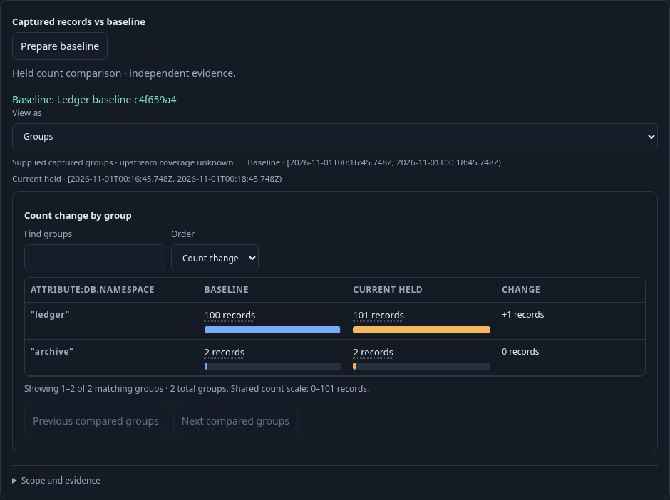

# Reuse a comparison with the destination's evidence — 300

Executable: [300-comparison-template.spec.js](300-comparison-template.spec.js).
Contract: [comparison templates](../docs/COMPARISON_VIEW_TEMPLATES.md).

The isolated generic runtime starts without saved definitions. Standard OTLP
PostgreSQL Client spans describe catalog and ledger services in separate namespaces.
The native service defaults are customized; their status measure is explicitly
removed through the existing controls to enter the captured-count profile. Both
baseline captures are created through native Preserve → Capture evidence, not
API-seeded definitions or mocked results.

1. **Author a comparison.** Run the catalog scope, capture its three observations,
   choose that baseline, Prepare and display grouped count changes. Save as a
   reusable template. The binding explicitly declares a destination baseline;
   the stored catalog capture is only a validation specimen. Returning from native
   capture restores fresh metadata/record controls over the held read without
   another Explore; reattached old Set/trace handlers remain retired.
2. **Move to the ledger scope.** Customize the other service, group by
   `attribute:db.namespace`, Run and capture 102 observations. Ingest one later
   matching record and Run again to observe 103. Scope, grouping and evidence
   differ from the authoring service.
3. **Require a choice.** Inspecting without a destination baseline refuses Apply.
   Explicitly choose the catalog capture as a negative control. Preview/Apply only
   bind this chosen ID; they do not read evidence or claim that it is compatible.
   Prepare reads that capture and refuses its wrong root before a comparison POST.
4. **Retire a late preview.** Hold an actual old-baseline expansion response, change
   the current picker to the ledger baseline, then release the old response. It
   cannot re-enable the old Apply. Inspect again for the current choice.
5. **Bind, then verify.** Preview names the chosen ledger baseline as unverified.
   Apply changes presentation without any evidence/source read. Prepare loads the
   ledger capture and compares 102 to the held current 103. The source capture
   is never fetched implicitly or copied into the destination definition.
6. **Page and preserve.** The next record page contains three observations while
   the prepared pair stays held. Save the target, reopen without reading and Run
   explicitly; the existing Run preparation effects re-verify the target baseline.
   Its exact query, grouping, binding and all presentation except the intentionally
   substituted baseline ID survive.

The main lifecycle performs six Explore HTTPs, one page request, two native
captures, two saves, five expansions, three comparisons and four capture loads.
The source capture is loaded only for its original preparation and the explicit
wrong-root negative control; the two later target preparations use only the chosen
ledger baseline. Ingestion/readiness polling is separate from these HTTP counters.

A separate post-ledger lane submits a real Keep with its successful response held,
navigates away and returns with its checked selection retained. Paused controls
stay disabled while explicit Run offers page replacement. No read or retry occurs
on return; releasing the old response cannot paint the new page. Explicit Run
adds one Explore/preparation and no second Keep. This lane is recorded separately
from the completed template lifecycle, not hidden in its request budget.

The observed Quint ledger constrains source reads, page reads, saves, captures,
comparison/expansion calls and capture loads. Eight corrupted ledgers and an
unfinished prefix must fail. One hundred Hegel cases exercise actual Go expansion
and JavaScript request/response admission, including hidden comparison/timeline
roles, explicit source-equal choice, typed target scopes and invalid/missing inputs.
They do not treat a syntactically valid capture ID as compatible evidence.

The optional independent Bombadil campaign opens the saved target, explicitly
Runs, rediscovers/applies the source template using the current destination
reference, explicitly Prepares again and pages the records. Its bounded budget
includes one Explore, one expansion, one page, two preparations and zero writes;
loading the forbidden source capture is an invariant violation.

Screenshots are captured from the actual application. Capture-only styling hides
an unrelated sticky investigation trail; UI and telemetry are not mocked.

