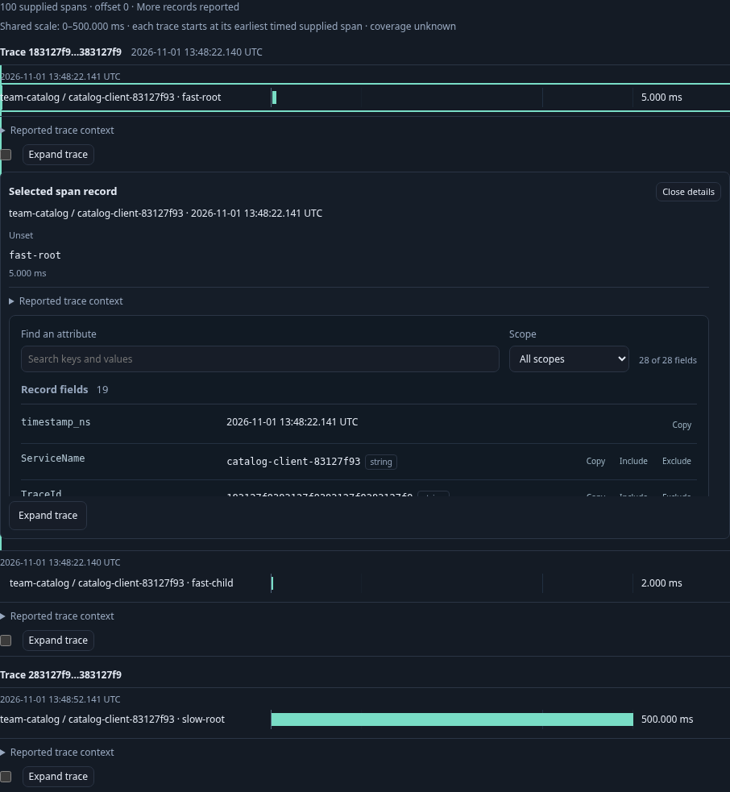
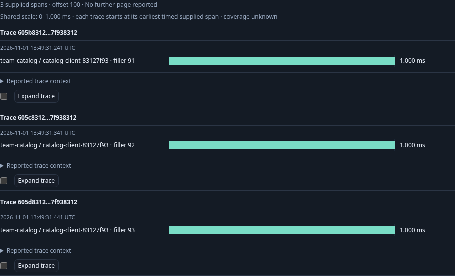

# Inspect where time went in supplied spans — 301

Executable: [301-supplied-span-waterfall.spec.js](301-supplied-span-waterfall.spec.js).
Contract: [supplied span timing](../docs/SUPPLIED_SPAN_WATERFALL.md).

The main journey starts a generic Go runtime with no saved definitions. Standard
OTLP database-client spans describe two services, several traces spread over a
minute, a five-millisecond fragment and a 500-millisecond fragment, a reported child
whose timestamp precedes its parent, duplicate parents, missing parents and
cycles. A worker span in the fast trace belongs to another service and is outside
the original service-filtered page. Readiness polling is fixture setup, excluded
from browser request accounting.

1. Discover the catalog client and Customize its existing database view. Add the
   existing ten-second count timeline explicitly, then Run its own fixed query.
2. Choose Span waterfall locally. The same 100-row page from 103 observations is
   retained, with the aggregate/timeline identities and clocks held. A reattached
   old Table action cannot read another trace. Parent information remains explicit.
3. Compare five and 500 milliseconds on one duration scale, with per-trace supplied
   origins. UTC remains available. Earlier trace fragments do not turn into tiny
   slivers because the page spans a minute. The chart is not complete trace latency.
4. Select a visually first row whose parent-first display position differs from
   its original page index. Keep resolves the exact original observation, question
   and basis; changing kind is refused while selected. Clear explicitly.
5. Activate the fast span with the keyboard. Shared Inspect shows structured
   attributes without a read. Expand trace explicitly then returns all three
   captured spans, including the other service's worker; no automatic expansion
   occurred when the waterfall was selected.
6. Save the timing composition as a reusable template. In the other service,
   configure its own intervals and different grouping, Run, inspect/apply the
   template locally, then Save and reopen. Its destination query remains its own.
7. Reopen the source template, Run explicitly and page to offset 100. The three
   remaining rows use a new page basis; the aggregate and timeline remain held.
   Reattaching a retired waterfall action cannot regain authority.

The observed lifecycle checks source/read/publication conservation, with corrupted
ledgers and unfinished prefixes rejected. Generated cases run the actual Go and
JS declaration validators plus geometry, rather than duplicating the production
validator. They exercise exact translation invariance, original positions, common
scales, ambiguous/invalid identities, cycles, zero and malformed timing.

The optional independent Bombadil actor Runs the saved source, selects/Keeps a
row, refuses kind replacement while selected, clears, changes Table/waterfall,
pages and inspects. Completion requires the held timeline, three rows at offset
100 and the exact request budget; no nested interactive controls or horizontal
overflow are allowed.

A separate public-component lane derives data from one real OTLP observation and
explicitly adds synthetic invalid timing/trace rows. Serialized HTML and detached
property updates retain all three positions, eight qualified fields and inert
mounting slots. Rich empty/null/missing values stay distinct. Invalid replacement
withdraws old handles and observed metadata; opening passive rows/Details performs
zero POSTs. This is a supplied-data contract test, not a second unseeded authoring
journey or a claim that malformed rows came through the collector.

The native journey also checks keyboard Inspect/Close focus and pressed state,
zero group-card padding/border/radius, no nested interactive controls and no document
overflow at 375 px. The first frame is an actual bounded component clip showing
the shared scale, fast-span inspection and slow span together.

The three bounded screenshots come from the real application. Capture-only
styling hides an unrelated sticky investigation trail; no product UI data is mocked.

