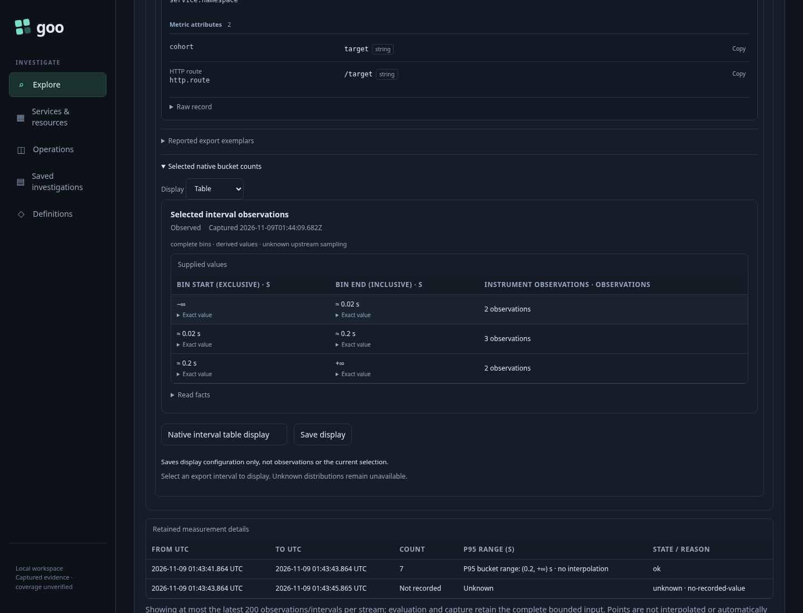
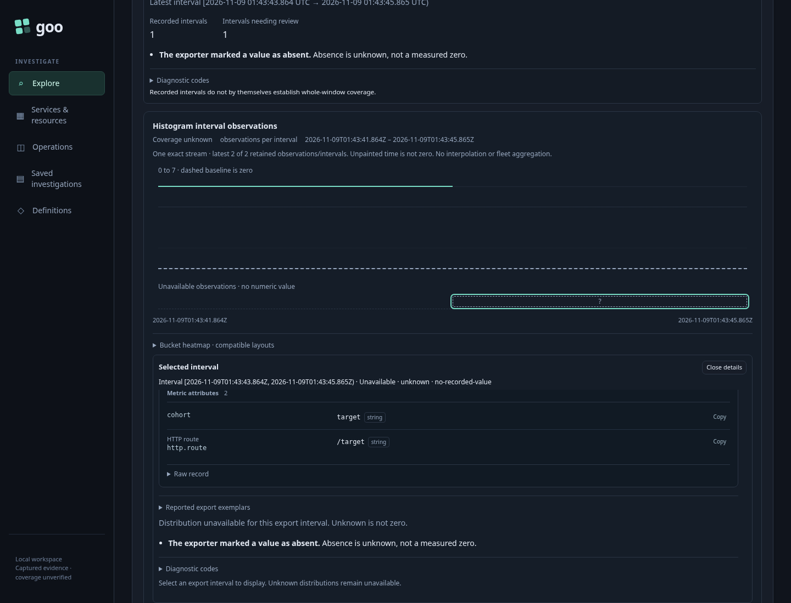

# Reuse a native histogram display

The operator already has a useful table over one instrument's real export interval. They save its display configuration, then apply it to a different bounded measurement question. Goo preserves the destination question and waits for an explicit source read and interval selection.

Executable: [371-native-histogram-reuse.spec.js](371-native-histogram-reuse.spec.js). Independent data: two OTLP histogram instruments ingested into ClickHouse. The donor has four observations in buckets `1/2/1` with bounds `.01/.1 s`; the destination has seven in `2/3/2`, bounds `.02/.2 s`, and a separate unknown export interval.

1. Run the source question, select its actual export interval and choose **Table**. **Save display** stores a content-addressed configuration ID. It stores no captured bins or selected interval. Changing display and saving preserve the existing measurement question, revision, basis and read timestamp.
2. Preview the destination with its own typed environment policy, namespace, service, attributes, exact stream and nanosecond bounds. Open **Save or share → Native view**, load the ID and inspect its configuration. **Apply display** keeps that entire destination question, clears any old result and stages an explicit Run. Save, Load and Apply make zero telemetry reads and zero ClickHouse queries.
3. Run once. No export interval is selected automatically. Select the destination's known export and open **Selected native bucket counts**. The table has `2/3/2`, not the donor's `1/2/1`; its exact bounds and total match an independent raw ClickHouse query. Its snapshot has the actual source owner's private complete-bin guarantee and the display requires complete bins.



4. Select the unknown export. Goo displays **Distribution unavailable for this export interval** and no visible bucket table. Unknown data never becomes a zero distribution. Both local selections make zero additional reads.



The journey also releases a successful metadata reply after the ID changes, invokes an actual old Apply callback while its controls are hidden, and cancels a real in-flight source read before releasing its successful reply. Stale work cannot apply a display or publish a result. That cancellation is a deliberately separate additional source read. Wrong units, an ordinary record question and a captured snapshot payload each receive HTTP 400; stored configuration bytes remain unchanged throughout.

The final genuine run passed in 59.5 seconds. The Bombadil campaign independently reached visible completion across 827 observations: load → apply → run → select → display, with exact destination bins and scope, one metrics read, two metadata requests and zero writes. Completion is asserted from observed UI state, not process exit. The compressed actual observation trace, readable summary and stored configuration remain under `artifacts/native-histogram-reuse371`; campaign screenshots were removed during cleanup. The two storyboard images above are actual Playwright frames.

Run against the reviewed binary and existing local OTLP/ClickHouse lab:

```sh
NO_PROXY=127.0.0.1,localhost no_proxy=127.0.0.1,localhost \
GOO_GENERIC_BINARY=/tmp/goo-371-reviewed-goo \
GOO_NATIVE_HISTOGRAM_REUSE_BOMBADIL=1 \
npx playwright test journeys/371-native-histogram-reuse.spec.js --workers=1
```
