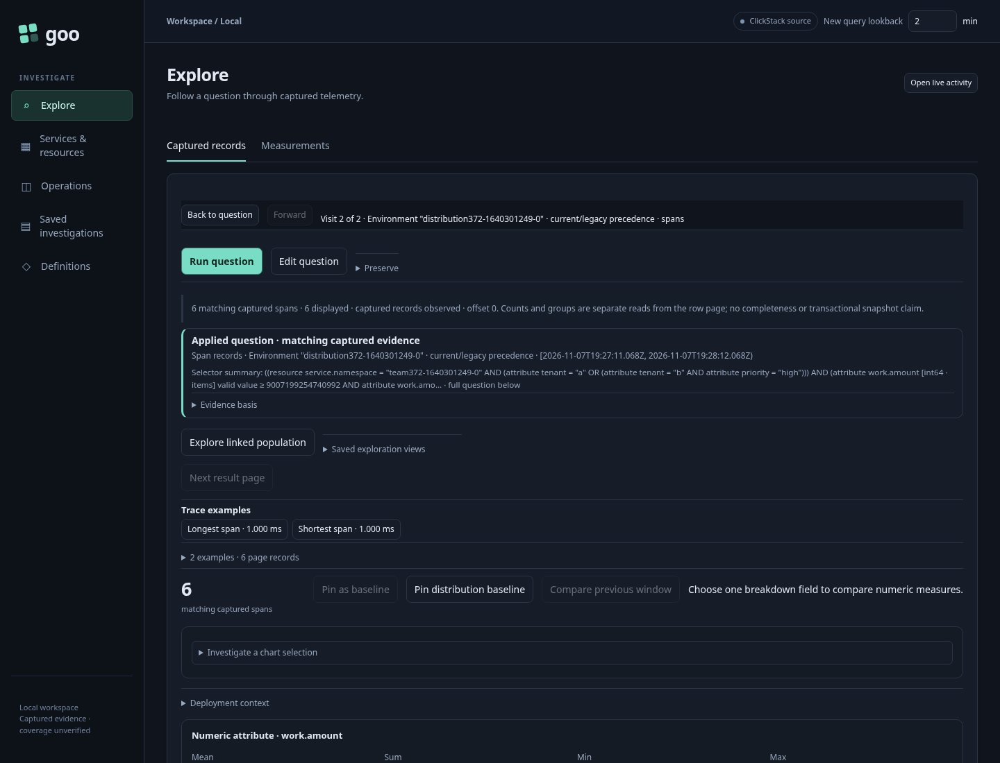
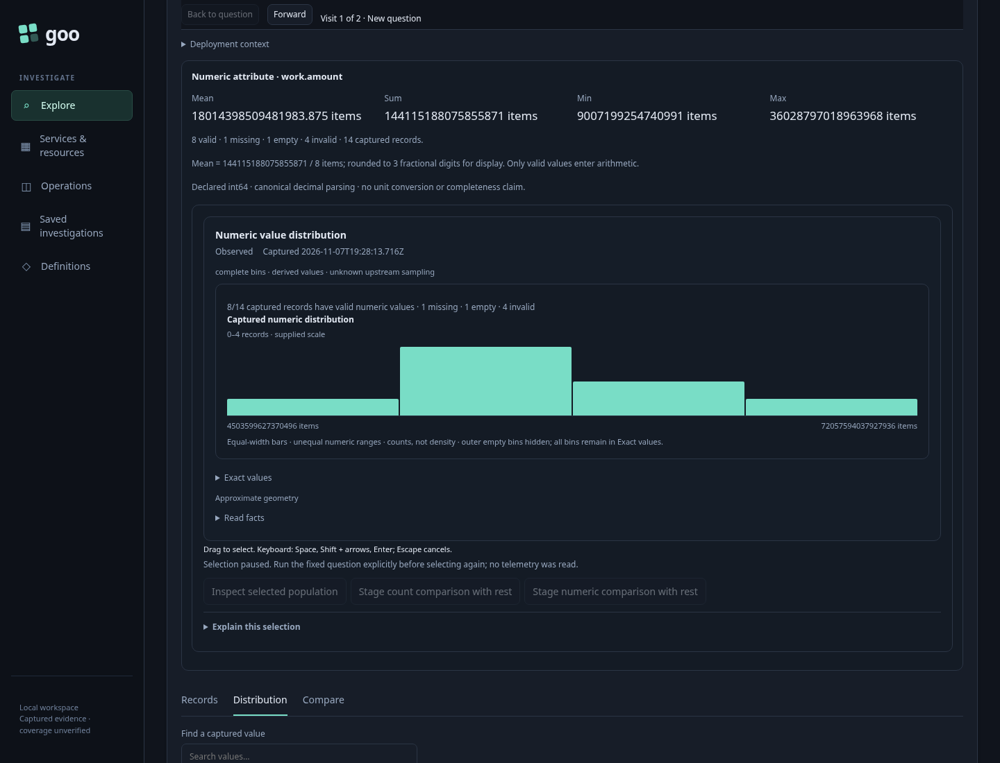

# Inspect a typed distribution population

An operator sees a suspicious quantity range in ordinary telemetry and wants to inspect its records without losing the original distribution. The range preserves the declared field namespace, numeric type, unit, fixed window and complete parent selectors.

Executable: [372-typed-distribution-population.spec.js](372-typed-distribution-population.spec.js). Fixtures ingest real OTLP records into ClickHouse. One case uses an attribute `int64` above JavaScript's safe-integer range with an effective environment selector; another uses a resource `decimal64` quantity at scale two with a current-key-only selector. Both include a misleading same-name field in the other namespace, nested filters, malformed values and environment precedence outliers.

1. Open the fixed distribution question and explicitly **Run question**. Independent raw ClickHouse records establish the full population and exact membership. The spans distribution contains 14 records; the logs distribution contains 13. Supplied fixed bins are checked against independent integer arithmetic, rather than reconstructed with the product's bin builder.
2. Focus the lower bin, press **Space**, **Shift + Right**, then **Enter** to select two adjacent bins. The spans range is `[9007199254740992, 36028797018963968)` items; the logs range is `[1.28, 5.12)` USD. Brushing performs no request.
3. Choose **Inspect selected population**. The source-free planner preserves the parent question and adds exact typed range predicates. The child is staged without reading telemetry. Explicitly **Run question** to read its records: six spans or five logs. IDs match the independent raw record oracle, including the half-open upper boundary and correct attribute/resource namespace.



4. Choose **Back to question**. The original distribution DOM, snapshot, basis and question remain held. Back makes zero reads and focuses the parent's enabled **Run question** button. The old Inspect and comparison controls are disabled, with visible guidance: **Selection paused. Run the fixed question explicitly before selecting again; no telemetry was read.** A new source read requires an explicit parent Run; returning does not renew old selection authority.



Invoking the captured old Inspect callback after Back makes neither a planner request nor a source read. The spans case also explicitly reactivates its parent, stages another child, starts a genuine source read and returns before its successful response is delivered. Back aborts that request; releasing its actual HTTP 200 response cannot replace the held parent.

The final journey passed in 1.1 minutes. Its 17 recorded boundaries distinguish source reads from metadata planning: brushing, staging, Back and stale callbacks make zero telemetry reads and zero SQL queries; each explicit Run makes one telemetry request and three SQL queries. The additional cancellation scenario is recorded separately.

Bombadil independently reached positive visible completion across 785 observations and eight phases. It performed two explicit reads, one metadata plan and zero writes. Completion requires exact child IDs and question scope, the original held parent, restored Run focus, all three retired controls disabled and the precise paused message. Its real campaign lasted 45.109 seconds; process exit alone is insufficient.

```sh
NO_PROXY=127.0.0.1,localhost no_proxy=127.0.0.1,localhost \
GOO_GENERIC_BINARY=/tmp/goo-372-reviewed-goo \
GOO_TYPED_DISTRIBUTION_BOMBADIL=1 \
npx playwright test journeys/372-typed-distribution-population.spec.js --workers=1
```

The readable report and compressed actual actor trace are retained under `artifacts/typed-distribution-population372`. The two screenshots above are genuine Playwright frames.
