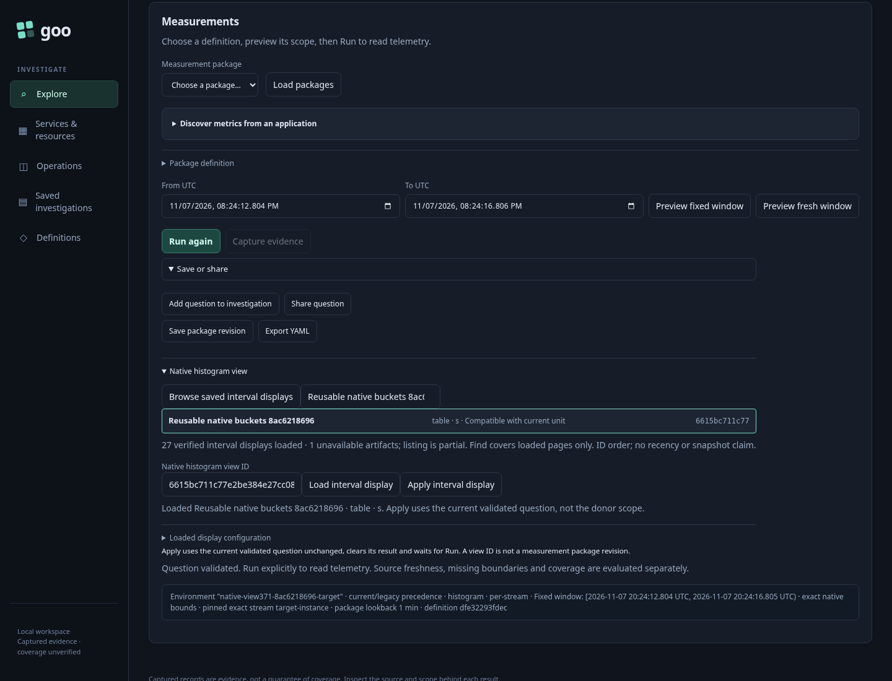
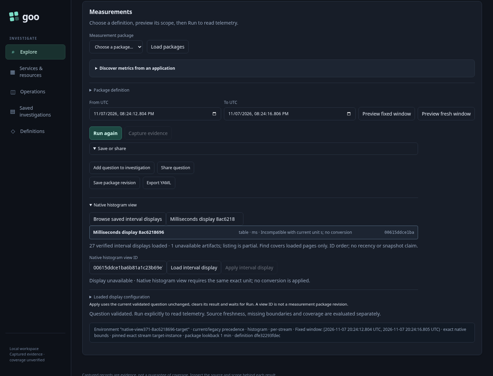
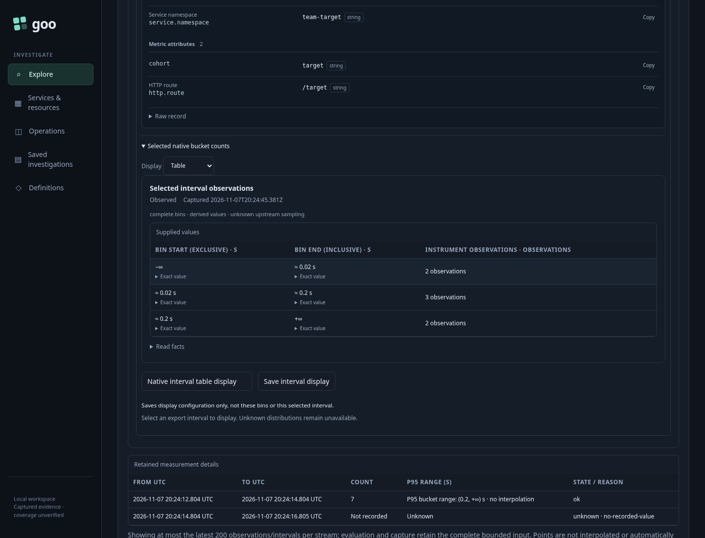

# Discover a saved native histogram display

An operator wants to reuse a useful display without remembering its ID or inheriting another service's scope. The Measurements workspace keeps discovery under **Save or share → Native histogram view**; opening it is passive.

Executable: [373-native-view-library.spec.js](373-native-view-library.spec.js). The fixture reuses real OTLP histograms: the source has four observations in buckets `1/2/1`; the destination has seven in `2/3/2`, with different `.02/.2 s` boundaries, typed environment policy, service, namespace, attributes, exact stream and nanosecond window.

1. Run the source question, select its known export interval, choose **Table** and **Save interval display**. The immutable artifact stores configuration, not bins or a selected interval.
2. Open the destination question in a new visit. **Browse saved interval displays** reads metadata explicitly. The test creates 26 additional configurations through the real metadata API and one intentionally corrupt file in its isolated runtime store. The first page scans 20 candidate IDs: 19 verified summaries and one diagnostic. **More saved interval displays** retrieves eight more verified summaries. The cursor is the last scanned ID, and Find covers loaded pages only. Neither ordering nor pagination implies recency or a transactional catalog snapshot.
3. Use local **Find loaded interval displays** and select **Inspect** on the saved row. Find makes no request. Inspection retrieves the exact immutable artifact and checks its title, kind and unit against the summary before enabling Apply. Raw configuration stays collapsed by default.



4. An `ms` configuration is visibly incompatible with the destination's `s` unit. Inspect shows the refusal and leaves Apply disabled; an actual reuse API call also returns HTTP 400. This configuration exercises metadata compatibility only: the test does not emit or claim any millisecond instrument data.



5. **Apply interval display** preserves the complete current destination question, clears the previous result and waits. Browse, More, Find, Inspect and Apply make zero telemetry reads and zero SQL queries. Explicitly **Run** once, then select an actual destination export interval. Goo does not select the latest export automatically. The table displays `2/3/2`, total seven, with the destination's boundaries—not the donor's bins. Independent raw ClickHouse values and the actual private complete-bin guarantee are checked.



The journey records 14 boundaries. It also verifies direct-ID continuation, a real list reply delivered after current-plan replacement, a page reply delivered after hiding the disclosure, an Inspect reply delivered after changing the ID, and an actual obsolete row callback after Find redraw. These cannot adopt stale metadata or issue unintended reads. The saved source artifact's exact bytes remain unchanged.

The genuine journey and Bombadil campaign passed in 1.0 minute. Bombadil independently reached positive visible completion across 799 observations and ten phases. Its 45.185-second campaign used **three metadata requests total**—one catalog GET, one exact-artifact GET and one reuse POST—plus one explicit telemetry read, zero writes and zero capture reads. Completion requires the visible destination table, exact current scope and bins; process exit alone is insufficient. The main journey separately accepts both metadata pages. The existing 371 reuse/unknown-interval/cancellation regression also passed against the same binary in 12.6 seconds.

```sh
NO_PROXY=127.0.0.1,localhost no_proxy=127.0.0.1,localhost \
GOO_GENERIC_BINARY=/tmp/goo-373-reviewed-goo \
GOO_NATIVE_VIEW_LIBRARY_BOMBADIL=1 \
npx playwright test journeys/373-native-view-library.spec.js --workers=1
```

The readable actual report, stored metadata, compressed actor trace and positive terminal frame remain under `artifacts/native-view-library373`. All three storyboard images above are actual Playwright frames.
