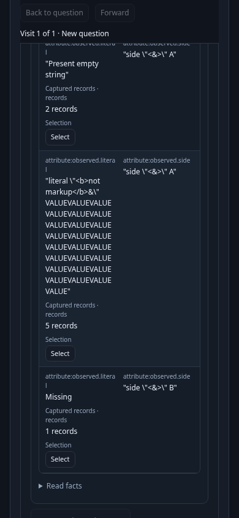
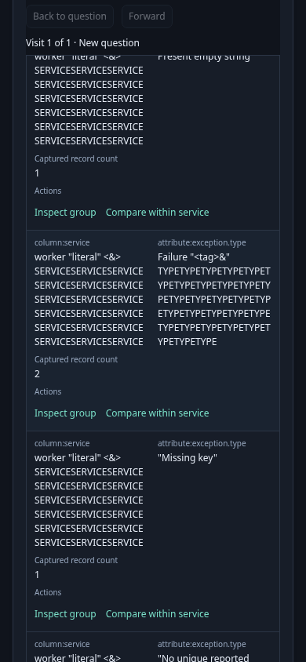
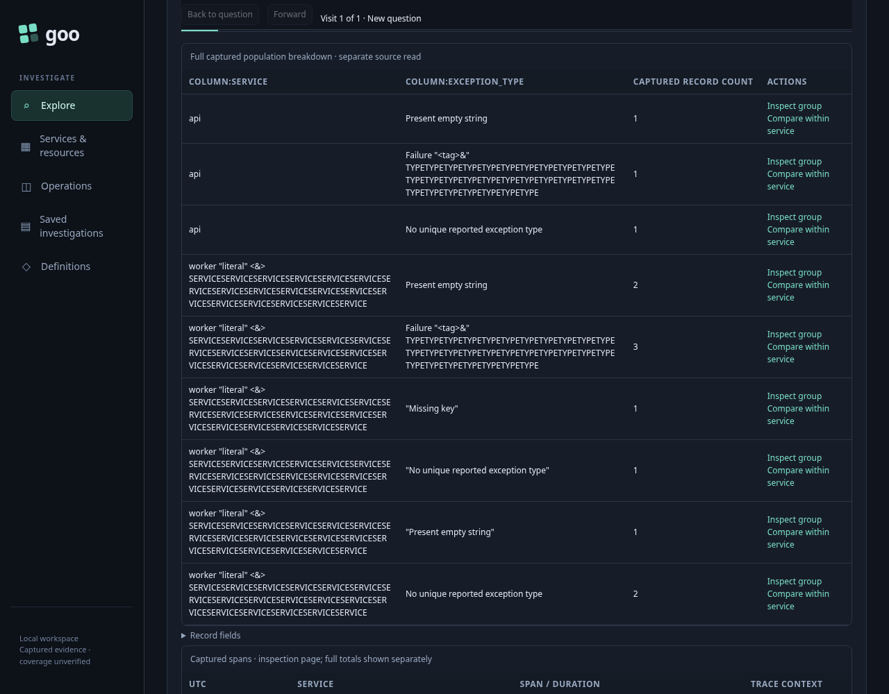

# Read a complete group without panning

An operator reviewing grouped telemetry needs to keep the exact group identity, count and next actions together. Narrow screens now stack the existing cells, retain native column headers and show header-derived labels. Desktop keeps its normal columns. No new query action is introduced.

Executable: [375-grouped-records.spec.js](375-grouped-records.spec.js). Two real OTLP fixtures feed three contexts: ordinary two-field log groups with their existing local Select control; scalar-environment log error triage; and typed-environment span error triage. Values include literal markup-looking text, missing keys, present empty strings, and literal strings equal to the missing/empty labels. Literal labels stay quoted, and continuation URLs retain the original raw values.

The matched baseline and final runs use the **same ingested records, fixed questions and source bases**, without reingestion. This bounded corpus includes a 147-character service, 133-character exception type and 154-character ordinary value. The measurements establish improvement for these records, not a universal fit guarantee for arbitrary strings.

| Context at 390px | Baseline scroll/client width | Final scroll/client width |
|---|---:|---:|
| Ordinary grouped logs | 724 / 262px | 262 / 262px |
| Scalar log triage | 605 / 322px | 322 / 322px |
| Typed span triage | 595 / 322px | 322 / 322px |

All baseline narrow rows required horizontal panning. All final measured rows keep their complete cells and controls inside the viewport without clipping or horizontal scrolling. The largest measured narrow row is 352.5px for ordinary groups and 256px for triage, within the tested 390×844 viewport. Desktop widths remain 896px for ordinary groups and 964px for triage inside the 1280px viewport.

## Ordinary groups: identity, count and local selection

Read the complete literal value and its qualified field label beside the second dimension and count. **Select** remains a local preview: the journey observes its real selection intent, unchanged snapshot and zero reads, then discards that local choice by navigating to the next context. It does not stage an additional source action.



## Triage: inspect the exact population

The existing **Inspect group** and **Compare within service** links remain in each row with its identity and count. At 390px the operator can Tab from Inspect to Compare, Shift+Tab back and press Enter. This stages the exact fixed question with zero reads. Explicit Run reads the matching records; independent raw ClickHouse attributes, events, status and IDs establish membership.



Typed span triage also exercises an empty value, a missing reported type and a literal `No unique reported exception type` string. Their displayed labels and raw continuation predicates remain distinct.


**Back to question** restores the original table, evidence basis, anchors and keyboard focus without rereading telemetry. The focus center is unobstructed. Invoking an actual captured obsolete callback after Back is prevented and cannot navigate or read. Resizing desktop → narrow → desktop → narrow preserves the same table, links and Select nodes.



The final main plus Bombadil campaign passed in 1.9 minutes. The main records 39 boundaries and ten explicit source reads; resizing, local Select, staging, Back and stale callbacks perform zero reads and zero SQL queries. The 390px Bombadil campaign independently reaches positive completion with exact child IDs and question, the held original table and anchor, restored focus, complete row bounds, unobstructed focus and no horizontal pan. Its 737 observations span seven phases over 45.206 seconds, with two reads and zero writes.

Six actual Chrome accessibility-tree snapshots cover all three contexts at desktop and narrow widths. The evidence also records native `th scope="col"`, cell positions and header-derived labels. Chrome retains table, column-header, row and cell roles, plus the existing buttons and links. This is observed Chrome structure and keyboard behavior, not an exhaustive screen-reader or cross-browser accessibility claim.

To reproduce the matched comparison, first run with `GOO_GROUPED_RECORDS_BASELINE=1` and the preserved baseline binary. Then use its saved `fixture.json` and `summary.json` with the final binary:

```sh
NO_PROXY=127.0.0.1,localhost no_proxy=127.0.0.1,localhost \
GOO_GENERIC_BINARY=/tmp/goo-375-reviewed-goo \
GOO_GROUPED_RECORDS_INPUT=/workspace/goo/artifacts/grouped-records375-baseline/fixture.json \
GOO_GROUPED_RECORDS_BASELINE_REPORT=/workspace/goo/artifacts/grouped-records375-baseline/summary.json \
GOO_GROUPED_RECORDS_BOMBADIL=1 \
npx playwright test journeys/375-grouped-records.spec.js --workers=1
```
