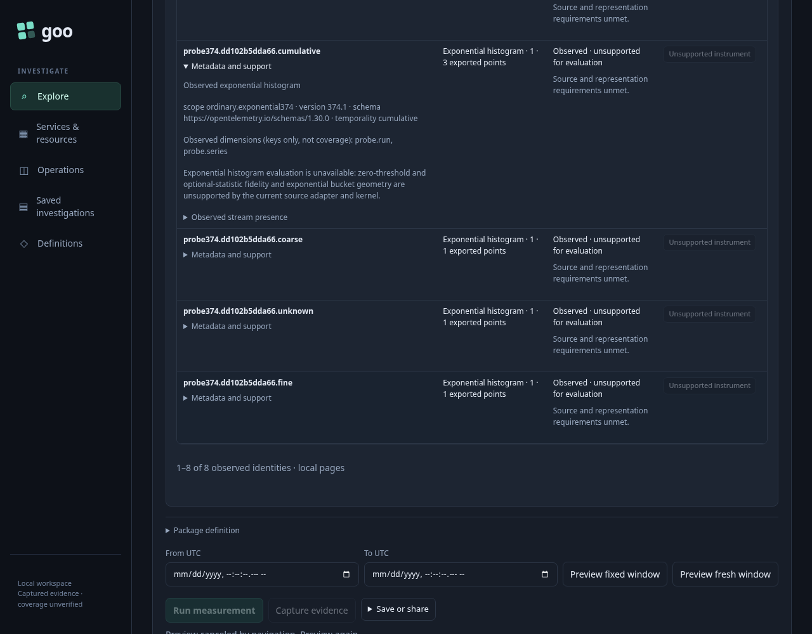
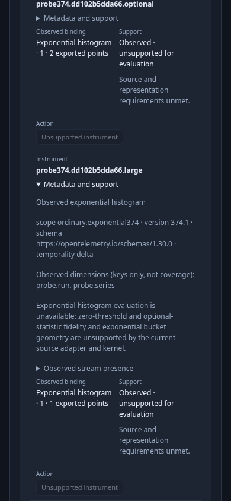

# Discover an unsupported instrument honestly

An operator opens metric discovery through the existing fixed-scope `goo:discover-metrics` handoff. This journey supplies that existing handoff directly; automatic all-signal service inventory still omits exponential-only services.

Executable: [376-unsupported-instruments.spec.js](376-unsupported-instruments.spec.js). It reuses the retained real OTLP probe from round 374 and the supported explicit-histogram sibling from round 373, without ingesting replacement records. Independent raw ClickHouse rows establish the exact bindings and exported-point counts.

1. The fixed environment, namespace, service and time window arrive without a source read. **Discover instruments** explicitly reads the catalog: eight exponential-histogram identities account for thirteen exported points. The large-count instrument is one exported point even though its observation count is 9,007,199,254,740,998.
2. **Metadata and support** exposes the qualified scope, version, schema, temporality, observed dimension keys and exact unsupported reason. The row says **Observed · unsupported for evaluation**. Its disabled **Unsupported instrument** action cannot create a definition or plan, including direct invocation of its actual callback. The existing manual package editor stays unchanged and Run stays disabled.
3. At 390px, the instrument identity and selected metadata span the catalog width. The remaining binding, support and disabled action remain inside the viewport without horizontal panning. Inspecting and resizing perform no telemetry read.

The supported sibling is a separate exact scope. Discover reads its two explicit-histogram exports; **Build measurement package** previews configuration without reading telemetry. Only explicit **Run measurement** reads the selected source. The known interval preserves its independently expected seven observations and bucket counts 2, 3, 2.

Chrome accessibility diagnostics retain the native catalog table and column-header names at the narrow viewport. This is an observed browser structure, not an exhaustive screen-reader claim. The actual optional-table-present result has no availability diagnostic; missing-table and probe-error cases are covered separately by backend/property checks, not fabricated in this browser session.

Initial actor campaigns exposed two test assumptions: the preexisting manual YAML editor is not empty, and the row’s first button belongs to nested stream presence rather than the unsupported action. The corrected actor captures that initial value and requires it to remain unchanged, while independently requiring disabled Run and zero plans, measurements and writes. Successful completion must be visibly observed in its actual snapshots; process exit alone is insufficient.

The final native journey and actor passed in 45.8 seconds (48.0 seconds including harness startup). Sixteen recorded boundaries include three explicit source reads: two discoveries and one supported measurement run. There is one configuration-plan request. The main workflow uses five raw SQL calls; including the actor’s separate discovery brings the total to seven. The independent 390px actor records 642 observations across six phases over 35.068 seconds, with one discovery read and zero plans, measurements or writes. Its terminal positive frame and compressed actual trace are retained. The measured narrow catalog is 288px wide with equal scroll/client widths and zero horizontal scroll.
