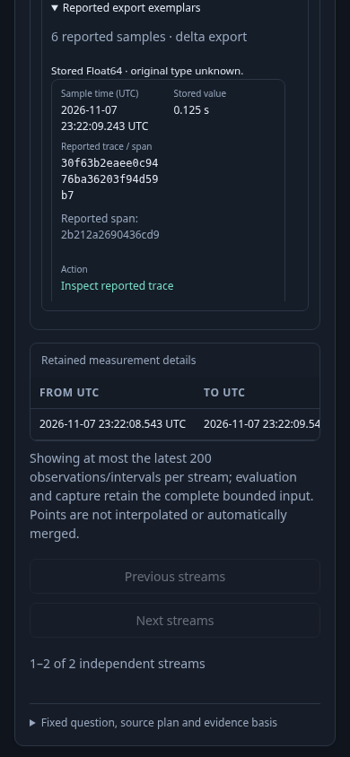
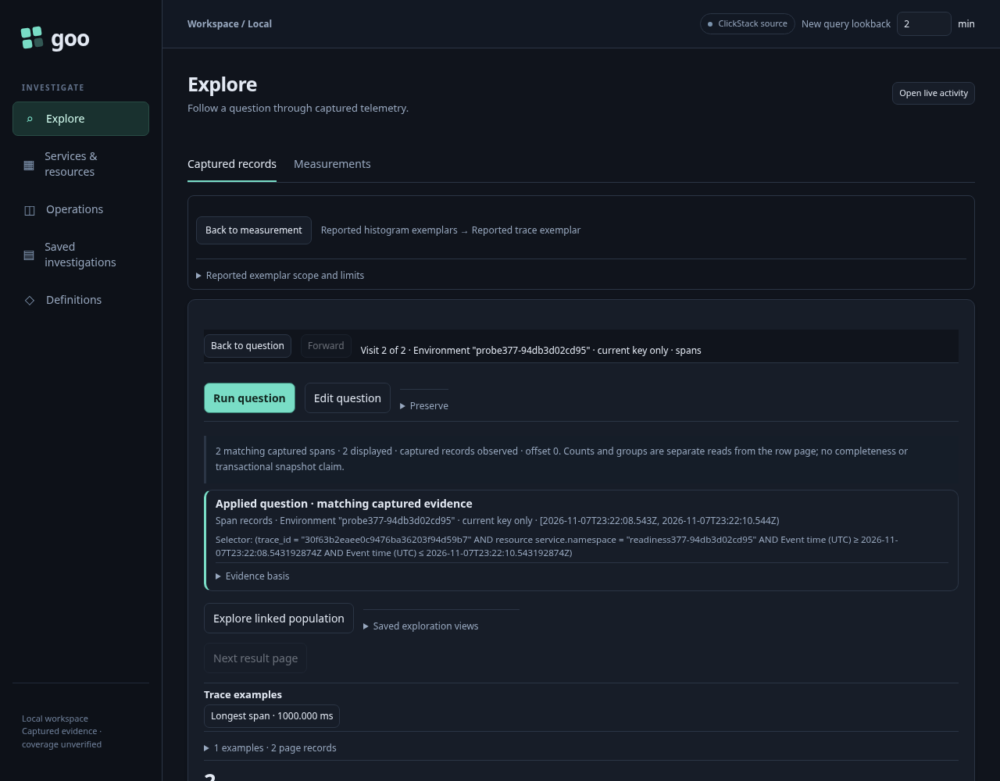

# Follow a source-reported exemplar

This bounded journey starts with the retained real OTLP histogram probe from round 377. It introduces no replacement ingestion. The operator explicitly runs a fixed histogram question, selects one source export and inspects the exemplars that exporter actually reported.

The intended flow is selected export → reported sample → staged trace question → explicit Run → held source export. A trace ID is a reference for a scoped search, not proof that the trace is present. The span ID is a display hint, not an extra predicate. Keeping the original fixed window, exact nanosecond bounds, typed environment and namespace while dropping metric, service and instance filters lets the known trace include both its root service and peer service.

The independent raw corpus contains three histogram exports, seven reported samples and four span rows. Two span rows reuse the same trace/span IDs in another environment or namespace. The journey must admit only the two original scoped spans. The source export’s ordinal, reported timestamp, trace/span IDs, attributes and stored Float64 value remain inspectable; a value’s original OTLP numeric type cannot be recovered from this exporter’s stored value.

No reported exemplars, unavailable exemplar information and a reported sample without a usable trace reference are distinct states. A missing trace ID has no follow action; a usable trace ID without a span ID can still stage the trace question. A large integer rounded into stored Float64 must not be presented as an exact original integer.

Executable: [377-histogram-exemplars.spec.js](377-histogram-exemplars.spec.js). The native journey inspects the empty export, then all six samples in the primary export. The missing trace has no action; the trace-only sample stages without a read. **Back to measurement** retains that source report. A new explicit parent Run reactivates source actions before the primary sample is followed.

The primary action stages the ordinary span question without a read. Explicit **Run question** returns exactly the known root and peer spans; matching IDs in the foreign environment and namespace are excluded. **Back to measurement** restores the original report/table/anchor nodes, evidence contents, keyboard focus and page scroll without rereading. The visible paused notice requires an explicit measurement Run before using source actions again. Invoking the captured retired callback remains inert.

The raw source probe has no unavailable-export example: that distinction is validated by focused adapter/property tests, while this browser run proves the actual reported-empty and reported-reference paths. Chrome's raw accessibility tree and native `th scope="col"` observations are retained as diagnostics; they are not an exhaustive assistive-technology claim.

Initial browser attempts corrected harness assumptions: the native return control is **Back to measurement**, and `service.namespace` must not be rejected by a substring test for `service.name`. The initial actor also selected a hidden cached empty-export panel; its final observation binds the exact selected export end. These diagnostic reports remain separate from the accepted run.

The final native journey plus actor passed in 54.4 seconds (56.7 seconds including startup). Eleven observed boundaries account for three explicit source acquisitions and five source SQL calls in the native journey: two parent measurement reads and one child record acquisition. Staging, local inspection, both returns and retired callbacks perform zero reads and zero writes. The separate 390px actor has 775 observations across seven phases over 45.224 seconds, two source acquisitions and zero writes. Its actual trace and positive terminal frame are retained; shared proxy totals include four additional SQL calls from this actor.

The actual parent HTTP response is 10,356 bytes. The supplied exemplar report serializes to 2,374 UTF-8 bytes using JSON.stringify; this projection size is not a raw-wire slice measurement. The measured narrow table has equal 259px scroll/client widths, zero horizontal scroll and a 390px document. Back restores page scroll to the original 3,160px and focuses the original Inspect reported trace anchor.

A measured content review moved lengthy source bounds and causality/scope caveats into a closed **Scope and limits** disclosure after the table. The visible cue remains **Stored Float64 · original type unknown.** The final 390px frame proves the first sample’s actual data and action content fit inside the inspector scroll region: its action ends at 326.844px inside the 335.844px region. The row’s trailing border/padding extends 1px below that region, so this does not claim the entire row border fits. The earlier 12px action-clipping diagnostic is retained separately.
