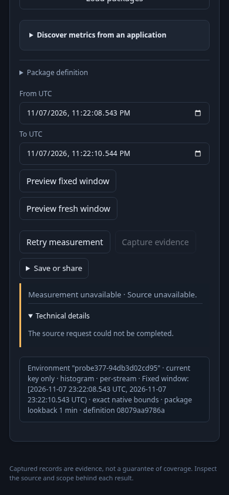
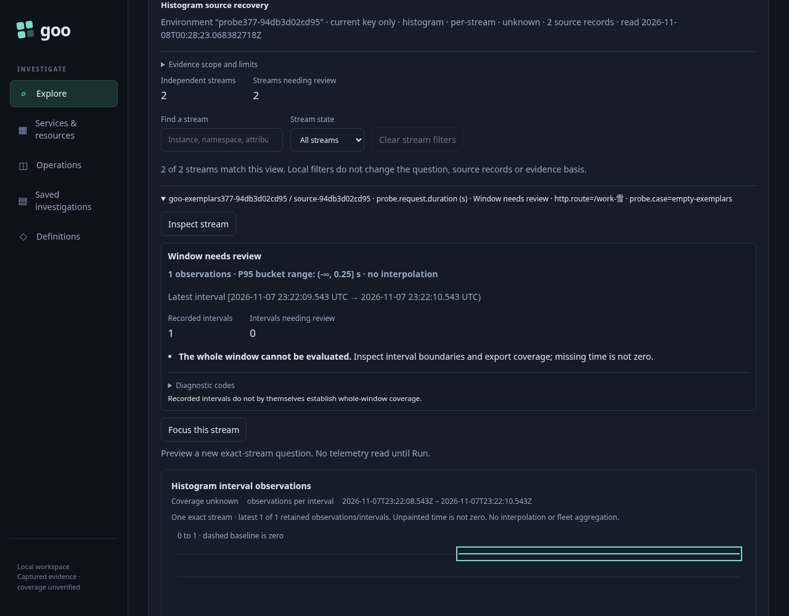

# Recover a fixed native measurement question

Status: delivered and actually exercised on the reviewed Go image.

The operator opens the existing Measurements surface with the retained 377 histogram question. The fixed question carries its original nanosecond bounds, typed environment, namespace and metric binding. This is the existing measurement-step entry, not a newly implemented inventory flow. No replacement telemetry is ingested.

1. Preview is metadata-only. **Run measurement** performs one bounded source acquisition. A planted upstream refusal is rendered through the shared source-refusal component; the source's raw error prose is not displayed. Capture remains disabled, and the failed question is not an empty/healthy result.
2. **Technical details** is a local disclosure. Waiting, inspecting details and invoking hidden, inert, disabled or detached recovery callbacks perform no read. **Retry measurement** is an explicit source read of the exact failed question, including original nanoseconds and display intent; it does not select a fresh lookback or re-preview.
3. Real ClickHouse recovery returns the two retained histogram exports and their known counts, 6 and 1. The refusal and Retry disappear, Capture becomes available, and the old callback cannot replace recovered evidence or read again.
4. A malformed successful-HTTP source body is a distinct rejected-source state, not no-data. It can recover through the same exact retry path. Editing or leaving Measurements retires a failure's callback; returning does not reactivate it.
5. Cancel a genuinely held source retry. The source connection closes, the UI remains cancelled with no Retry and no captured result, and a late refusal cannot replace that state.
6. Hold a genuinely successful Go/ClickHouse response after backend completion. Leave Measurements, return, and deliver that original response. It cannot replace the withdrawn owner, publish recovered evidence or reactivate the obsolete callback.

The journey independently reads the actual retained source rows. Only failures are planted at a scoped upstream boundary; successful API responses and telemetry are never fabricated. A separate Bombadil campaign must visibly recover real data, preserve the exact question, reject the old callback and complete with two source acquisitions and zero writes. Process exit alone is insufficient.

Actual frames, visually reviewed:

The native journey plus actor passed in **47.4s** (50.5s including startup).
Twenty-one recorded boundaries cover **10 native source acquisitions / 10 SQL
queries**, six metadata plans and zero writes. The separate actor records **633
observations across six phases over 35.105s**, with two reads, zero writes,
exact-question equality, visible recovered data and an inert obsolete callback.
The full source proxy records 12 SQL calls including the actor's two.

Successful acquisition does not make the measurement healthy or complete: these
independent streams still have unknown whole-window coverage. The recovered frame
honestly retains that state while showing the real source exports and counts.

Both main Playwright PNGs show current native UI. Bombadil's JPEG files froze after
the inspected-refusal phase even while its actual DOM snapshots reported recovery;
those JPEGs are not claimed as positive visual evidence. The compressed original
trace and a visually verified refusal frame are retained separately alongside the
main recovery PNG. The compact artifact directory is about **0.58MB**.

Executable: [378-native-recovery.spec.js](378-native-recovery.spec.js). Set `GOO_NATIVE_RECOVERY_BOMBADIL=1` to include the positive actor; use an explicitly reviewed `GOO_GENERIC_BINARY`.
