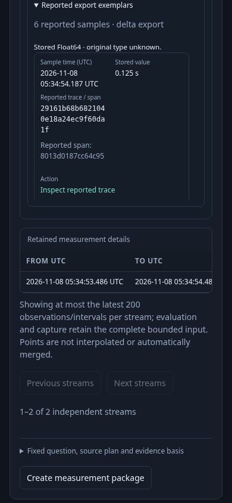
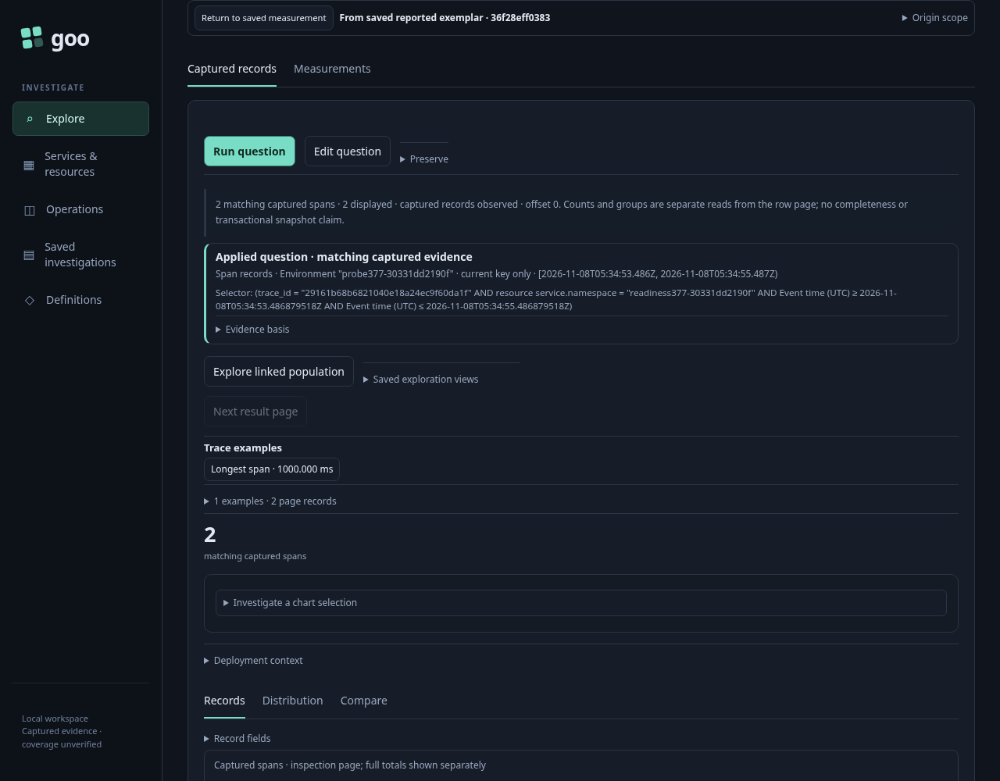

# 380 — follow a reported exemplar from Saved evidence

Implemented and validated with a real Go runtime, Playwright and Bombadil. Reuses
377-shaped real OTel histogram exports and same-trace environment/namespace
decoys. The restored environment retained old histogram points but the trace TTL
had expired; a fresh uniquely scoped actual OTLP fixture is prepared separately
for 380 rather than fabricating source responses. The journey itself injects no
telemetry. One explicit capture creates immutable app custody in an isolated
runtime; browsing and following that capture create no additional custody writes.

1. Open the immutable measurement capture. Select its primary source export and
   inspect the reported samples. Stored source Float64 values retain their
   unknown-original-type warning; a sample is a reported association, not proof
   of causality, bucket contribution or a complete trace.
2. Follow **Inspect reported trace**. The child is a draft under the original
   measurement window, checked environment policy and exact namespace. Citation
   retains capture receipt/basis, exact source row, export bounds and sample ordinal.
   Staging reads neither source telemetry nor stored evidence again.
3. **Run question** reads fresh spans by reported trace ID. The two matching
   root/peer spans are distinct services; same-trace environment and namespace
   decoys remain excluded. The reported span hint is not a query predicate.
4. **Return to saved measurement** restores the same selected export DOM and focus,
   without a source/store read or mutation of the capture. Prior callbacks cannot
   reactivate navigation. The current Saved owner may follow another sample using
   a newly bound lease; it never needs to rerun or replace immutable metric evidence.
5. Source refusal and an actual late-success response preserve the same held
   return. Back cancels pending record acquisition; late delivery cannot overwrite
   the retained Saved view.

Actual frames:

The real journey passes in **46.8 s** (49.7 s including runner startup). Independent
raw reads observe three histogram exports and four same-trace records; exactly
the original environment/namespace/window root and peer are returned. Eleven
recorded phase facts prove no source/receipt rereads during inspection, stage,
return and retired actions; three explicit record reads cover success, refusal
and a held actual late 200. Capture bytes and held DOM remain unchanged.

Source-free staging still runs the existing Explore metadata lifecycle: GET
recipes and retained-evidence status, distinct from telemetry or capture reads.
Returning during a pending run sends one cancellation control request; it does
not read evidence. Ordinary completed/refused Back makes no network request.

Bombadil records **931 DOM states** over 40.068 s with positive exact-question,
record-membership, held-origin/focus and no-pan completion. After the initial
Saved read, it makes one explicit source read, no metric reads, no further receipt
reads and no custody writes. The final JPEG was visually verified as current
expanded Saved metadata; one frame, compressed trace and paint/replay limitation
are retained while 931 repeated JPEGs are removed.

Actual report:
`artifacts/saved-exemplars380/d32de947-7594-401c-884d-9cd41eca7377/summary.json`.
The actual report is also projected through the existing population-drilldown
model in a separate verification step; model results are recorded in VALIDATION.md.

