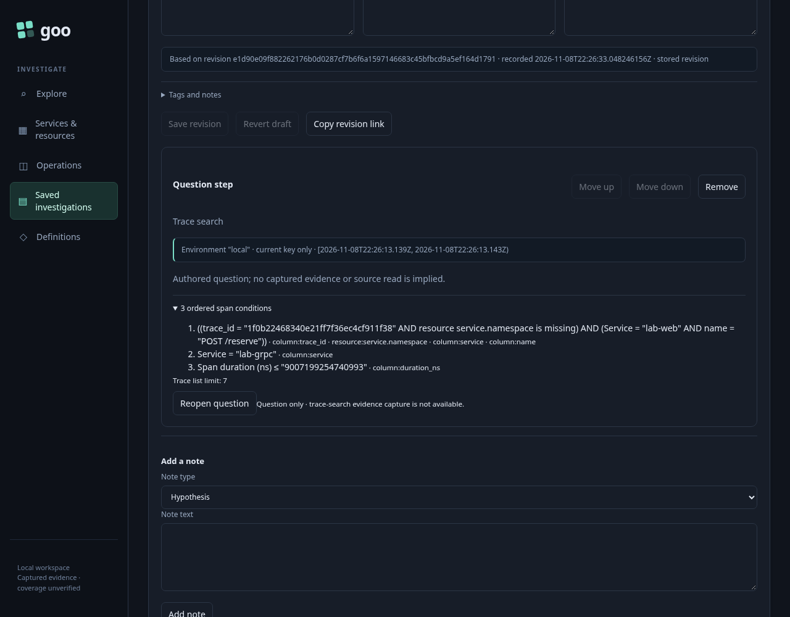
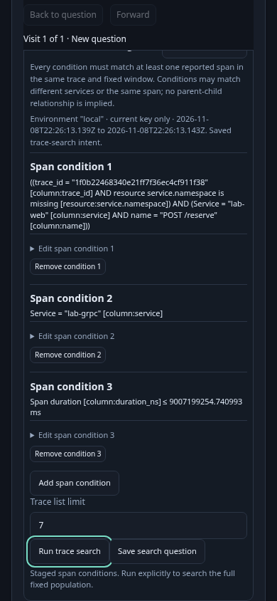

# 382 — preserve a cross-service trace-search question

Actual Playwright and positive Bombadil acceptance pass. Frames below were
captured from the reviewed Go runtime with independently observed ordinary OTel
records; no replacement telemetry was ingested.

1. Open a fixed span question over one independently observed ordinary OTel trace
   with several services. Inspect a real span and use **Find traces with this
   operation** to enter the existing trace-search flow.
2. Add a condition for another reported service and an exact unsigned duration
   threshold above 2^53. Choose a non-default list limit. Conditions are existential
   within a reported trace; they do not imply parent-child order or a unique request.
3. Search explicitly and compare matching trace IDs and per-condition witnesses to
   independently queried raw records. Preserve the exact typed environment policy,
   fixed scope, condition order and numeric strings.
4. Use **Save search question** and save the existing investigation revision.
   This stores authored intent, not evidence. No telemetry is read while adding
   or saving the card; trace-search evidence capture remains outside this milestone.
   Its local ordered-condition disclosure preserves exact JSON/qualified fields
   and the list limit without any HTTP request or source read.
5. Reopen the exact immutable revision and use **Reopen question**. The whole
   search is staged without reading source data or requiring an applied record
   result. **Run trace search** explicitly performs the fresh search.
6. Share/reopen the typed step without a source read. Old hidden Save callbacks
   cannot add duplicate cards or trigger work. Desktop and narrow frames document
   the saved question and staged search; the positive actor follows the real saved
   card through explicit search and actual matching witnesses.

The journey selects existing source data; it does not ingest replacement telemetry
or fabricate successful responses. Independent source scope may contain different
namespaces; namespace restrictions remain honest predicates in individual span
conditions, not an invented global trace-search field. Metadata reads and one
explicit investigation write are distinct from telemetry reads and custody capture.

Actual frames: `382-saved-trace-search.png` (immutable question card) and
`382-reopened-trace-search-390.png` (whole staged question before Search). The final actor JPEG was visually inspected but remained frozen on reading
controls despite completed DOM. It is retained as a paint limitation, not proof
of completed visual output. The two Playwright frames show the final reviewed UI.

## Actual acceptance

The final run passes in **55.8 seconds** (59.2 seconds including the wrapper).
Two independent read-only source queries select four actual spans across two
services in one reported trace. The initial and reopened searches both match the
independent raw-record oracle, preserve the exact typed scope and condition order,
and retain unsigned threshold `9007199254740993` and list limit 7.

The main flow makes three explicit source API reads (one parent population and
two searches), one immutable investigation write and no capture write. Adding/
saving intent, exact revision reload, reopening the question, stale hidden Save
callbacks and shared-link staging make no telemetry/SQL read. Metadata and
investigation-store reads are recorded separately rather than called no-network.
Keyboard Enter drives Search, Save and Reopen; new draft focus reaches its title
and reopened search focus reaches its explicit Run control. Stored document bytes
remain unchanged through reuse.

The measured flow includes thirteen facts, including zero-request local inspection
of all saved ordered conditions. The separate **661-state / 40.345-second** actor
reaches positive exact-scope,
exact-request and matching-record completion with one explicit search and zero
document/capture writes. All six proxy SQL requests are real forwarded reads:
five from the main flow and one from the actor. No source success was substituted.

Report: `artifacts/saved-trace-search382/70c61ec4-18c9-4544-b5b8-0b9412377a83/summary.json`.
The compact actor bundle retains its final reading-state JPEG, compressed trace
and an explicit paint limitation. Repeated JPEG pruning means it is not a complete
`bombadil --reproduce` directory.

