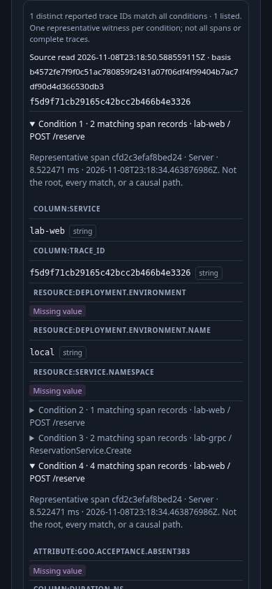
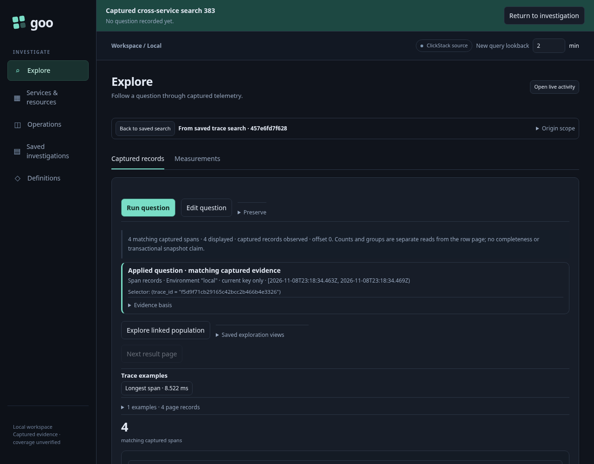

# 383 — keep the search evidence, then follow a reported trace

Actual Playwright and positive Bombadil acceptance pass against the reviewed Go
runtime. The source fixture selects retained ordinary OTel data; this journey does
not ingest replacement telemetry or substitute a successful source response.

1. Stage and explicitly run a fixed cross-service search over four independently
   queried spans from two reported services. Four conditions prove a shared-span
   match, a distinct-service match, qualified missing values and an exact numeric
   threshold above JavaScript's safe integer range.
2. Save the search question in an investigation revision. **Run and capture**
   performs a separate source read, publishes an immutable search receipt and
   links it to a new investigation revision. Its own read clock, complete matching
   count, bounded list, qualified witnesses, warnings and plan are retained.
3. Refuse the source, verify a real search request fails, then reopen the capture.
   Inspect its actual qualified witness fields with no telemetry read. The custom
   field component explicitly renders the absent attribute as **Missing value**.
4. **Open trace question** stages only the reported trace ID and original typed
   environment / fixed time window. Per-condition namespace, service and operation
   constraints are absent from the child. **Run question** explicitly reads fresh
   spans. Its origin citation retains the complete search request and saved receipt.
5. **Back to saved search** restores the identical held host, row, expanded
   witness details, original receipt and action focus without rerunning search or
   rereading the capture store.
6. Repeat through an actual upstream refusal and a held actual successful response.
   Back aborts the pending child and issues one cancellation control request; its
   late successful response cannot replace or rewrite the saved search. Capture
   bytes remain unchanged throughout all three child visits.
7. A separate narrow Bombadil campaign independently observes the exact child
   request, actual span membership and focused same-parent return, with one fresh
   source read, no search rerun, no capture-store reread and no writes.

## Actual acceptance

The final run passes in **49.8 seconds** (**51.6 seconds** reported by the Playwright
wrapper; lab traffic draining is separate). The final report records **14 measured
facts**. The main flow performs four explicit source API reads, one server-owned
capture reread, two investigation writes, one capture write and one offline capture
GET. Returning after success, refusal and pending cancellation makes no source or
capture-store data read; the pending return's cancellation control is counted
separately. Source proxy SQL counts include multi-query record reads and the actor,
not just API actions. Two additional independent raw-record queries establish the
fixture before the proxy-backed application runs.

This actual search has **one matching reported trace**, list limit **7**, and
`hasMore: false`; it does not exercise real list truncation. The independently read
lab records contain **no explicitly empty qualified values**. Actual missing values
are checked both in the source/result oracle and rendered component state. Generated
Go/Hegel properties cover empty-versus-missing values and totals larger than a list
limit; this journey does not claim those source scenarios occurred.

The **774-state / 40.187-second** actor reaches positive exact-request,
matching-record and held-parent completion. Its final JPEG was visually inspected:
it shows the saved search and the focused **Open trace question** control after
Back. Repetitive JPEGs were pruned after inspection; the compact bundle retains that
verified frame, compressed trace and a paint note. It is not a complete
`bombadil --reproduce` directory.

Report: `artifacts/captured-trace-search383/c0aa877d-f40a-4cc1-946b-838a5c33d8bc/summary.json`.

The desktop child screenshot also confirms the next consolidation opportunity:
fixed-result controls and context still occupy most of the initial viewport before
individual span rows. Roadmap 384 addresses that layout; this milestone preserves
the evidence and navigation contract first.

