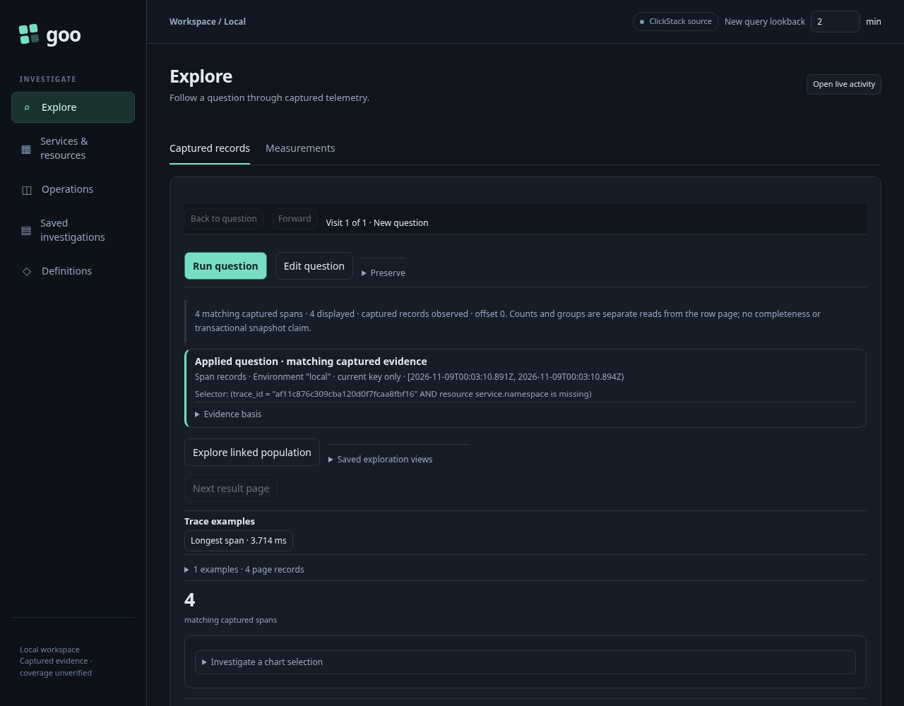
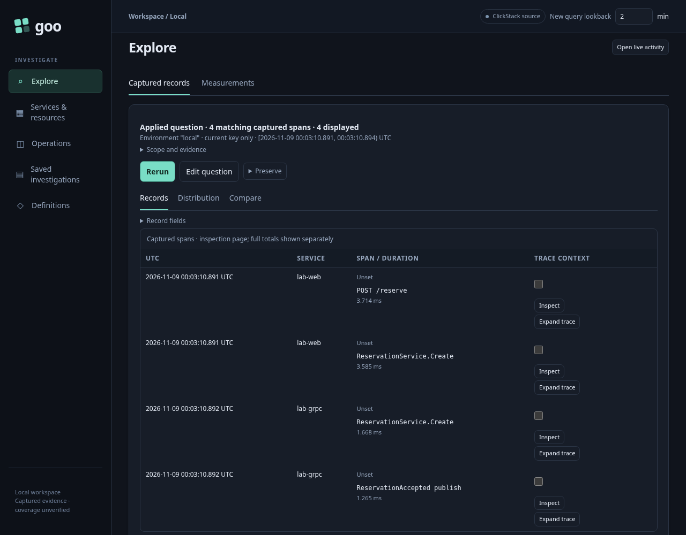
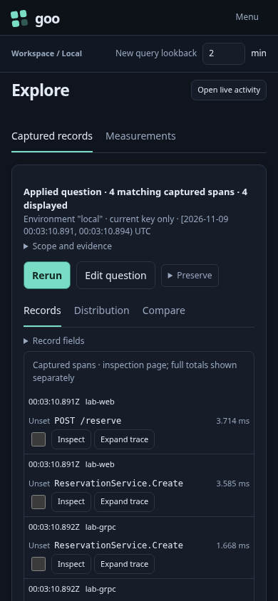
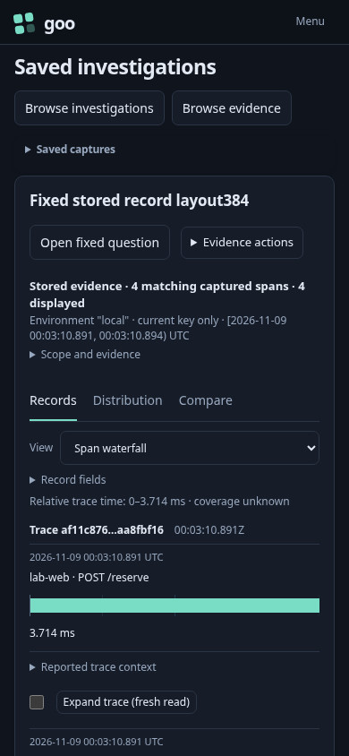

# 384 — see the fixed result before secondary controls

Actual Playwright and positive Bombadil acceptance pass on the reviewed Go build.
The ordinary fixed entry is a cold document visit; it does not inherit an Activity
return. Every frame uses natural document/main scroll position zero. Geometry
intersects the viewport with each element's own real scroll ancestors, including
actual client borders; no screenshot scrolls to the result to manufacture a fit.

1. Open an ordinary fixed OTel trace question and run it explicitly. One compact
   applied scope/count and action row precede the actual records at desktop and
   narrow widths. Source query and full count are unchanged; each explicit read retains its own
   independent source clock.
2. Open and close **Scope and evidence** locally. Selector, source clock, basis,
   plan and warnings remain available without another read.
3. Edit the applied question into an invalid duration draft. Controls stay open and
   old rows clear. The existing Run control remains enabled for this shortcut;
   clicking it refuses locally, preserves raw input/error and makes no source read.
   An old capture callback cannot reopen the capture dialog or publish work.
4. Open captured search evidence, stage a reported trace and run its fresh fixed
   question. Back restores the same held search DOM, receipt and focus without a
   source or capture-store reread.
5. From a real paused Activity span, use **Analyze this observation window** and
   run the original exact selector/window. Back returns to the same held stream
   rows and inspector action without restarting the stream.
6. Open an immutable ordinary record capture. Its table and span waterfall share
   the compact summary. Kind changes and scope disclosure remain local, preserve
   physical capture bytes and require no source read or new capture.

## Actual before/after geometry

The paired rows below use the same independently queried trace, query, full count
and compiled plan. Values are the first actual record's top coordinate in pixels,
measured from the viewport at scroll position zero. The previous layout places
its first record below the viewport in all six paired frames.

| Context | 1280 × 1000 before → after | 390 × 844 before → after |
| --- | ---: | ---: |
| Cold fixed record question | 1198.72 → 500.39 | 1433.11 → 550.36 |
| Fresh trace from held search | 1201.72 → 564.39 | 1418.98 → 642.73 |
| Stored record table | 1262.86 → 517.39 | 1790.50 → 603.45 |

The fresh Activity child also starts at 500.39 / 550.36. Its independent recent
trace bank is separate from the paired fixed trace because tail observation uses
an actual recent window. The complete stored waterfall item occupies
**608.45–813.95 px** at 390 × 844, including its timing, context and actions;
the test does not accept only a sliver or just its timing bar.

The original paired trace expired at midnight. Independent ClickHouse inspection
found zero remaining records and the actual exporter-created TTL
`toDate(Timestamp) + INTERVAL 1 DAY` with `ttl_only_drop_parts=1`. That is calendar-day
expiry, not a rolling 24-hour guarantee. The old report remains preserved; both
before and after were repeated on a fresh real trace. No replacement telemetry,
replayed successful source response or rewritten capture was used.

## Actual acceptance

Final Playwright: **47.0 s** (**48.9 s** including wrapper). All **27 measured facts**
and **10 strict geometry frames** pass. Source calls are three explicit fixed
reads plus one initial stream; two capture GETs load evidence. Local disclosure,
invalid Run refusal, stale capture callbacks, kind changes and Back make no source
read. Main UI actions publish no capture or document. Setup capture reads are
recorded separately, and original physical capture bytes remain unchanged.

The narrow Bombadil campaign records **659 states / 35.098 s**. It observes actual
table → waterfall → table widgets, exact supplied record IDs and read basis,
current scope/count and full first-item geometry. After initial stored reopen its
local exploration makes zero source reads, capture GETs or writes. The final JPEG
was visually checked as the current returned Table; it is not a stale paint from
the waterfall. The compact bundle retains that frame, compressed trace and a
limitation note: repeated-frame pruning means it is not a complete
`bombadil --reproduce` directory.

The existing 383 nonactor journey also passes against this same build, including
actual source refusal, cancellation and a late successful child response. All
three returns preserve held evidence and focus. Historical 383 documentation PNGs
were restored byte for byte; refreshed regression frames remain only in artifacts.

Final report:
`artifacts/fixed-result-layout384/reviewed/b8bba76d-200d-459a-8dc1-3a061a7843f5/summary.json`.
Paired baseline:
`artifacts/fixed-result-layout384/baseline/24f90c1e-0a82-4bb0-a009-c85196c544fc/summary.json`.
383 regression:
`artifacts/captured-trace-search383/622e62d2-5cce-45ac-8f46-736561c110e2/summary.json`.

