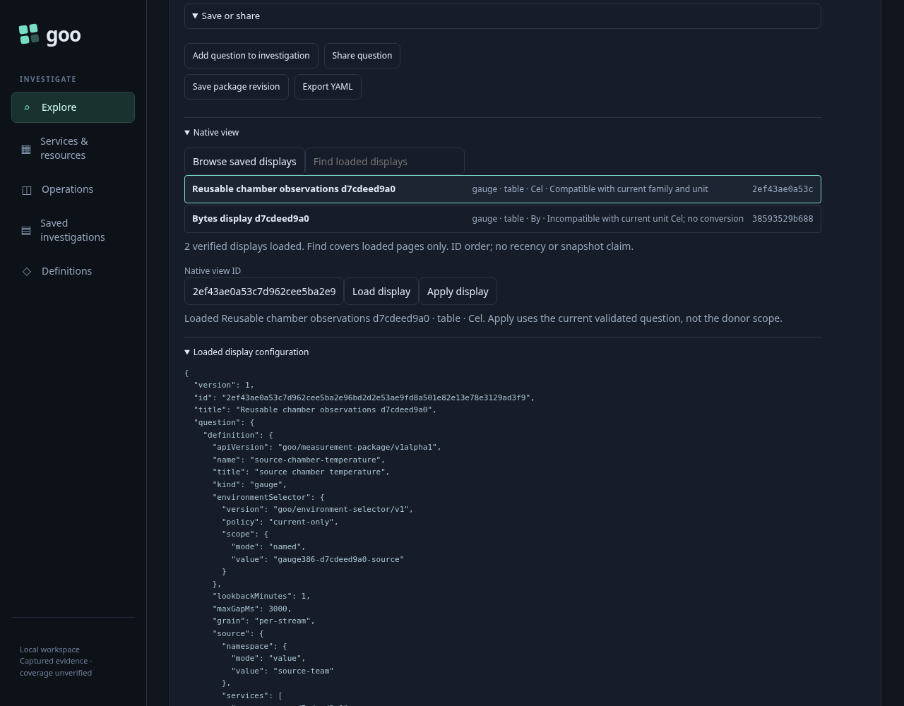
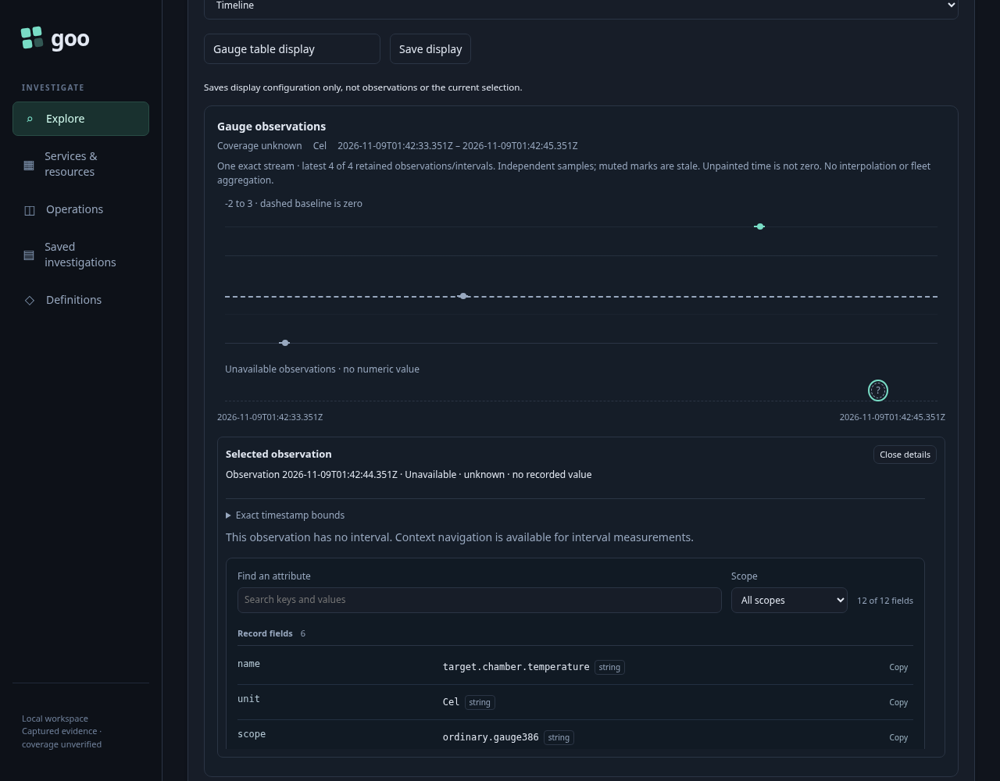
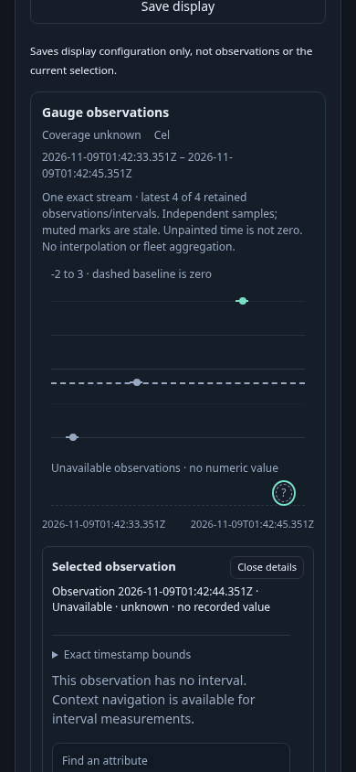

# Reuse a native gauge display over another question

A cold-chain operator has a Celsius temperature question for one chamber. They prefer a table while checking exact observations, then a timeline while investigating gaps. They save that display and apply it to another chamber's own service, namespace, environment policy, instrument, attributes, exact stream and nanosecond window.

The acceptance input consists of **generated OTLP gauge observations** sent through the actual collector into ClickHouse. It does not establish sensor accuracy or instrumented-application behavior. The source reports 20 and 22 Cel. The destination reports -2, 0 and 3 Cel, followed by a point with the OTel no-recorded-value flag. Against its fixed window and declared three-second freshness limit, its retained states are stale, stale, observed and unknown. A flagged point carries no usable value; a recorded zero remains zero. Foreign namespace and current-environment conflict controls are present in the physical source bank but excluded from the destination's exact stream.

| Step | Interaction | What is preserved and what reads |
| --- | --- | --- |
| Author | Run the source gauge question, select Table, enter a native view title and Save display | One initial measurement read. Saving stores immutable display configuration, not observations, selection, basis or read clock. |
| Discover | Open the different destination question and Browse saved displays | Bounded metadata only. Entries declare family, selection, kind and exact unit. |
| Inspect | Inspect the saved Celsius gauge display | A metadata GET verifies configuration before Apply. A byte-unit display is inspectable but incompatible; no conversion is inferred. |
| Apply | Apply the compatible gauge display | A metadata POST retains the entire destination question, clears the prior result and waits for explicit Run. It does not import the donor's chamber or readings. |
| Read | Run measurement | Exactly one destination measurement read. The first view is the saved table, containing the destination's four retained observations. |
| Explore | Switch Table → Timeline, inspect the unknown observation, switch to Table and back | Local rendering only. Exact values, stale/unknown states, read evidence and selected observation remain intact. No interpolation, fleet aggregation, completeness promise or zero fill is introduced. |
| Reject stale intent | Hold a real successful configuration GET, change the requested ID, then release it | The old response cannot become an applicable current view. A genuinely missing ID returns 404 and supplies no data. |
| Check custody | Read the saved configuration file again | Physical bytes remain unchanged through reuse, read, local switching and refusal controls. |

Counters, raw requests/responses and independent physical gauge rows are recorded by [386-native-gauge-view.spec.js](386-native-gauge-view.spec.js). Its oracle is [native-gauge-view386.js](support/native-gauge-view386.js). The Bombadil actor independently requires the exact destination result, literal zero, unknown observation, final visible timeline with retained selection, one measurement read and three metadata operations before completing. A click or process exit alone is not success.

Gauge declarations use `retained-observations`, timeline/table, time/recorded-value and `requiresComplete:false`. Histogram declarations remain a distinct complete-bin export-interval branch. Counter questions are refused by the shared native-view contract in this milestone.

## Reproduce

Use the reviewed current Go binary, the configured local collector/ClickHouse and the repository's normal Playwright/Bombadil tooling. Run heavy jobs serially; no retained store reset is needed.

```sh
GOO_GENERIC_BINARY=/tmp/goo-386-reviewed-goo GOO_NATIVE_GAUGE_VIEW_386_BOMBADIL=1 NO_PROXY=127.0.0.1,localhost npx playwright test journeys/386-native-gauge-view.spec.js --workers=1
```

The isolated runtime is removed in `finally`, with its configuration store and summary copied under `artifacts/native-gauge-view386`. Generated source observations remain subject to the lab's calendar-day UTC TTL; a later run creates a new isolated cohort rather than treating expired evidence as current.

## Actual frames and results

The final actual run passed in 56.6 seconds, checking eleven measured interaction boundaries. The independent physical bank contained two donor points and six destination-instrument points; only four matched the destination question. A subsequent actual histogram-reuse regression passed in 11.6 seconds against the same shared owner.

Inspecting the immutable donor configuration before applying it to the current destination:



The destination timeline, including stale signed values, a real zero and an explicitly unavailable observation:



The same current destination on a 390-pixel screen:



Bombadil admitted 814 snapshots through eleven phases. Its positive completion requires the actual destination question and observed values, a visible timeline, the selected unknown observation after Table → Timeline restoration, one measurement read, three metadata operations and zero writes. The final rendered JPEG was inspected independently; it shows the selected unavailable observation in a separate labelled rail and the literal stale zero on the numeric zero baseline. The rail and numeric plot share the physical time axis: all four measured timestamp positions differ from their expected centers by at most 0.016 pixels on desktop and 0.011 pixels at 390 pixels. Missing values have no numeric coordinate.

The actual wire adapter admitted 25 handler responses and seven valid request bodies. It separately verifies that the unsupported counter declaration fails the request schema and returns 400; a missing configuration returns 404.

```sh
/workspace/.venvs/goo-api/bin/python journeys/support/native-gauge-view386-wire.py artifacts/native-gauge-view386/summary.json
```

The finished campaign trace is losslessly archived as `bombadil/trace.jsonl.gz`; restore with `gzip -dk trace.jsonl.gz` before Bombadil inspection or reproduction. `archive-index.json` records its uncompressed SHA256 and frame mapping. Exact duplicate JPEG bytes are represented by relative symlinks, preserving all 814 screenshot paths while retaining eight distinct frames. Replaying against live telemetry still requires the original source cohort before expiry; the journey command produces a fresh cohort for later runs.
