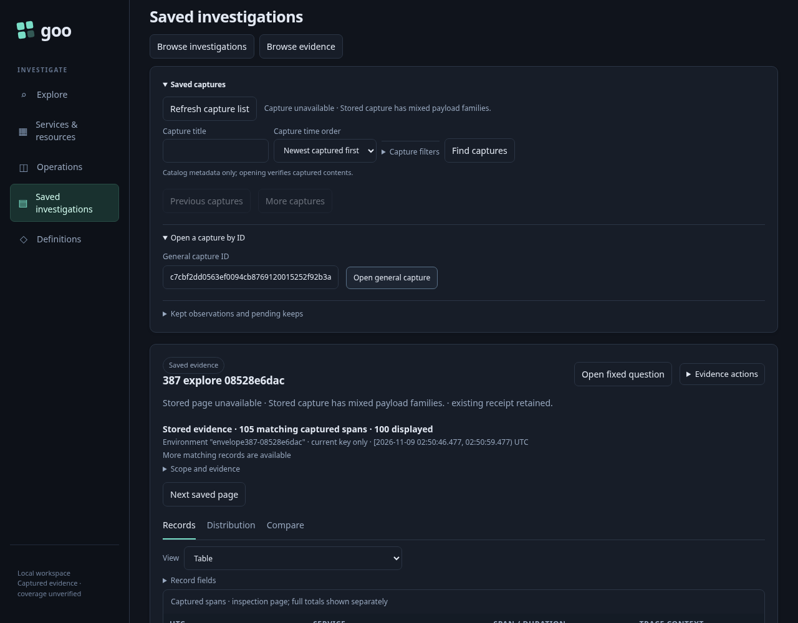
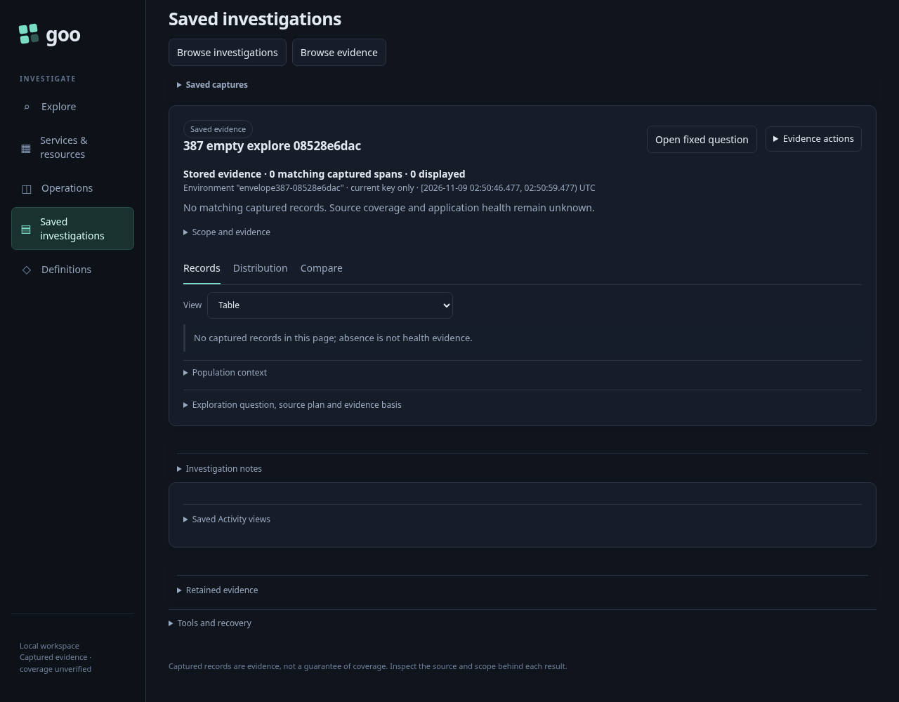
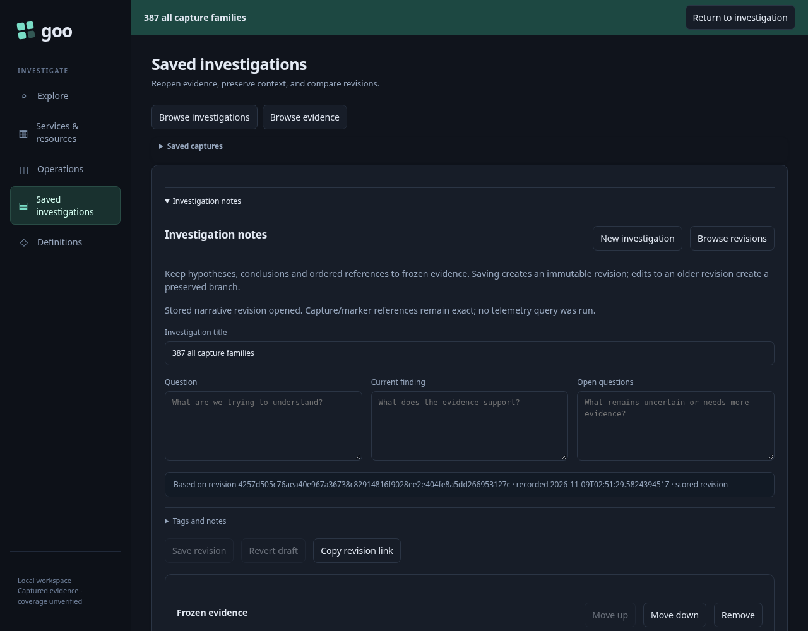
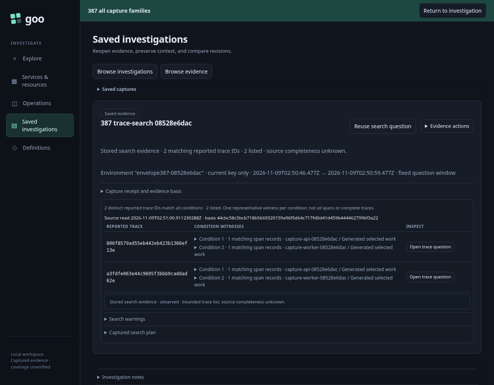
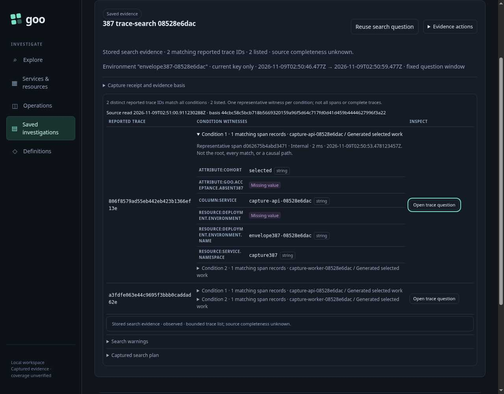

# One checked capture family, then reusable evidence

An investigator returns to saved work while the telemetry source is unavailable. Records, service inventory, comparisons, native measurements, observed explanations and trace searches should all reopen from custody. Each full response must contain exactly the result family named by its receipt. An unavailable or malformed replacement must leave the investigator's existing evidence intact.

The acceptance bank uses generated OTLP test instrumentation through the actual collector and ClickHouse: 111 unique span records across two services, plus four Celsius gauge observations. Of those spans, 105 match the selected API population and four match its baseline. Two additional worker spans share reported trace IDs with selected API records. Those IDs are generated association fixtures, not proof of real distributed calls. Independent physical-source queries check settlement and member IDs before creating captures.

| Saved family | Actual bank and journey |
| --- | --- |
| Records | Full matching count 105, 105 retained inspection records, first page 100 and second page five; their unique IDs match the raw bank. |
| Inventory | Observed names from two services in the exact generated namespace, environment selector and fixed interval. This is not fleet membership. |
| Comparison | Four baseline records versus 105 selected records, with separately captured source evidence. |
| Measurement | Four generated Celsius observations, including a recorded zero and an explicitly absent value. |
| Explanation | An actual observed population-explanation result is held by its server token. Promotion happens after a real source-refusal probe and must not rerun telemetry. |
| Trace search | Two matching reported trace IDs, with qualified representative witnesses. A legitimately missing attribute is preserved as nested `fieldValues[].value:null`. |
| Empty records variant | A real no-match question preserves full count zero, retained count zero, no pagination and unknown source coverage/application health. Its original empty-row wire representation is retained. |

1. Create five source-backed capture families and hold the actual observed explanation response. Read and preserve their physical configuration/evidence bytes.
2. Refuse ClickHouse through the scoped source proxy and establish unavailability with an actual failed Explore query. Promote the already held explanation without another source read.
3. Reopen every valid capture offline. Missing witness values remain valid data; only unclaimed result/question arms are rejected.
4. Exercise invalid isolated artifacts. A journey-only Go helper reads valid typed captures, mutates their fields in memory and computes Go's canonical content digest. Mixed result arms, mixed question arms and corrupt scope associations are rehashed; explicit foreign-null arms are inserted after hashing the typed body, so silently dropping null would otherwise produce a matching digest. The helper permits writes only in the temporary runtime's capture directory.
5. Exercise the browser boundary separately with **negative-only corrupted transport probes**. Each probe first fetches an actual valid stored response, then deliberately adds a foreign result/question arm to that response. These malformed HTTP 200 envelopes are labelled negative probes, never counted as genuine valid API or telemetry responses. The existing capture's receipt, displayed evidence and relevant DOM identities must remain unchanged.
6. Open one investigation containing references to all six families. Those cards load receipt metadata only; they must not require a full capture payload, witnesses or telemetry. Metadata references are not full evidence pages.
7. From the retained trace-search capture, stage a reported-trace question without reading. Restore the real source, explicitly Run once, inspect actual member IDs, and use the existing **Back to saved search** control. The original parent rows, receipt, custody clocks and focus return without rereading custody or telemetry.

The executable is [387-capture-envelope.spec.js](387-capture-envelope.spec.js), with the generated source bank in [capture-envelope387.js](support/capture-envelope387.js) and the isolated typed corruption helper in [capture-envelope387-mutate.go](support/capture-envelope387-mutate.go). The Bombadil actor independently requires the actual fresh-child response and the final visible parent, unchanged row identities, receipt, visible missing witness and source/read budgets. A click or clean process exit alone is not completion.

## Reproduce

Use the repository's reviewed current Go binary and configured local collector/ClickHouse. Build the test-only mutator from the root module, then run the isolated browser journey. Keep heavy jobs serial; no lab-store reset is needed.

```sh
go build -o /tmp/goo-capture-envelope387-mutate journeys/support/capture-envelope387-mutate.go
GOO_GENERIC_BINARY=/tmp/goo-387-reviewed-goo GOO_CAPTURE_387_MUTATOR=/tmp/goo-capture-envelope387-mutate GOO_CAPTURE_ENVELOPE_387_BOMBADIL=1 NO_PROXY=127.0.0.1,localhost npx playwright test journeys/387-capture-envelope.spec.js --workers=1
```

The temporary runtime is removed in `finally`; its captures, negative fixtures and actual summary are copied under `artifacts/capture-envelope387`. Controlled source telemetry remains subject to the lab's UTC calendar-day TTL. A later run creates a fresh isolated cohort rather than treating expired source data as a successful current read.

## Actual acceptance

The final browser run passed in 1.3 minutes with 39 measured interaction boundaries. It verified all six main families, the empty Explore variant, 30 canonical isolated-file refusals, six retained UI file refusals and 18 explicitly malformed transport envelopes. A separate negative probe returned a valid first-page envelope for a request for offset 100: the browser refused the wrong address, preserved the original page and comparison action, then successfully retried Next and returned Previous with one stored GET each and no SQL.

The actual empty capture's HTTP page contained `rows:[]`; those bytes were preserved. Legitimate null-row input is covered by the independent generated/unit cases rather than an invented successful transport response. Its visible zero does not establish application health.

Rejected replacement evidence leaves the admitted page and its local comparison action usable:



The real empty capture reopens offline with unknown coverage and health:



The journey checks six receipt-only references in one investigation. This frame
shows its saved narrative and frozen-evidence section; the cards continue below
the viewport:



The retained search returns after an explicit fresh trace read:



The independently inspected final Bombadil frame preserves the qualified missing witness and actual focus on its continuation:



Bombadil admitted 663 snapshots through six phases. Completion requires the visible original parent, identical row identities, receipt and custody content, the actual child span IDs, the visible missing witness and restored focus. After its initial stored load, it performs one explicit source read, zero custody rereads and zero writes.

The wire adapter validates genuine traffic separately from deliberate negative transports:

```sh
/workspace/.venvs/goo-api/bin/python journeys/support/capture-envelope387-wire.py artifacts/capture-envelope387/summary.json
```

It admitted 92 genuine handler responses and 11 request bodies. Eighteen malformed envelopes fail the response schema; the wrong-page envelope is valid independently but fails the requested-page binding. Neither is counted as a genuine successful response.

Finished campaign traces are losslessly stored as `bombadil/trace.jsonl.gz`; restore with `gzip -dk trace.jsonl.gz` before Bombadil inspection or reproduction. `archive-index.json` records the uncompressed SHA256 and frame mapping. Exact duplicate JPEGs use relative symlinks, preserving all 663 screenshot paths with seven distinct rendered frames. Live reproduction still requires the matching runtime and unexpired source cohort; rerun the journey to generate a fresh cohort later.
