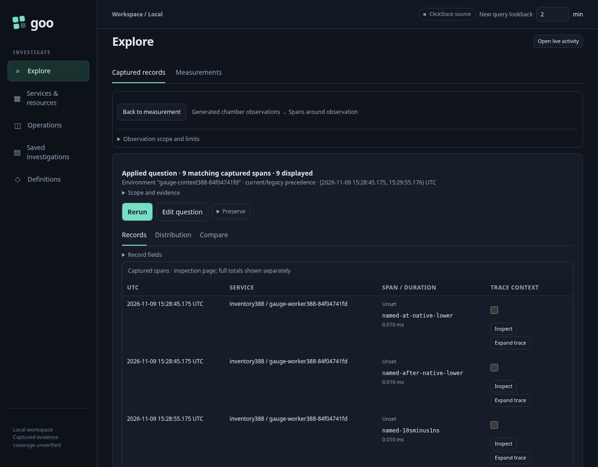
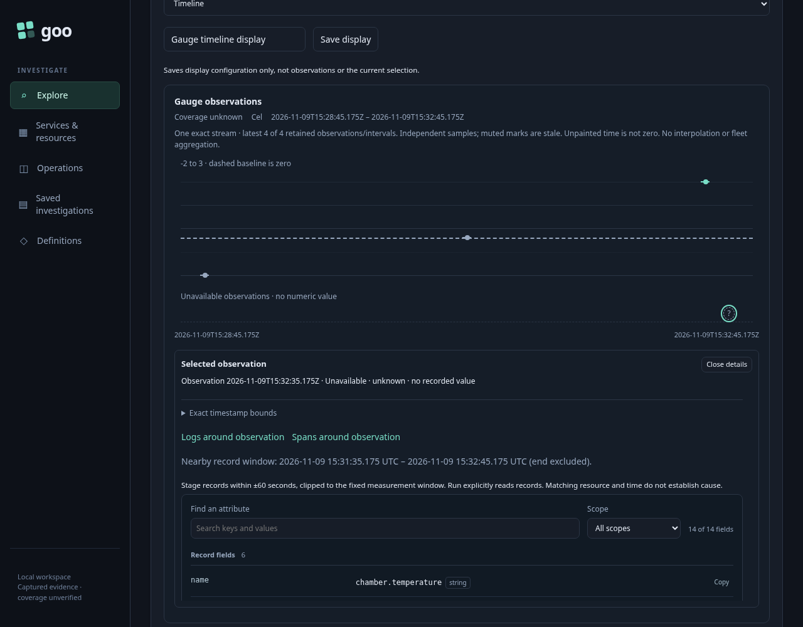
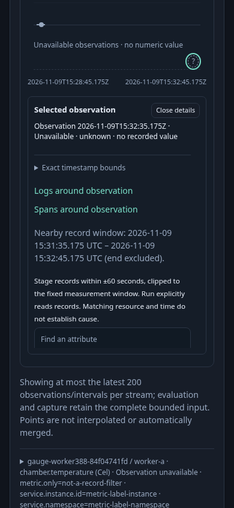
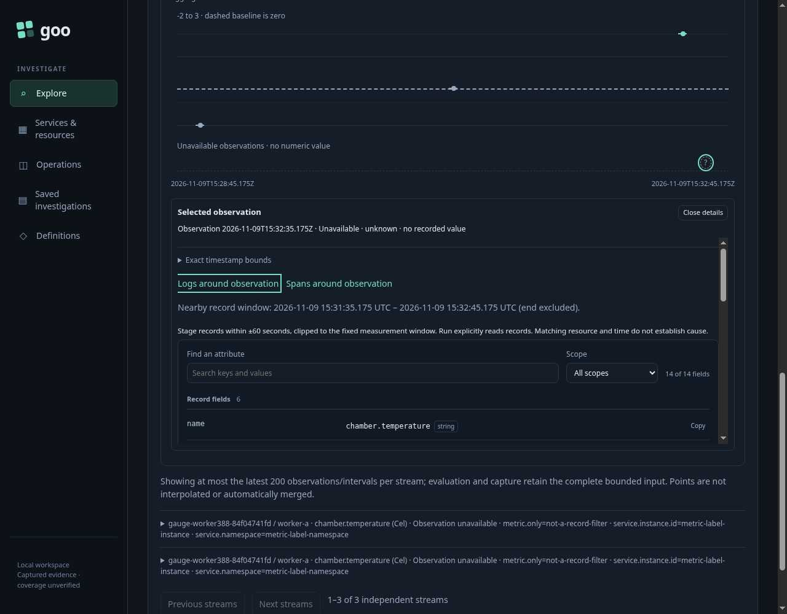

# From a reported gauge observation to nearby records

An investigator opens an ordinary per-service gauge measurement, selects a reported observation and asks for nearby logs or spans. **Logs around observation** and **Spans around observation** stage a fixed ±60-second question, clipped to the original native bounds. The interval is half open: the lower endpoint is included and the upper endpoint is excluded. This is temporal context, not a claim of causality, complete coverage or a unique invocation.

The generated OTLP acceptance cohort is test instrumentation, not a physical sensor or instrumented application. It exports 97 span records, 97 log records and 16 gauge points through the real collector. Independent ClickHouse queries check physical settlement before the browser starts. Three selected gauge streams have named, empty and missing resource namespaces. Current environment attributes take precedence over legacy attributes. Foreign service, instance, namespace and environment controls must not leak into the record question.

| Interaction | Checked behavior |
| --- | --- |
| Select the lower stale observation | Its reported timestamp selects spans in the clipped lower window. The stale value is not treated as a current reading. |
| Select the upper unknown observation | The unavailable-value rail still carries a real reported timestamp. Nearby logs do not require inventing a numeric value. |
| Select a recorded zero | Zero remains recorded data. The middle interval uses the full ±60-second radius. |
| Follow a context link | Stage the typed question without reading telemetry or custody. |
| Run | Read the selected record signal explicitly; actual IDs must match the independent nanosecond oracle. |
| Source refusal and retry | A real scoped source refusal remains a failure. Return to the held measurement, stage again and explicitly read after recovery. |
| Back to measurement | Restore the same evidence nodes, selected observation, basis, read-at clock, bounds and focus without another read. |

The gauge freshness policy is 30 seconds, deliberately different from the context radius. Source rows at the exact endpoints and ±1 nanosecond distinguish the ±60-second question from a single timestamp, the whole native window, millisecond rounding or an accidental freshness-based radius. Resource namespace and instance are preserved; metric-only labels, instrumentation identity and unrelated resource attributes are not copied into record filters.

The executable [388-gauge-observation-context.spec.js](388-gauge-observation-context.spec.js) owns the source export and independent membership oracle in [gauge-observation388.js](support/gauge-observation388.js). The Bombadil actor independently observes the actual native response, explicit child response and final visible held parent. A click alone cannot complete its journey.

## Reproduce

With the local collector and ClickHouse configured, build the reviewed current application and run the isolated browser journey. Preserve the lab stores; each run generates a fresh scoped cohort.

```sh
go build -o /tmp/goo-388-reviewed-goo ./cmd/goo
GOO_GENERIC_BINARY=/tmp/goo-388-reviewed-goo GOO_GAUGE_OBSERVATION_388_BOMBADIL=1 NO_PROXY=127.0.0.1,localhost npx playwright test journeys/388-gauge-observation-context.spec.js --workers=1
/workspace/.venvs/goo-api/bin/python journeys/support/gauge-observation388-wire.py artifacts/gauge-observation388/summary.json
```

The isolated runtime is removed in `finally`; its actual observations remain under `artifacts/gauge-observation388`. Controlled source records expire under the lab's UTC calendar-day TTL. A later run creates a fresh cohort rather than claiming expired source data is current.

## Acceptance status

The final browser run passed in 58.9 seconds with 16 measured interaction boundaries. It independently admitted all 97 spans, 97 logs and 16 physical gauge points. One native measurement read selected 12 observations across three streams. The three nearby populations contained 9 spans, 9 logs and 13 spans; their single-timestamp controls contained 1, 1 and 2 records, while the full-window controls contained 25, 26 and 25.

The main journey made one measurement read and four explicit record attempts, including one real source refusal followed by recovery. Staging, selection and held returns made no telemetry or custody reads. Custody reads and writes remained zero. The first run exposed a retained-owner authority bug; the corrected owner now grants only local context staging from the same held result, without reviving measurement execution or saving authority.

The explicitly run spans question shows the clipped scope and retained measurement return:



A reported observation without a numeric value can still stage nearby records:



The same context remains usable at 390 pixels without horizontal overflow:



Bombadil independently observed 660 snapshots through eight phases. Its completion requires the actual logs response, unchanged original stream/timeline nodes and evidence, the visible selected unknown observation and restored focus. It made one native read and one explicit logs read, with zero custody reads or writes. The final actual paint was inspected independently; these frames are intentionally scrolled to the selected observation rather than claims about the initial viewport.



The wire adapter admitted 20 genuine handler responses and six request bodies: nineteen HTTP 200 responses and the actual HTTP 502 source refusal. Finished campaign data is losslessly stored as `bombadil/trace.jsonl.gz`; restore with `gzip -dk trace.jsonl.gz` before inspection. `archive-index.json` retains the uncompressed SHA256 and all 660 screenshot paths. Exact duplicate JPEGs use relative symlinks, retaining five distinct rendered frames.
