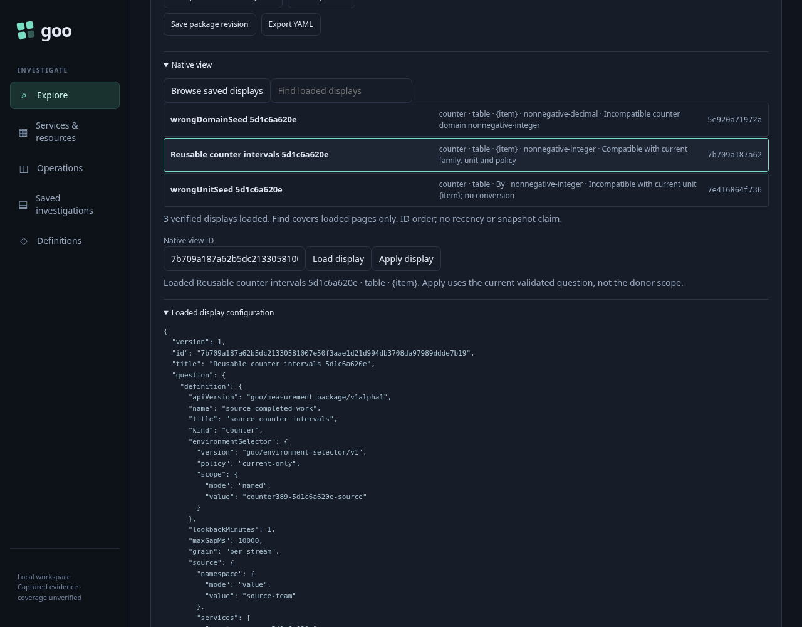
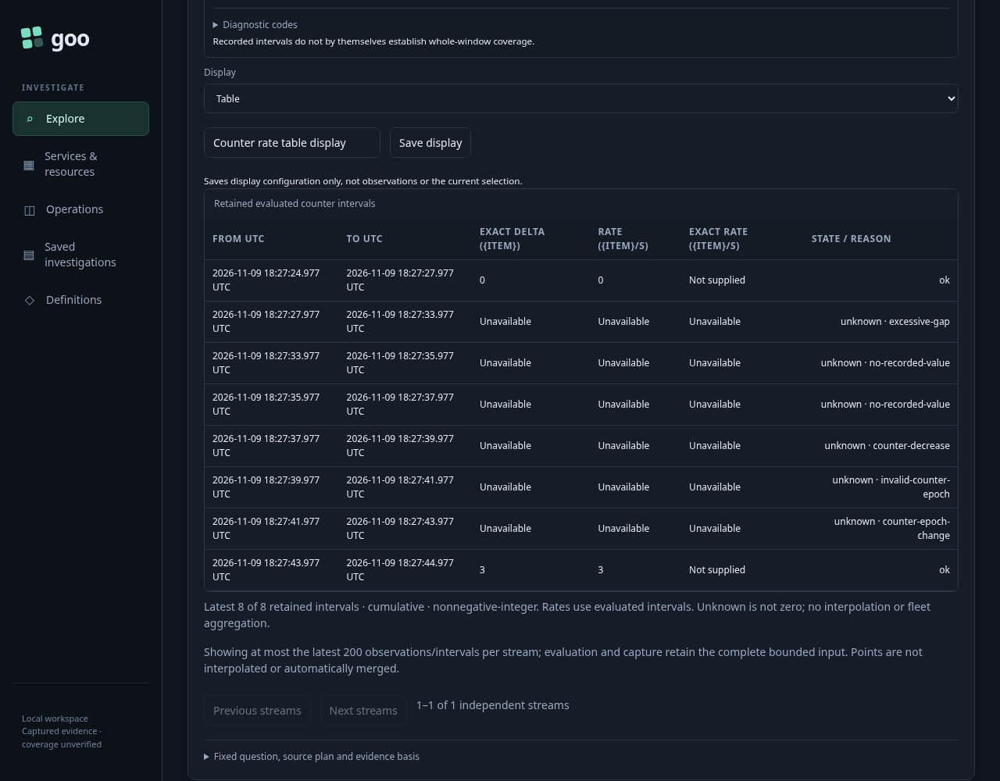
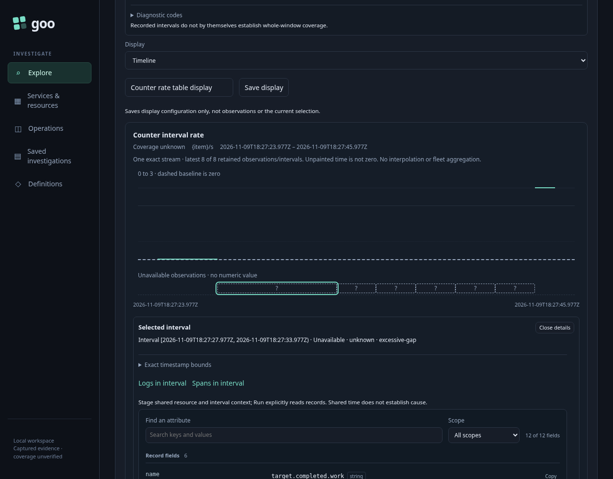
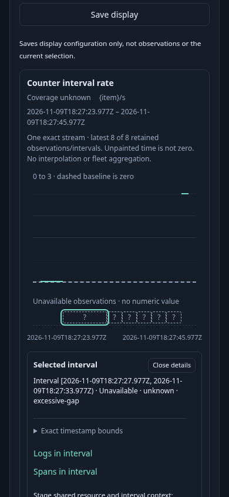
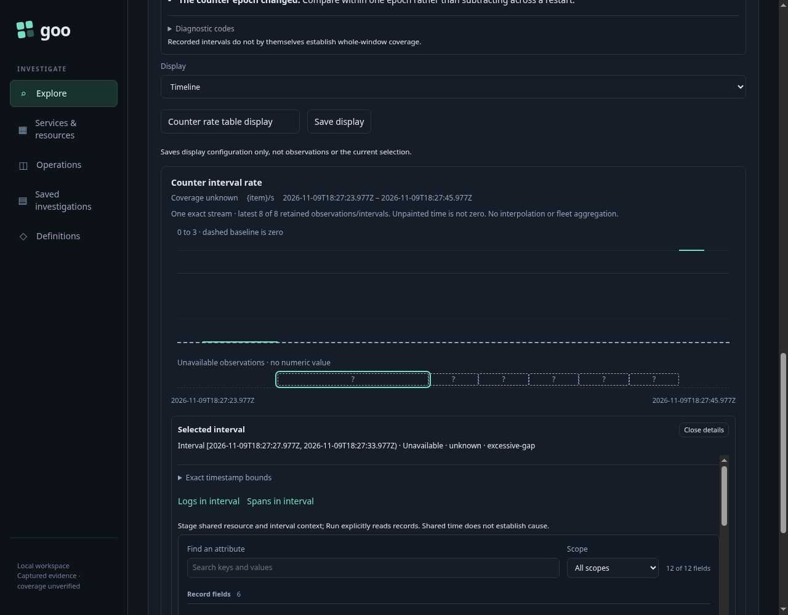

# Reuse a counter display without inheriting its measurement policy

Milestone 389. Actual runtime acceptance is recorded below; the independent
model replay is recorded in [validation](../VALIDATION.md).

An investigator finds a useful counter table and wants the same presentation on
another service. The display should carry its visual kind, while the new question
keeps its own source, environment, namespace, fixed time window and gap policy.

The executable [389-native-counter-view.spec.js](389-native-counter-view.spec.js)
uses generated ordinary OTLP sum exports through the actual collector and
ClickHouse. These are controlled instrumentation values, not proof of real
distributed calls, ingestion completeness or application health.

1. Read a donor service's cumulative integer counter, select an interval, then
   choose Table. Save the
   display configuration; saving performs no telemetry read.
2. Open a different service/environment/namespace and fixed question, with a
   four-second maximum gap instead of the donor's ten seconds. Explicitly read its
   current result and select a valid interval. Browse the saved
   metadata without reading telemetry.
3. Inspect saved views with the wrong unit and with the same unit but a different
   counter domain. Both refuse Apply. The real server reuse endpoint independently
   refuses each incompatible combination.
4. Inspect the compatible integer view and Apply it. The real prior result and
   selected interval are cleared and
   the complete destination question is unchanged. The UI waits for explicit Run.
5. Run the destination. Its eight evaluated intervals include a real zero rate,
   an excessive gap, no-recorded-value boundaries, an undeclared decrease and
   tainted epoch, an explicit epoch change, and a valid post-reset rate. A reused
   donor maxGap would incorrectly turn the six-second gap into a valid interval.
6. Toggle Timeline/Table locally and inspect the unknown gap interval. Unknown
   intervals have no numeric rate and appear on the unavailable rail. Returning
   to Timeline preserves the selected interval without another read.
7. Re-read the immutable configuration bytes after the actor campaign. Donor data,
   selected intervals, custody and gap policy must not move into the destination.

The source bank contains three donor exports, nine destination exports, two
deliberately foreign destination exports and three decimal exports. Independent
physical queries establish settlement and exact start/end times, values, flags,
temporality and monotonicity before native reads are accepted.

A separate explicit HTTP measurement read exercises the decimal exports. Two
three-second intervals each have delta `0.75` and exact rate `1/4` per second.
This direct call is recorded separately from browser-owned source operations;
it is not counted as a UI action or manufactured successful response.

The strong [Bombadil actor](../verification/bombadil/native-counter-view389.ts)
independently browses, inspects and applies the saved view, explicitly reads the
destination once, checks the actual request and retained counter result, toggles
the two kinds, and completes only with the unknown interval still selected.
A click, an actor phase or clean exit alone is insufficient.

## Reproduce

Use the reviewed current Go binary and configured local collector/ClickHouse.
Keep heavy jobs serial and preserve the lab's existing stores and volumes.

```sh
GOO_GENERIC_BINARY=/tmp/goo-389-reviewed-goo GOO_NATIVE_COUNTER_VIEW_389_BOMBADIL=1 NO_PROXY=127.0.0.1,localhost npx playwright test journeys/389-native-counter-view.spec.js --workers=1
/workspace/.venvs/goo-api/bin/python journeys/support/native-counter-view389-wire.py artifacts/native-counter-view389/summary.json
```

The isolated runtime cleans up in `finally` and preserves its configuration files
under the ignored campaign artifact directory. Later runs create fresh source
cohorts rather than reusing expired calendar-day TTL data.

## Actual acceptance

The final Playwright run passed in 1.1 minutes with 11 measured interaction
boundaries. Three browser-owned native reads cover the donor, the destination's
real prior result, and the explicit post-Apply destination read. The separate
decimal HTTP call supplies a fourth explicit read outside the UI budget. The
actor independently performs one destination read. The proxy therefore observes
five native SQL calls across these distinct workflows; metadata operations do
not query telemetry.

The actual source bank settled at 17 sum exports. The target keeps its four-second
gap policy: six unknown intervals retain gap, flagged-data, decrease, tainted epoch
and epoch-change reasons. The real zero and post-reset rate three remain numeric.
The decimal HTTP result contains two exact `1/4` rates with delta `0.75` and
floating display rate `0.25`. The immutable saved artifact is byte-identical
after all main and actor actions, and the isolated runtime reports cleanup.

The two incompatible summaries can be inspected without acquiring Apply authority:



The table distinguishes evaluated `Unavailable` fields from a known integer
interval whose optional exact-rate field was `Not supplied`. Real zero stays zero:



The time view keeps unknown intervals outside the numeric scale:



The checked 390-pixel frame has no horizontal page overflow. Native frames are
intentionally scrolled to their display; this is not an above-fold entry claim:



The actor admitted 687 snapshots through 11 phases. Completion independently
requires the actual destination request/result, eight exact evaluated intervals,
two numeric rates and six unknown rail intervals, the selected gap and its
visible explanation. It performs one source read, three metadata operations and
zero publication/capture writes. The final actual frame preserves that selection:



The wire adapter validates 28 genuine handler responses and 12 request bodies:
23 HTTP 200 responses, three immutable-configuration creations and two genuine
incompatible-reuse refusals. No successful API or telemetry response is replaced.

Finished campaign traces are stored losslessly as `bombadil/trace.jsonl.gz`;
restore with `gzip -dk trace.jsonl.gz` before trace inspection. The archive index
records the original SHA256 and exact screenshot mapping. Seven unique JPEGs
preserve all 687 original screenshot paths using relative symlinks. Later live
reproduction needs a fresh journey cohort after the source TTL expires.

See the [counter display contract](../docs/NATIVE_COUNTER_VIEW_REUSE.md) and
[bounded source review](../docs/reviews/COUNTER_VIEW_REVIEW_389.md).
