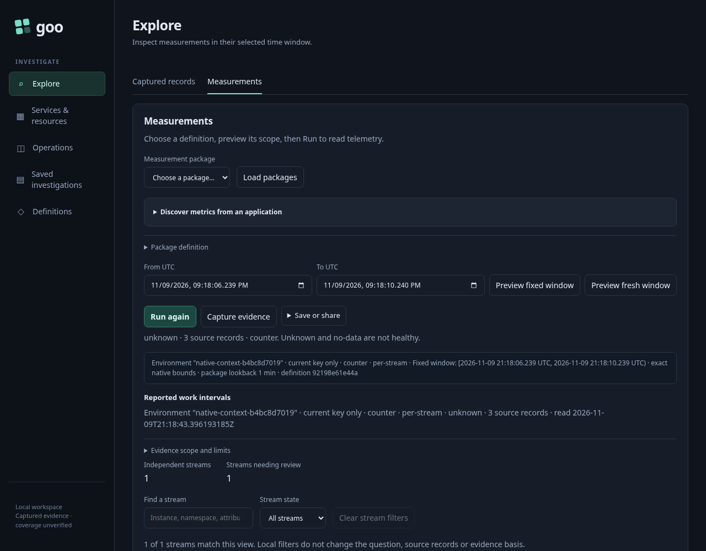
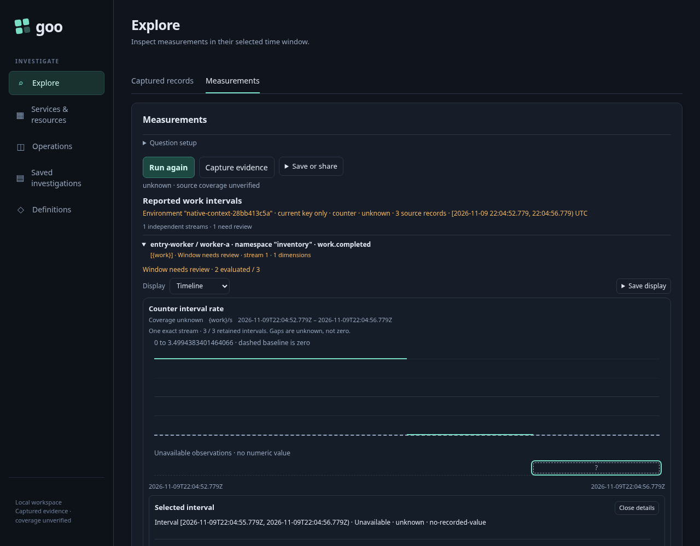
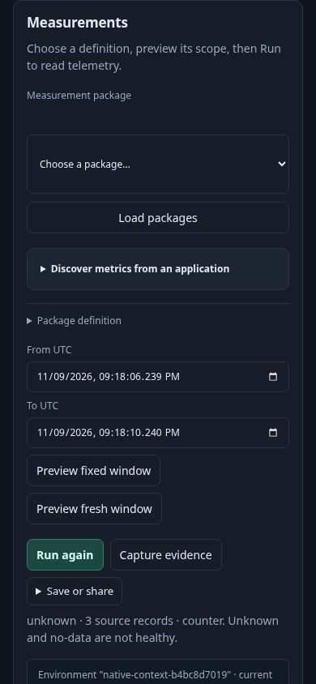
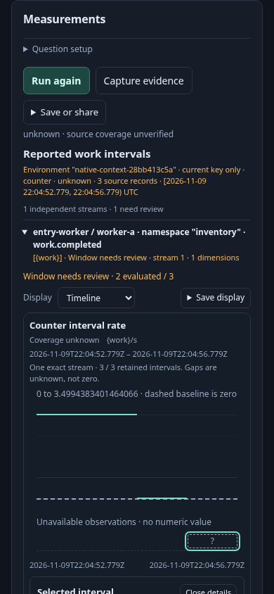
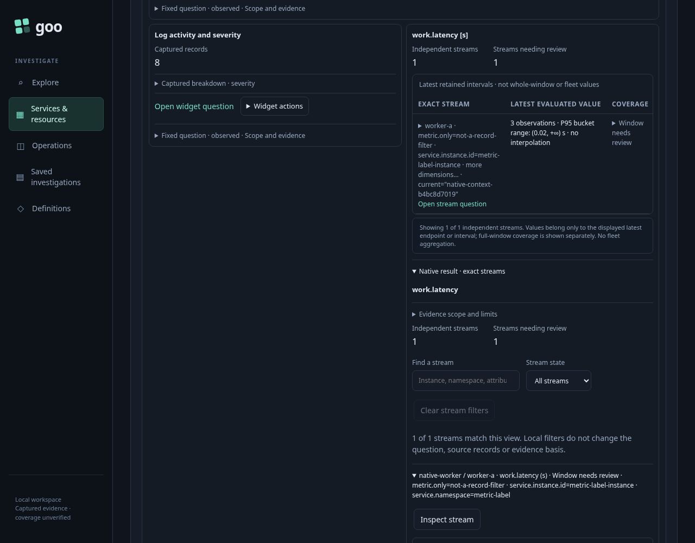
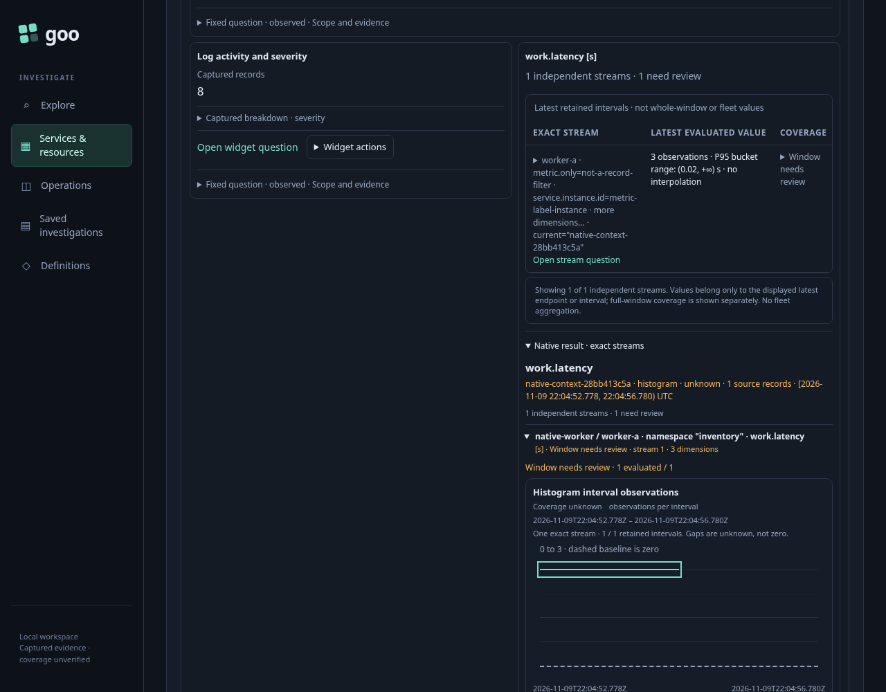
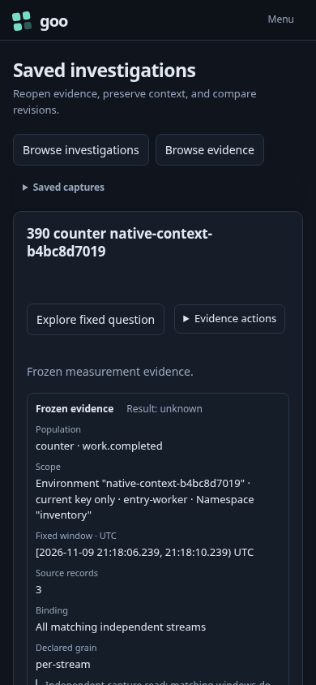
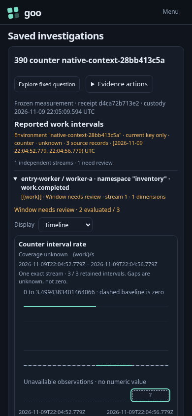
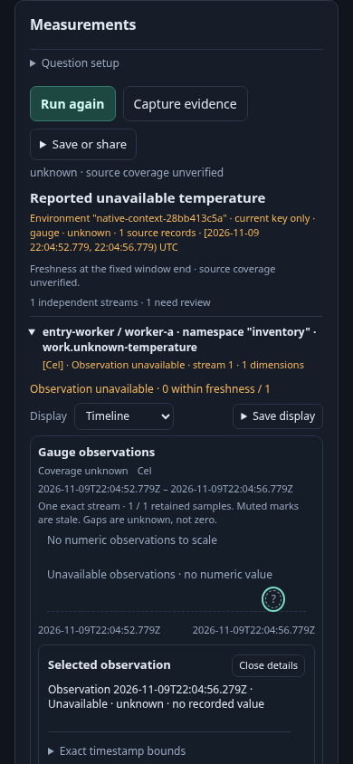
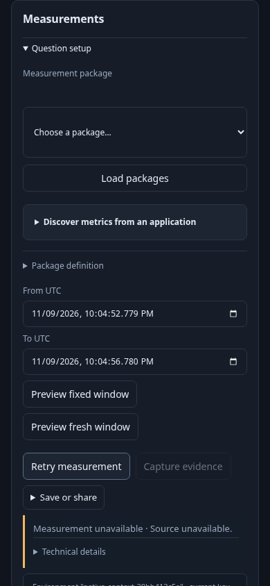

# Native evidence before configuration

The final browser journey passes. The independent ledger/model gate is reported
in [validation](../VALIDATION.md); this storyboard distinguishes measured DOM
outcomes from pixel evidence.

An investigator has already chosen a measurement question. After Run, they should
see its observations, fixed window and uncertainty without passing a stack of
configuration, raw attributes and save controls. The same presentation should work
when inspecting a service's retained native widget or reopening saved evidence.

The executable [390-native-entry.spec.js](390-native-entry.spec.js) uses controlled
ordinary OTLP through the real collector and ClickHouse. It seeds three counter
exports (known nonzero, recorded zero, unavailable), three mixed gauge observations
(stale negative, stale zero, unavailable), one unknown-only gauge observation and
one three-observation histogram export. Eight ordinary spans and matching logs
establish the discovered service. These are generated association fixtures, not
instrumented real application calls or proof of complete collection.

## User journey

1. Open an ordinary fixed counter question and explicitly Run. Its chart or first
   row, current unit/state and fixed window should be visible at the natural entry
   position. Browse full stream attributes only when needed.
2. Inspect a mixed gauge. Stale values remain numeric observations; zero is not
   missing. Inspect the separate unknown-only gauge: its reported timestamp remains
   selectable while an empty numeric scale consumes no vertical plot area.
3. Open Save display, switch Timeline/Table and author a title. Default titles do
   not name an obsolete kind; changing kind does not overwrite an authored title.
   These local actions neither read telemetry nor publish configuration.
4. Run a no-match gauge question. The visible no-data state is not a healthy zero.
   Refuse a real source request, then explicitly retry the same question; failure
   and recovery remain visible while optional detail stays collapsed.
5. Reopen an actual counter capture with telemetry unavailable. Custody, source
   read time and frozen evaluation bounds remain separate. Reopening performs one
   capture GET, no telemetry query, and does not change the saved artifact bytes.
6. Open service inventory, choose the reported service and expand its native
   histogram. After that actual user gesture, the retained chart appears without
   another source or custody read. The service's initial source reads are recorded
   separately from this passive expansion.

Every entry is exercised at 1280×1000 and 390×844: seven surfaces, fourteen entry
observations. The browser records root/main/workspace scroll positions, clipping
ancestors, first-item and mark rectangles, and the numeric/unavailable time axes.
The harness does not scroll a chart into view to manufacture entry success.
Application focus/scroll and a browser's normal reveal of an actual clicked
service-expansion control are recorded explicitly. Those service frames mean
“after expansion,” not page-at-scroll-zero.

## Before baseline

The reviewed pre-390 binary passed the complete fourteen-entry acquisition and
effect sequence in 1.2 minutes. Its natural ordinary counter first mark was below
the viewport at y=1774.6 on desktop and y=2609 on narrow. The saved counter first
mark was y=1601.2/y=2204.6. The service histogram remained below its post-expansion
viewport at y=1601.9/y=1855.3. Refusals were visible; the narrow no-data state was
offscreen. These are measured viewport coordinates, not inferred CSS intentions.

The full matrix lives beside the ignored run report. Four representative before/after
pairs are retained for documentation. Final first-item viewport coordinates are:

| Surface | Before | After |
| --- | ---: | ---: |
| Ordinary counter, desktop | 1774.6 | 648.9 |
| Ordinary counter, narrow | 2609.0 | 580.9 |
| Saved counter, narrow | 2204.6 | 613.9 |
| Service histogram after expansion, desktop | 1601.9 | 818.1 |
| Service histogram after expansion, narrow | 1855.3 | 814.5 |

All actual data marks and visible critical summaries fit their measured clipping
regions. This establishes the first observation, not a promise that an entire
expanded native workspace fits one screen.










Unknown-only data keeps its reported timestamp and selectable rail, without a
blank numeric plot. A real source refusal keeps its status and explicit retry:




## Actual acceptance

The final main journey passes in 1.3 minutes: fourteen strict entry geometries,
27 ordered acquisition/local-effect boundaries, 28 main UI source requests, four
capture reads and zero writes. The actual proxy observes 52 SQL requests during
that main sequence. Browse/disclosure/kind/title changes add no telemetry or SQL;
source refusal/retry and source-unavailable capture reopening are explicit.
Actual wire checking admits 137 genuine responses and 43 request bodies.

The independent actor observes 719 snapshots over five phases. It checks its real
unknown-only response, requested question, reported sample timestamp, whole-mark
DOM geometry, unscaled numeric plot, exact time-axis alignment and completed
selection/context actions. It issues one native read, no capture reads and no
writes; that separate read advances proxy SQL count from 52 to 53.

**Actor camera limitation:** the earlier campaign produced 662 identical initial
setup images. The fresh campaign has 719 image paths and four distinct image
contents; completed actor pixel verification has not been established. Images
are preserved in the ignored campaign archive, but are not positive actor pixel evidence. The
actor's `paint` field is a computed DOM/geometry predicate. The fresh Playwright
frames above provide the actual visual evidence; no actor image is presented as
an observed completed paint.

Saved/service held-return journeys 364 and 368 pass on the final binary (19.0s /
19.3s), including exact child questions, refusal/pending returns, retired callback
checks and no-read Back. Gauge/counter reuse journeys 386 and 389 pass (13.1s /
15.9s) with the new Save display disclosure. The four-test serial batch passes in
1.2 minutes, with its optional old actors disabled. Their source/evidence budgets
remain independent from this main 390 run.

The first final run caught a narrow mixed-gauge unknown mark 20px below the
viewport. A compact note/layout correction preserves the numeric plot height.
The next run caught saved native marks below the fold; moving accepted native
evidence before its catalog/toolbar and provenance fixed the actual entry. Neither
failure was rescued with test scrolling or weakened viewport assertions.
An independent coordinate oracle then found a service host button margin shifting
marks by 3.5px. Explicit component mark margins fix the leak. The fresh main
journey and service 368 pass again, and the current-source component suite passes
all three tests, including the nested service coordinate regression.

## Reproduce

Use the current reviewed binary and an existing collector/ClickHouse lab. Heavy
jobs stay serial. No store or volume reset is needed.

```sh
GOO_GENERIC_BINARY=/tmp/goo-389-reviewed-goo GOO_NATIVE_ENTRY_390_MODE=baseline NO_PROXY=127.0.0.1,localhost npx playwright test journeys/390-native-entry.spec.js --workers=1
GOO_GENERIC_BINARY=/tmp/goo-390-reviewed-goo GOO_NATIVE_ENTRY_390_MODE=final GOO_NATIVE_ENTRY_390_BOMBADIL=1 NO_PROXY=127.0.0.1,localhost npx playwright test journeys/390-native-entry.spec.js --workers=1
/workspace/.venvs/goo-api/bin/python journeys/support/native-entry390-wire.py artifacts/native-entry390-final/summary.json
```

The [source fixture](support/native-entry390.js) and
[geometry observer](support/native-entry390-geometry.js) retain the finite source
and paint contract. The [actor](../verification/bombadil/native-entry390.ts)
independently observes the real unknown-only response, visible unscaled rail and
successful selection; clicks or a completed process alone do not establish success.
Finished actor traces are losslessly stored as `bombadil/trace.jsonl.gz` with an
uncompressed SHA256 in `archive-index.json`; restore with `gzip -dk trace.jsonl.gz`
before trace inspection. Duplicate image paths use relative symlinks, preserving
all original names. Fresh reproduction creates a new cohort because lab data has
a UTC calendar-day TTL. The temporary runtime is stopped and its captures copied into the ignored
run directory before its temporary files are removed.
