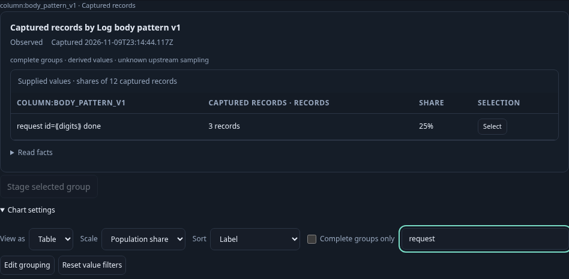
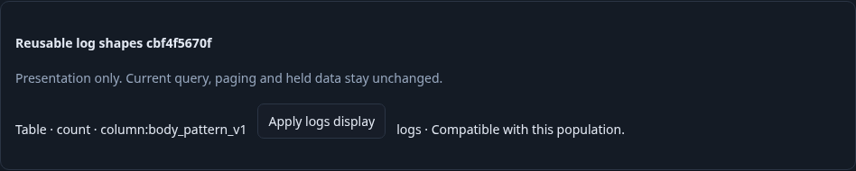
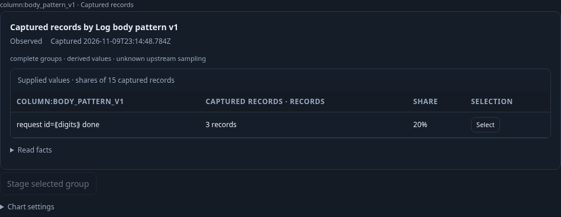
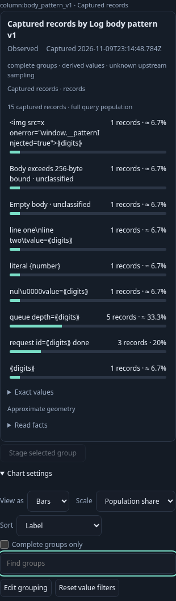

# Reuse log-shape presentation in another population

The reviewed 391 binary passes the actual journey in 48.3 seconds. Twelve
ordered effect boundaries cover four main source reads, two configuration reads
and one configuration publication. Local display changes and Inspect/Apply add
no telemetry or SQL reads. The frozen capture remains byte-identical.

A service owner analyzes ordinary OpenTelemetry logs grouped by the pinned
`body_pattern_v1` field. The initial analysis keeps its existing readable shape
rows, record continuation and comparison controls. “Explore linked population”
opens the existing population workspace; there the owner enables a reusable logs
display, chooses Table, orders labels and finds request shapes. Find changes
presentation, while shares retain all twelve source records as denominator.

The owner saves this presentation in an immutable exploration view, then opens
a destination configuration with another team predicate and fixed bounds.
Inspect and Apply reuse the count-only `log-pattern-count-v1` profile without
reading telemetry. Explicit Run supplies the destination evidence. Three request
records now represent 20% of fifteen destination records, rather than 25% of the
source's twelve. Switching to Bar and clearing Find remains local.

Canonical `lp1` keys remain identities. Readable inferred shapes, HTML-like text,
control characters, empty bodies and oversized bodies do not become executable
markup or a replacement filter identity. An independently scanned OTLP fixture
checks the complete count partition; bounded record pages are not denominators.
A frozen source capture's bytes remain unchanged throughout reuse.

The finite negative controls are explicitly supplied test values: a changed-read
wrapper cannot keep complete source authority, and an imported unknown snapshot
cannot retain a complete partition. They are separate from actual source-positive
observations. A retained old pattern link cannot take ownership after navigation.
Existing pattern-comparison regression covers its unchanged continuation.

The 35-second Bombadil actor records 652 snapshots across six phases and opens the saved source configuration, explicitly
runs it, then observes successful Table and Find changes while retaining the full
population count. Completion requires observed outcomes, not merely clicked
controls. The actor completes explicit Run, Bar, Table and Find outcomes. Its physical
source work is checked independently against the proxy SQL tail (21→30), not
resource timing: the original browser timing counter reported zero and was
unavailable as a source-count observation. No actor pixel verification is claimed.






Reproduce serially against a reviewed Go binary and existing collector/ClickHouse:

```sh
GOO_GENERIC_BINARY=/tmp/goo-391-reviewed-goo GOO_LOG_PATTERN_DISPLAY_391_BOMBADIL=1 NO_PROXY=127.0.0.1,localhost npx playwright test journeys/391-log-pattern-display.spec.js --workers=1
```

Existing pattern regressions also pass on the final binary: full investigation
(including held comparison, frozen capture, fixed package preview and paused
Activity return), retired-owner guards, and bounded-cardinality refusal. The
fixed preview bounds are checked separately from the saved three-minute default.
