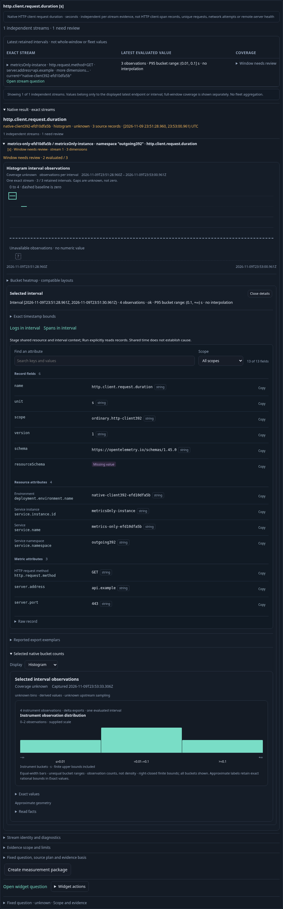
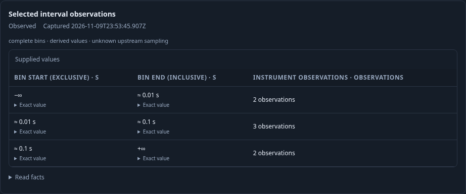
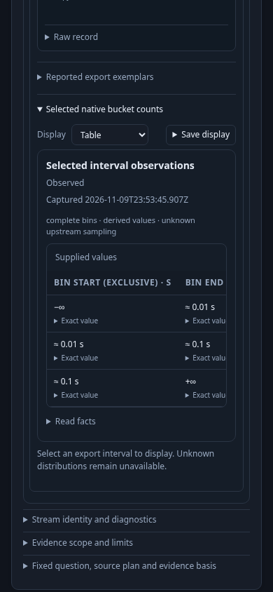

# Observe native outgoing HTTP duration without inventing span evidence

The reviewed 392 binary passes the actual journey on its first run: 54.7
seconds for the test, 57.2 seconds including the runner. Fifteen ordered effect
boundaries cover 34 main source requests, eleven capture/configuration reads,
one display publication and one evidence capture. Local gestures add no source
requests or SQL. The separate actor performs one explicit measurement read.

An operator opens a fixed service inventory containing four services. A
metrics-only service has ordinary `http.client.request.duration` explicit
histograms in seconds and a useful native duration card, while its record family
remains All spans. It does not acquire the Outgoing HTTP Client-span lens.
A spans-only service offers that lens and explicitly reads its two Client records
with nonempty current method metadata. A combined service has independent native
and span evidence; neither becomes proof of unique requests or remote health.
A milliseconds stream remains generically inspectable without client-profile
qualification.

The operator expands “Native result · exact streams”, selects a known export
interval and inspects retained buckets. These gestures use supplied data and
perform no source reads. “Open stream question” stages that exact stream for a
subsequent explicit Run. The operator chooses Table, saves its display, and
captures the source evidence. Reusing the display in the combined service keeps
the destination's full question and requires another explicit Run; the saved
source bytes do not change.

The finite physical bank contains fifteen histogram exports across four exact
streams and six ordinary Client spans. Delta exports include a flagged unknown.
Cumulative exports include a baseline, epoch reset, recovery, an 80-second gap
that exceeds the discovered 60-second policy, and another recovery. A custom
schema and omitted method/destination dimensions remain visible as unverified
stream context. Known, omitted and custom schema URLs do not cause rejection.
The fixture's explicit questions use the same 60-second policy; independent
arithmetic checks each returned interval and bucket count against raw source.

The 35-second Bombadil actor records 560 snapshots across six phases and independently runs an exact destination
question, observes known buckets as Table, and selects the unknown reset interval
without manufacturing a histogram. It records actual fetch request/response
objects and a physical proxy SQL tail. It does not use resource timing as a
source-count oracle. Actor snapshots are admitted under the emitted name `state`,
and each cohort gets a fresh output directory.





The generic service/native context regression 368 and outgoing Client-span
regression 385 also pass on this binary (13.9s and 15.3s; serial batch 31.1s).
These preserve held returns, explicit whole-trace expansion and independent
source budgets. Capture and reusable-display bytes remain unchanged. The main
sequence ends at 77 SQL requests; the actor advances that to 78. Actor snapshots
and real request/response observations establish its outcomes; no actor pixel
verification is claimed.

Reproduce serially against an existing collector/ClickHouse and reviewed binary:

```sh
GOO_GENERIC_BINARY=/tmp/goo-392-reviewed-goo GOO_NATIVE_HTTP_CLIENT_392_BOMBADIL=1 NO_PROXY=127.0.0.1,localhost npx playwright test journeys/392-native-http-client.spec.js --workers=1
```
