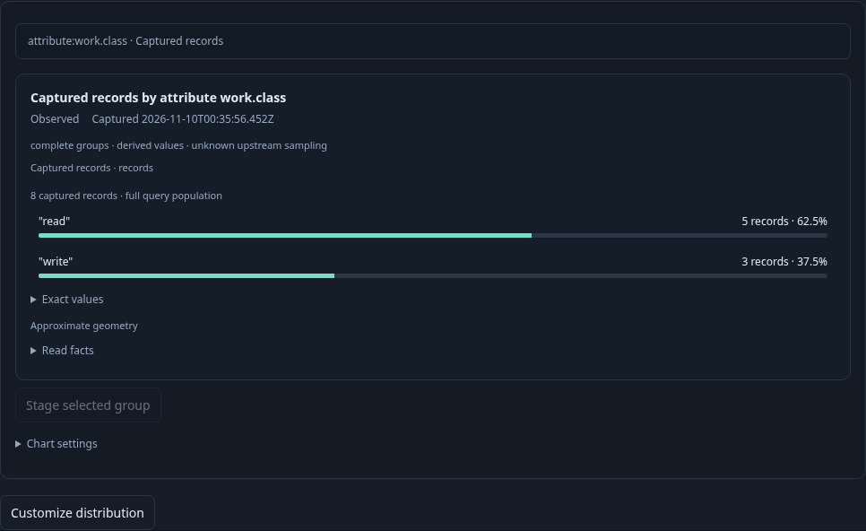
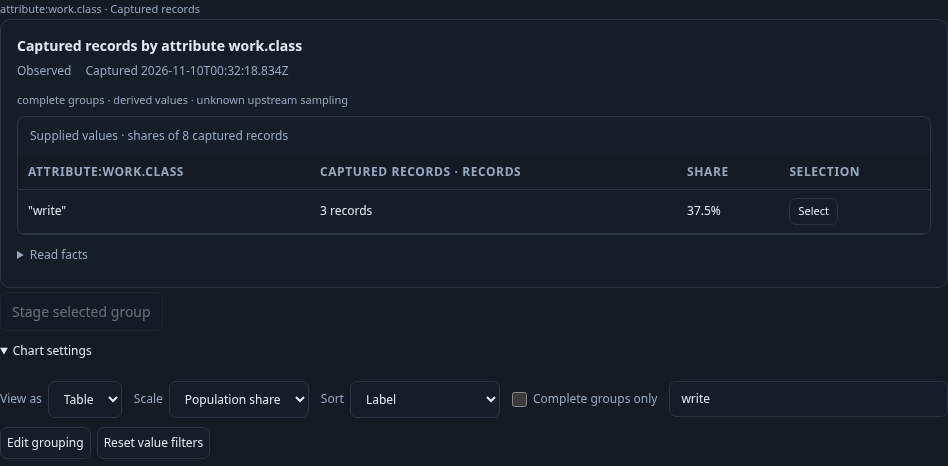
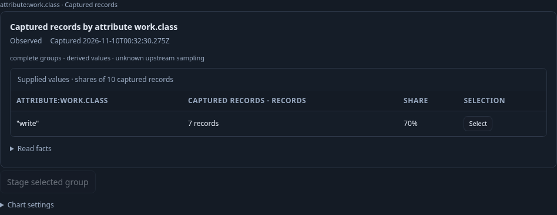
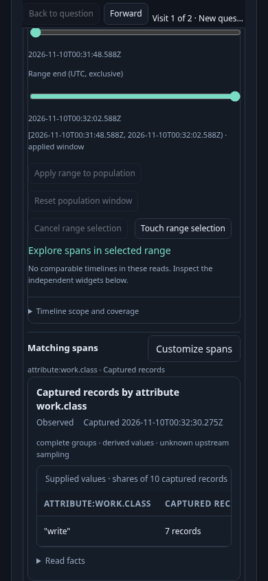

# Customize a distribution directly

The actual logs and spans journey passes in 20.0 seconds (21.7s including the
runner). It follows accepted distribution → **Customize distribution** → staged
population → explicit Run → local presentation → saved view reuse. A record
inspection is no longer needed to reach these controls.

Each original question has a named, versioned environment policy, fixed bounds,
a typed namespace/team predicate with an OR group, one grouping and a nondefault
three-row page. Customize preserves the complete question at offset zero. The
parent's captured distribution, source basis, timestamp, Find text and presentation
remain unchanged when the operator uses **Back to question**.

The child initially contains configuration and no chart. Explicit Run reads its
fixed population. The operator chooses Table, sorts labels and finds write work:
three of eight source records, 37.5%. That local filter does not replace the full
population denominator. A saved display is inspected and applied in another
compatible question with different predicates, fixed bounds and environment
policy. This stages configuration without telemetry; explicit Run supplies ten
destination records, seven of which match the saved write display (70%).






The finite ordinary OTLP bank has eighteen logs and eighteen spans. Independent
raw ClickHouse IDs and counts admit source, child and destination responses.
Thirty-five measured boundaries cover fourteen main source requests, four
configuration-object reads and two browser configuration publications; two
additional destination definitions are explicit test setup. The source proxy
observes fifty SQL requests. Local presentation, staging and held Back add none.

Real producer callbacks are invoked with hidden and inert openers, during a held
replacement response, and after that source owner is superseded. They produce no
continuation event or source read. Actual empty results and nonzero record offsets
show an unavailable continuation; an actual source refusal supplies no Customize
button. Changed-read refusal is covered by the generated/helper checks, rather
than claimed as a main-journey source observation.

The initial profile is ordinary single-field Count Bar/Table for logs and spans,
with nonempty accepted complete groups. Numeric, duration/status, specialized pattern, reported-edge,
histogram, grouped-time and page-offset profiles remain outside this continuation.
Complete captured groups do not establish complete upstream ingestion.

The companion Bombadil actor passes in 37.9 seconds (40.1s including the runner),
recording 608 snapshots across eight phases. Its two actual HTTP reads are the
original fixed question and the explicitly run child; Customize, local Table and
held Back add none. The actor physical SQL tail is 4→12, eight statements. A
separate genuine source-frame prelude accounts for one read and the first four
SQL statements. The actor retains the original source revision and Find text.
No resource-timing counter or actor pixel verification is claimed.

Reproduce serially against an existing collector/ClickHouse and reviewed binary:

```sh
GOO_GENERIC_BINARY=/tmp/goo-394-reviewed-goo NO_PROXY=127.0.0.1,localhost npx playwright test journeys/394-distribution-customize.spec.js --workers=1
GOO_GENERIC_BINARY=/tmp/goo-394-reviewed-goo NO_PROXY=127.0.0.1,localhost npx playwright test journeys/394-distribution-customize-actor.spec.js --workers=1
```

Independent admission and required Quint replay pass in 4.64s (package 4.651s),
zero skips; six semantic mutants and a staging-read control are rejected.

The actor companion consumes the main run's fresh finite source bank. It creates
its own runtime and uniquely named campaign directory, leaving the main report
unchanged.

See [generated and observed verification commands](../verification/README394.md).
