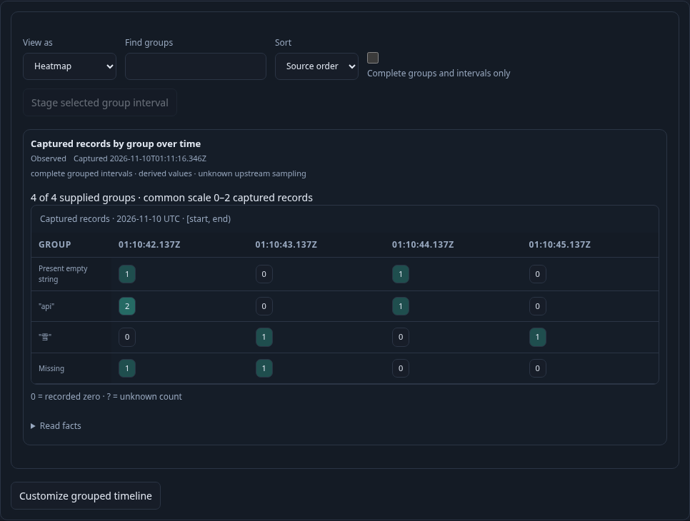
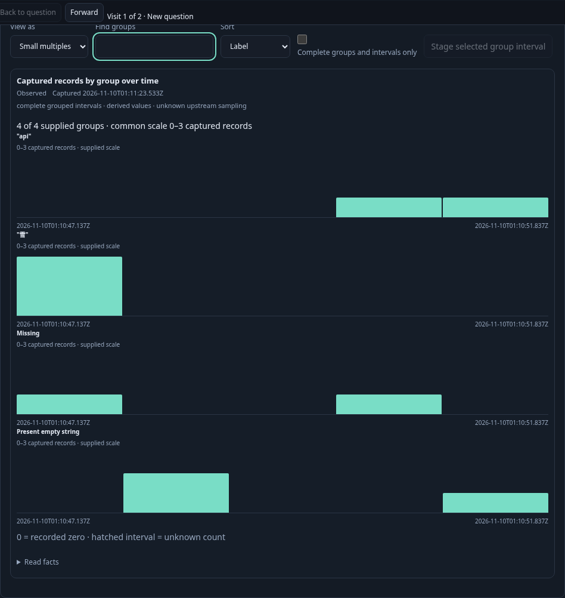
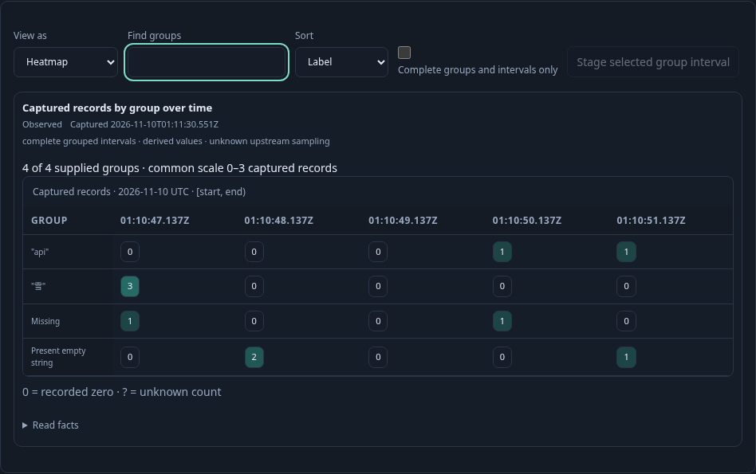
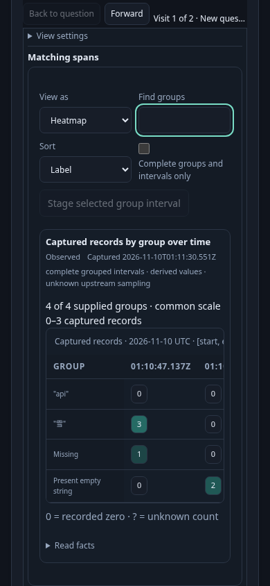

# Reuse a grouped count timeline

The actual logs and spans journey passes in 19.9 seconds (22.1s including the
runner). Twenty-seven measured boundaries cover six source requests, four
configuration-object reads and two browser configuration publications. Two
destination definitions are explicit setup. The source proxy observes 36 SQL
requests; staging, local changes and held Back add none.

An operator reads logs or spans grouped by a literal attribute over fixed
one-second intervals anchored to its exact query start, 137ms after a UTC
second boundary. The source population contains nine records across four
distinct categories: missing key, present empty string, `雪` and `api`. Its
3.5-second window has sixteen group×interval cells, including recorded zeros and
a 500ms final interval. Each category has actual records somewhere in the window;
no all-zero category is invented.

The operator switches the supplied plot to Heatmap and finds `雪`. All sixteen
cells remain in the data model and the common scale remains 0–2, including the
hidden groups. **Customize grouped timeline** stages the existing timeline and
records composition with the entire typed question. It supplies no child chart
until explicit Run.

In the child, Small multiples, Heatmap and Table share the same cells. Find and
ordering change local presentation. The operator saves a reusable view, previews
a known-zero cell for the missing-key category in the partial final interval,
and stages that exact missing-key, 500ms interval in a nested child without
reading telemetry. **Back to parent population** restores the accepted timeline;
**Back to question** then returns to the original source view. The parent's
source basis, capture clock,
Find text and presentation remain unchanged. A retained old stage callback cannot
act from the disconnected child.

The saved composition is inspected and applied in another compatible population
without reading telemetry. Its explicit Run reads ten records in a different
4.7-second window: twenty cells and a 700ms final interval. The destination keeps
its own filters, environment policy, bounds and page settings. Its shared scale
is 0–3 even when Find hides the group with the largest value. Saved source bytes
remain unchanged.

Independent raw record IDs, attribute-key presence and timestamps admit each
half-open group×interval count. Missing and empty categories remain typed values,
not interchangeable display labels. Known captured zero and unknown coverage
have different semantics. Category/cell completeness does not prove complete
upstream ingestion or a transactional snapshot across independent reads.

The finite profile is `grouped-count-v1`: count only, one qualified grouping and
existing fixed intervals. The existing eight-group and 1,000-observed-cell source
limits remain; at most 1,920 derived cells cover eight groups over 240 intervals.
Heatmap is available through 32 intervals; larger supported windows use Small
multiples or Table. No top list or silent truncation establishes completeness.






The separate 35-second Bombadil actor passes in 36.5s (runner 37.9s):
568 snapshots across nine phases, two actual source/child request-response pairs
and twelve SQL statements, with no source-frame prelude. It observes a real
known-zero selection and returns to the same source basis, clock, cells and
Find text. No resource-timing or actor pixel-verification claim is used.

Independent admission and required Quint replay pass in 4.840s with zero skips.
Eleven main semantic mutants, one unauthorized staging-read model control and
four actor mutants are rejected. Browser checks also measure at least 5.11:1
text contrast for the filled source heatmap cells.

Reproduce serially against an existing collector/ClickHouse and reviewed binary:

```sh
GOO_GENERIC_BINARY=/tmp/goo-395-reviewed-goo NO_PROXY=127.0.0.1,localhost npx playwright test journeys/395-grouped-timeline.spec.js --workers=1
GOO_GENERIC_BINARY=/tmp/goo-395-reviewed-goo NO_PROXY=127.0.0.1,localhost npx playwright test journeys/395-grouped-timeline-actor.spec.js --workers=1
```

See [verification commands and proof boundaries](../verification/README395.md).
