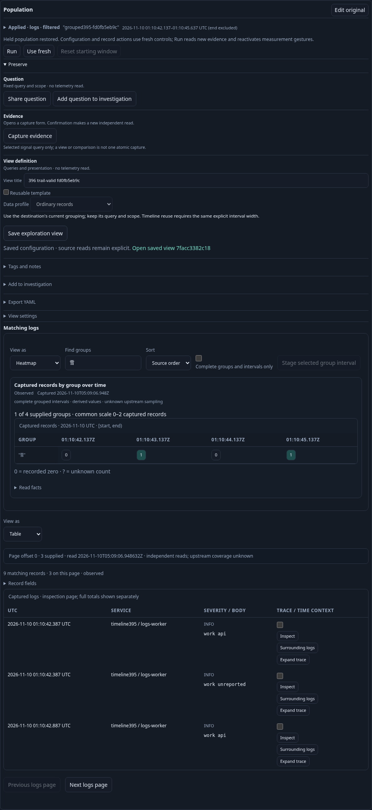
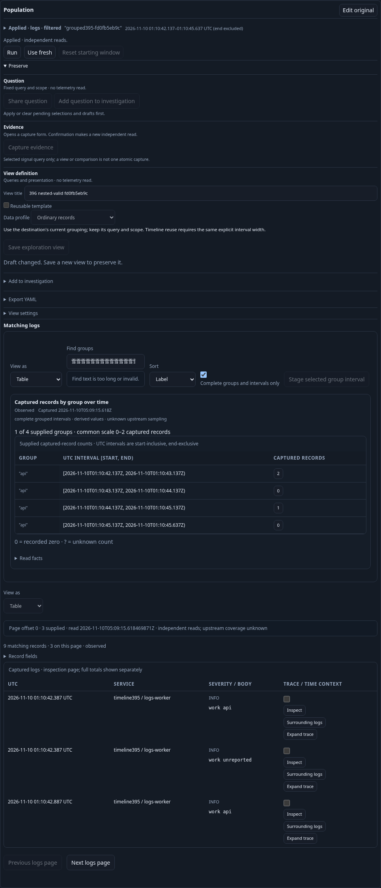
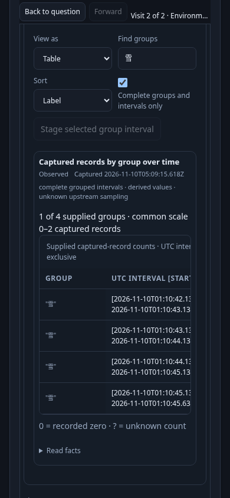

# Keeping local intent on held evidence

A grouped log investigation can leave its current result, inspect a narrower
interval, and return without rereading telemetry. Returning also preserves the
ability to change the local presentation and save exactly what is visible.

The actual 396 journey uses the existing 395 OTLP log bank and fixed question.
It runs that question, customizes the grouped timeline, explicitly runs the
paired population, selects a known-zero interval, stages its narrower question,
and returns. It then changes the timeline and saves its definition. Back and
Forward through the investigation trail repeat the same local-edit workflow.

The pre-fix run established that nested Back already saved the correct local
intent. Trail Back/Forward displayed a new Heatmap/Find/order selection but saved
the previous Table selection. The final run saves the visible declaration in
both cases, retaining the accepted dataset's identity and read time.

Find accepts Unicode text but bounds its UTF-8 representation. Entering 86 snow
characters (258 bytes) is an invalid draft. Save is disabled until the user
corrects it; the earlier run instead published the last valid definition.

These are inspected component screenshots, including a deliberate scroll to the
narrow timeline. They make no claim about natural top-of-page entry geometry.

A final actual failed replacement holds a real unavailable response while old
Find, Stage and Save callbacks are invoked. The callbacks cannot alter the
current draft or publish, during the request or after its failure. The current
configuration owner may still offer Save: failure of a telemetry read does not
itself invalidate a reusable configuration.

The final main run passes 20 measured boundaries with four source requests,
one saved-definition read, three configuration publications and 19 physical
SQL attempts (18 successful, one refused). Local editing, staging, return and
retired-callback probes add no telemetry reads. Baseline and final reports are
kept separately under `artifacts/held-draft396-{baseline,final}`.

The Bombadil companion exercises the same return/edit/save/correct cycle:
536 DOM snapshots cover 13 phases ending in completion, with two actual source
requests, three configuration publications and 12 physical SQL reads. The
separate main journey owns the actual failed-replacement barrier. Its screenshots
above come from Playwright; actor completion is checked through observed DOM and
request/response evidence, without a camera pixel-verification claim.
