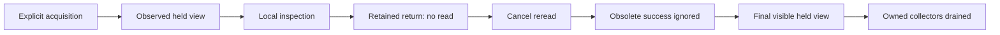

# Acquisition and retained return

This contract checks the browser's observed ownership and completion, independently
of transport success. Actual OTLP/ClickHouse assertions remain the source oracle.

A user explicitly acquires a view, inspects locally, leaves and returns, then
cancels a reread. An obsolete HTTP 200 completes that invocation but cannot adopt
its bank. The final visible view retains its question, window and local state.

The named ordered journey lives in `Scenario()` in `../shadow.go`; it is stronger
than the binding's short model-only reachability outline. Raw DOM identities stay
in the driver log and are interned only for model equality. An explicit drained
marker follows owned request/body collection; EOF does not imply settlement or
telemetry completeness. Request, effect, adoption and visible display remain
different concepts; this bounded projection does not prove general causality.

Edit the Quint below, then run `go tool gotogether tangle model/acquisition.md`
from the verification module. The sibling `.qnt` is generated, checked in for
plain Quint consumers, and checked for drift before tests in CI. The original
portable handoff under `../testdata/cw1` remains immutable provenance.



## Executable contract

```quint
// Visible DOM ownership projection. Read IDs identify completed transports only;
// their bodies never establish a displayed bank. Navigation epochs are checked
// for monotonic progression; retained DOM identity rejects stale adoption.
// Source/query conservation remains the independent native gate's job.
module acquisition {
  var held: {bank: str, clock: str, question: int}
  var local: {page: int, find: str, detail: int}
  var acquired: bool
  var returned: bool
  var late: bool
  var finished: bool
  var navigationEpoch: int
  var reads: Set[int]
  var safe: bool
  action init = all {
    held' = {bank: "", clock: "", question: 0},
    local' = {page: 0, find: "", detail: 0},
    acquired' = false, returned' = false, late' = false,
    finished' = false, safe' = true, navigationEpoch' = 0, reads' = Set(),
  }
  action read(read: int, epoch: int, code: int): bool = all {
    read > 0, epoch >= 0, code >= 0,
    not(reads.contains(read)), epoch <= navigationEpoch,
    reads' = reads.union(Set(read)), navigationEpoch' = navigationEpoch,
    held' = held, local' = local, acquired' = acquired,
    returned' = returned, late' = late, finished' = finished, safe' = safe,
  }
  action show(phase: str, bank: str, clock: str, question: int, page: int, find: str, detail: int, epoch: int, visible: bool): bool = {
    val display = {bank: bank, clock: clock, question: question}
    val view = {page: page, find: find, detail: detail}
    val adopt = phase == "explicit-read" or phase == "explicit-reread"
    val retain = Set("retained-return", "cancel-pending-reread", "pending-departure", "late-success-ignored", "final").contains(phase)
    all {
      epoch >= navigationEpoch, epoch <= navigationEpoch + 1,
      not(adopt) or reads.size() > 0,
      navigationEpoch' = epoch, reads' = reads,
      held' = if (adopt) display else held,
      local' = if (phase == "local-inspect" or phase == "explicit-reread") view else local,
      acquired' = (acquired or phase == "explicit-read"),
      returned' = (returned or phase == "retained-return"),
      late' = (late or phase == "late-success-ignored"),
      finished' = (phase == "final" and acquired and returned and late),
      safe' = (safe and (not(acquired or adopt) or visible) and (not(adopt) or bank != "") and
        (not(acquired) or adopt or display == held) and
        (not(retain) or view == local)),
    }
  }
  action step = any {
    read(1, 0, 200),
    show("explicit-read", "bank", "clock", 1, 1, "", 1, 0, true),
    show("local-inspect", "bank", "clock", 1, 1, "", 1, 0, true),
    show("retained-return", "bank", "clock", 1, 1, "", 1, 0, true),
    show("cancel-pending-reread", "bank", "clock", 1, 1, "", 1, 0, true),
    show("late-success-ignored", "bank", "clock", 1, 1, "", 1, 0, true),
    show("final", "bank", "clock", 1, 1, "", 1, 0, true),
  }
  val retainedOwnership = safe
  val journeyFinished = finished
}
```
